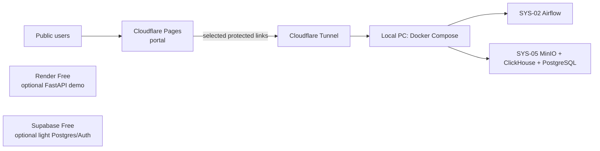

# Zero-Cost Multi-Cloud Deployment Plan

Project: Financial Analytics and Fraud Detection System  
Updated: 2026-08-25  
Objective: publish a credible thesis demo at zero cost while keeping stateful data services reliable.

## 1. Decision

Use **Cloudflare Pages** as the permanent public home for the portal, **Cloudflare Tunnel** to give controlled access to services running on the development machine, **Supabase** only for optional lightweight application data, and **Render** only for a small stateless API demonstration.

This is intentionally not a fully cloud-hosted deployment. The free tiers available do not offer a reliable, permanent host for Airflow, ClickHouse, MinIO, and PostgreSQL together. Keeping those services in the local Docker environment preserves data and avoids unexpected paid usage.

## 2. Platform Placement

| Component | Platform | Exposure | Operating rule |
|---|---|---|---|
| `portal.html` | Cloudflare Pages | Public HTTPS | Deploy from GitHub on each approved push. |
| Portal service links | Cloudflare Tunnel + Cloudflare Access | Private, authenticated | Expose only a service needed for a live demo. |
| SYS-02 Airflow and its metadata database | Local PC Docker | Private | Start before a scheduled pipeline or demo. |
| SYS-05 MinIO, ClickHouse, PostgreSQL | Local PC Docker | Private | Keep data volumes on the local disk and back them up. |
| SYS-04 FastAPI demo, if implemented | Render Free | Public HTTPS | Stateless API only; tolerate cold starts. |
| Optional small app data, user accounts, or feedback | Supabase Free | App-private | Do not store the lakehouse or Airflow metadata here. |
| SYS-06 Telegram alerting | Local PC Docker | Outbound only | Keep the token in a local `.env`, never in GitHub or a public frontend. |

Do **not** deploy ClickHouse, MinIO, Airflow, or any Docker volume to Render, Vercel, or Cloudflare Pages. They require persistent disk and continuously available compute.

## 3. Free-Tier Guardrails

1. Cloudflare Pages hosts static content only. It does not run the Docker ecosystem.
2. Render Free web services may sleep after inactivity and have an ephemeral filesystem. Treat an API deployed there as a demonstration service, not a continuously running worker.
3. Supabase Free is limited-capacity and can pause after inactivity. Store only small, replaceable data there.
4. Vercel is an alternative frontend host, not an additional deployment target. Use it only if the portal is later rewritten as a Next.js application; otherwise use Cloudflare Pages.
5. Do not add a payment method or enable automatic upgrades on any service unless a future budget is approved.
6. Check each provider's usage dashboard monthly and keep an export of important data locally.

## 4. Phased Deployment

### Phase A — Prepare the repository

- Create a GitHub repository if one is not already connected to the selected provider.
- Add `.env` to `.gitignore`; commit only `.env.example` files with placeholder values.
- Replace all demo credentials (`admin123`, `airflow_secret`) before any public exposure.
- Keep Docker database ports bound locally; do not forward PostgreSQL, ClickHouse, or MinIO's S3 API.
- Add a `PUBLIC_*_URL` configuration layer to the portal so development uses `localhost` while the published portal uses Cloudflare URLs.

### Phase B — Publish the portal on Cloudflare Pages

1. Create a Cloudflare Pages project and connect the GitHub repository.
2. Set the production branch to `main`.
3. Because the portal is static, use the repository root as the output directory and leave the build command empty.
4. Confirm the generated `pages.dev` URL loads `portal.html`.
5. Add a custom domain only after the default deployment is verified.

Acceptance check: a visitor can open the portal over HTTPS, but cannot reach a database or administrator interface from the page.

### Phase C — Add protected live-demo access

1. Install `cloudflared` on the PC that runs Docker.
2. Create a named tunnel, authenticate it to the Cloudflare account, and map only explicit HTTP services, for example Airflow on `http://localhost:8085`.
3. Create Cloudflare Access policies that allow only the project owner and invited evaluators by email.
4. Use distinct hostnames such as `airflow-demo.<domain>` and `api-demo.<domain>`.
5. Keep MinIO Console, ClickHouse, PostgreSQL, and Airflow's database unavailable through the tunnel unless a particular demonstration requires one; protect any exception with Access.

Acceptance check: an unauthenticated browser cannot open the Airflow hostname; an approved email address can.

### Phase D — Optional API on Render

Only do this after a small FastAPI service exists and is stateless.

1. Connect the GitHub repository to Render and create one Free Web Service.
2. Configure the service to listen on Render's assigned `PORT`.
3. Add a `/health` endpoint and keep all runtime state outside the container.
4. Add the Render URL to the portal configuration.
5. Expect a cold start after inactivity; demonstrate this honestly rather than relying on it for real-time ingestion.

Acceptance check: `/health` responds after the service wakes, and restarting it does not lose required data.

### Phase E — Optional Supabase

Use Supabase only if the portal needs authentication, lightweight feedback, or a small business-data table.

1. Create one Free project and record the database URL and public API URL as secrets.
2. Create only small application tables, with retention and export instructions.
3. Use row-level security before placing client access tokens in a frontend.
4. Export the schema and data periodically.

Do not point Airflow's metadata database at Supabase and do not migrate ClickHouse or MinIO data to Supabase.

## 5. Operations Runbook

### Normal development

1. Start SYS-05, then SYS-02 using the existing local scripts.
2. Run `check_health.ps1` before a demo.
3. Open the public Cloudflare Pages portal.
4. Start the Cloudflare Tunnel only for a scheduled remote demo.
5. Stop the tunnel after the demo if remote access is no longer required.

### Before every thesis demonstration

- Verify Docker containers and free disk space.
- Verify Airflow, MinIO, and ClickHouse locally.
- Check that the tunnel hostname requires Cloudflare Access.
- Test the portal in an incognito browser.
- Back up PostgreSQL, ClickHouse, and MinIO data.
- Keep a local-only fallback: open `portal.html` and the `localhost` interfaces directly.

### Monthly maintenance

- Review Cloudflare, Render, and Supabase usage dashboards.
- Rotate any credential that was ever used as a demo/default password.
- Apply Docker image updates only after a local test.
- Export Supabase data and retain local backups.
- Remove unused deployments, preview links, domains, and environment variables.

## 6. Security Baseline

- Never commit `.env`, private SSH keys, Cloudflare tunnel credentials, Telegram tokens, or Supabase service-role keys.
- Use strong, unique passwords for Airflow, MinIO, ClickHouse, and PostgreSQL.
- Do not expose ports 5432, 5433, 8123, 9000, or 9001 publicly.
- Give Cloudflare Access the minimum set of allowed emails.
- Treat the public portal as read-only; all administrative UIs remain protected.

## 7. Work Required in This Repository

| Priority | Change | Purpose |
|---|---|---|
| P0 | Add public URL configuration to `portal.html` | Replace hard-coded `localhost` links when deployed. |
| P0 | Move credentials from Compose defaults into `.env` | Prevent publicly known demo passwords. |
| P0 | Create a Cloudflare Tunnel configuration and runbook | Provide protected remote demos. |
| P1 | Add a root cloud/demo Compose profile | Start only the systems required for each demonstration. |
| P1 | Add backup scripts | Preserve local state before demos and upgrades. |
| P2 | Extract a stateless FastAPI demo for Render | Optional public API endpoint. |
| P2 | Add Supabase integration only when needed | Avoid premature cross-cloud complexity. |

## 8. Success Criteria

- The portal has a stable public HTTPS URL with no ongoing charge.
- The complete data pipeline remains usable locally without reliance on a paid cloud service.
- Remote administrative demos are available through Cloudflare Access when needed.
- No database or secret is publicly exposed.
- A local backup and a local demo path remain available if any free service pauses or changes its limits.

## Sources Checked

- Cloudflare product use should be confirmed against the account's current dashboard limits before enabling a feature.
- Render Free documentation: https://render.com/docs/free
- Supabase Free pricing: https://supabase.com/pricing
- Oracle Always Free reference, for a future migration if account approval succeeds: https://docs.oracle.com/en-us/iaas/Content/FreeTier/freetier_topic-Always_Free_Resources.htm
