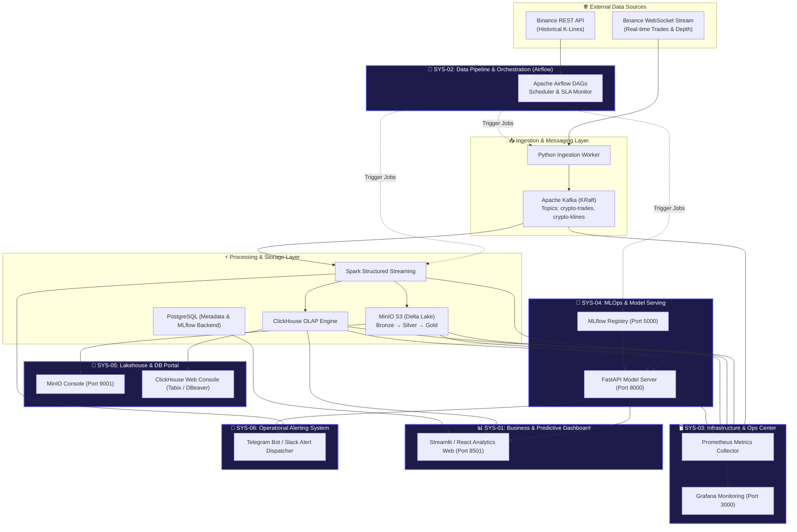

# 🌐 FINTECH DATA PLATFORM - SYSTEM ECOSYSTEM MASTER GUIDE

> **Đồ án Tốt nghiệp**: Financial Analytics & Fraud Detection System  
> **Kiến trúc**: Mini Company / Enterprise Data & AI Platform Architecture  
> **Cập nhật**: 2026  

---

## 📚 TỔNG QUAN HỆ THỐNG ECOSYSTEM (SYSTEM ARCHITECTURE OVERVIEW)

Hệ thống được thiết kế theo kiến trúc **Micro-services & Event-Driven Enterprise Platform**, bao gồm 6 phân hệ (Systems/Web Apps/Services) phục vụ cho 4 nhóm người dùng chính trong một công ty tài chính: **Business/Traders, Data Engineers, AI/ML Engineers, và DevOps/SRE**.



---

## 🗂️ MỤC LỤC DANH MỤC DOCUMENTATION 6 SYSTEM

| Mã System | Tên System Document | Công nghệ cốt lõi | Port mặc định | Vai trò chính |
| :--- | :--- | :--- | :--- | :--- |
| **[SYS-01](file:///e:/Graduation_Thesis/Plan/systems_docs/01_Business_Predictive_Analytics_Dashboard.md)** | **Business & Predictive Analytics Dashboard** | Streamlit / React, Plotly, WebSockets | `8501` | Trực quan hóa giá real-time, tín hiệu dự báo AI (LSTM/XGBoost), cảnh báo Anomaly & Fraud |
| **[SYS-02](file:///e:/Graduation_Thesis/Plan/systems_docs/02_Data_Pipeline_Orchestration_System.md)** | **Data Pipeline & Orchestration System** | Apache Airflow, Python DAGs | `8080` | Quản lý, lập lịch và giám sát các luồng dữ liệu batch/streaming ETL từ A-Z |
| **[SYS-03](file:///e:/Graduation_Thesis/Plan/systems_docs/03_Infrastructure_Operations_Center.md)** | **Infrastructure & Operations Center** | Grafana, Prometheus, Node/Kafka Exporters | `3000` | Giám sát sức khỏe hạ tầng Docker, CPU/RAM, Kafka Consumer Lag, đĩa đệm storage |
| **[SYS-04](file:///e:/Graduation_Thesis/Plan/systems_docs/04_MLOps_Model_Governance_Center.md)** | **MLOps & Model Governance Center** | MLflow, FastAPI, PyTorch, LightGBM | `5000` / `8000` | Track thí nghiệm AI, quản lý phiên bản model (Registry), phục vụ dự báo qua REST API |
| **[SYS-05](file:///e:/Graduation_Thesis/Plan/systems_docs/05_Lakehouse_Database_Management_Portal.md)** | **Lakehouse & Database Management Portal** | MinIO Console, ClickHouse, Delta Lake | `9001` / `8123` | Quản lý lưu trữ Medallion Architecture (Bronze/Silver/Gold), Time Travel & SQL ad-hoc query |
| **[SYS-06](file:///e:/Graduation_Thesis/Plan/systems_docs/06_Operational_Alerting_Notification_System.md)** | **Operational Alerting & Notification System** | Telegram Bot API, Async Alert Dispatcher | N/A (Bot Service) | Gửi cảnh báo bất thường thị trường & lỗi sự cố hệ thống tức thời 24/7 đến thiết bị di động |

---

## 🔌 BẢNG MA TRẬN PHÂN PHỐI PORT & RESOURCE MAP (INFRASTRUCTURE MAP)

| Service Container Name | Internal Port | Mapped Host Port | Mục đích truy cập UI / API |
| :--- | :--- | :--- | :--- |
| `streamlit_dashboard` | 8501 | **`8501`** | Web Dashboard Chính dành cho User/Business |
| `airflow_webserver` | 8080 | **`8080`** | UI Quản lý Data Pipeline (Airflow) |
| `mlflow_server` | 5000 | **`5000`** | UI Quản lý Model Registry & Experiments |
| `fastapi_serving` | 8000 | **`8000`** | API Prediction & Swagger Docs (`/docs`) |
| `grafana` | 3000 | **`3000`** | UI Monitoring Hạ tầng & Kafka Lag |
| `prometheus` | 9090 | **`9090`** | Time-series Metrics Database UI |
| `minio_console` | 9001 | **`9001`** | MinIO Object Storage Browser UI |
| `minio_api` | 9000 | **`9000`** | S3-Compatible API Endpoint |
| `clickhouse_server` | 8123 (HTTP) / 9000 (Native) | **`8123`** | ClickHouse HTTP Interface / Tabix Web UI |
| `postgres` | 5432 | **`5432`** | Database chứa Metadata (Airflow, MLflow) |
| `kafka_broker` | 9092 | **`9092`** | Kafka Broker Endpoint (KRaft Mode) |

---

## 👥 VAI TRÒ & NGUYÊN TẮC PHÂN QUYỀN (RBAC MATRIX)

```
+-----------------------------------+---------------------------------------------------------------+
| Nhóm người dùng (Role)           | Các System UI được phép truy cập & thao tác                     |
+-----------------------------------+---------------------------------------------------------------+
| Executive / Business / Trader     | [SYS-01] Business Dashboard, [SYS-06] Telegram Alerts Bot     |
| Data Engineer                     | [SYS-02] Airflow, [SYS-05] Lakehouse MinIO/ClickHouse, SYS-06 |
| AI / ML Engineer                  | [SYS-04] MLflow & FastAPI, [SYS-01] Analytics, [SYS-05] Data  |
| DevOps / SRE Admin                | [SYS-03] Grafana/Prometheus, [SYS-02], [SYS-05], [SYS-06]     |
+-----------------------------------+---------------------------------------------------------------+
```

---

## 🚀 HƯỚNG DẪN KHỞI ĐỘNG TOÀN BỘ ECOSYSTEM VỚI DOCKER COMPOSE

```bash
# 1. Clone repository & chuyển vào thư mục dự án
cd e:/Graduation_Thesis

# 2. Tạo file cấu hình môi trường .env (nếu chưa có)
cp .env.example .env

# 3. Khởi chạy toàn bộ 9+ dịch vụ hạ tầng Docker
docker-compose up -d --build

# 4. Kiểm tra trạng thái hoạt động của toàn bộ container
docker-compose ps

# 5. Truy cập các Web UI chính:
# - SYS-01 Business Dashboard: http://localhost:8501
# - SYS-02 Airflow DAGs:       http://localhost:8080 (User/Pass: admin/admin)
# - SYS-03 Grafana Ops:        http://localhost:3000 (User/Pass: admin/admin)
# - SYS-04 MLflow Registry:    http://localhost:5000
# - SYS-05 MinIO Console:      http://localhost:9001 (User/Pass: minioadmin/minioadmin)
# - SYS-04 FastAPI Docs:       http://localhost:8000/docs
```

---
*Tiếp theo, vui lòng xem chi tiết tài liệu A-Z của từng System từ `01` đến `06` nằm cùng thư mục này.*
