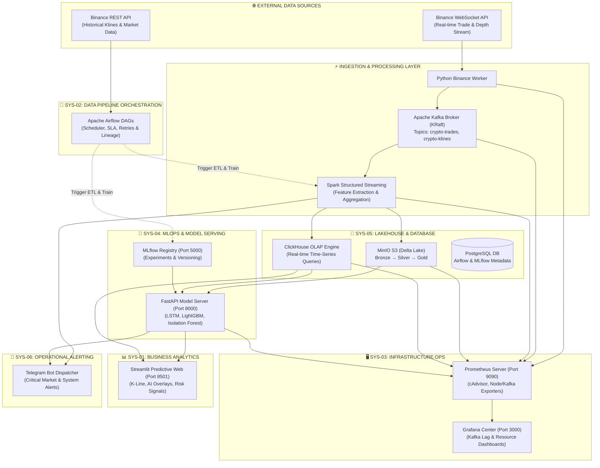

# 🌐 ECOSYSTEM MASTER INDEX: ARCHITECTURE & OPERATIONAL FRAMEWORK

> **Dự án Đồ án Tốt nghiệp / Enterprise Platform**: Financial Analytics & Fraud Detection System  
> **Mô hình kiến trúc**: Mini Company Data & AI Enterprise Platform  
> **Phiên bản tài liệu**: 2.0 (Toàn diện từ A-Z)  
> **Ngày cập nhật**: 2026  

---

## 📚 1. TỔNG QUAN HỆ THỐNG ECOSYSTEM (SYSTEM ARCHITECTURE OVERVIEW)

Hệ thống được thiết kế theo mô hình **Enterprise Data & AI Microservices Architecture**, giả lập trọn vẹn hoạt động của một công ty công nghệ tài chính (FinTech Mini Company). Hệ thống quản lý toàn bộ vòng đời dữ liệu: từ thu thập thời gian thực (Real-time Ingestion), lưu trữ Data Lakehouse (Medallion Architecture), huấn luyện và quản trị mô hình AI (MLOps), điều phối tiến trình (Orchestration), đến trực quan hóa dự báo (Business Dashboard), giám sát hạ tầng (Operations Center) và phát thông báo khẩn cấp (Alerting System).



---

## 🗂️ 2. MA TRẬN 6 PHÂN HỆ VÀ TÀI LIỆU CHI TIẾT (SYSTEM MATRIX)

Dưới đây là danh mục 6 phân hệ cấu thành toàn bộ nền tảng. Mỗi phân hệ đã được tài liệu hóa chi tiết từ A-Z trong file riêng biệt:

| Mã System | File Tài Liệu Chi Tiết | Phân Hệ & Công Nghệ | Vai Trò & Chức Năng Chính | Port Mặc Định |
| :--- | :--- | :--- | :--- | :--- |
| **SYS-01** | [`01_Business_Predictive_Analytics_Dashboard.md`](file:///e:/Graduation_Thesis/Plan/systems_docs/01_Business_Predictive_Analytics_Dashboard.md) | **Business & Predictive Analytics Dashboard**<br>*(Streamlit, Plotly, WebSockets)* | Trực quan hóa giá real-time, đường dự báo AI (LSTM/XGBoost), đánh dấu bất thường (Isolation Forest) và gian lận (LightGBM). | `8501` |
| **SYS-02** | [`02_Data_Pipeline_Orchestration_System.md`](file:///e:/Graduation_Thesis/Plan/systems_docs/02_Data_Pipeline_Orchestration_System.md) | **Data Pipeline & Orchestration System**<br>*(Apache Airflow 2.x, Python, Postgres)* | Lập lịch, tự động hóa, điều phối và giám sát các luồng dữ liệu ETL, huấn luyện lại mô hình AI và dọn dẹp Data Lakehouse. | `8080` |
| **SYS-03** | [`03_Infrastructure_Operations_Center.md`](file:///e:/Graduation_Thesis/Plan/systems_docs/03_Infrastructure_Operations_Center.md) | **Infrastructure & Operations Center**<br>*(Grafana, Prometheus, cAdvisor, Kafka Exporter)* | Giám sát sức khỏe hạ tầng Docker, phần cứng CPU/RAM/Disk, độ trễ Kafka Consumer Lag và cảnh báo sự cố hạ tầng. | `3000` / `9090` |
| **SYS-04** | [`04_MLOps_Model_Governance_Center.md`](file:///e:/Graduation_Thesis/Plan/systems_docs/04_MLOps_Model_Governance_Center.md) | **MLOps & Model Governance Center**<br>*(MLflow, FastAPI, PyTorch, LightGBM)* | Quản lý phiên bản mô hình AI (Model Registry), theo dõi vết thí nghiệm, cung cấp các API dự báo giá và gian lận RESTful. | `5000` / `8000` |
| **SYS-05** | [`05_Lakehouse_Database_Management_Portal.md`](file:///e:/Graduation_Thesis/Plan/systems_docs/05_Lakehouse_Database_Management_Portal.md) | **Lakehouse & Database Management Portal**<br>*(MinIO S3 Console, ClickHouse OLAP, Delta Lake)* | Lưu trữ dữ liệu 3 tầng Medallion (Bronze/Silver/Gold), truy vấn SQL ad-hoc siêu tốc dưới 10ms, kiểm tra Time Travel logs. | `9001` / `8123` |
| **SYS-06** | [`06_Operational_Alerting_Notification_System.md`](file:///e:/Graduation_Thesis/Plan/systems_docs/06_Operational_Alerting_Notification_System.md) | **Operational Alerting & Notification System**<br>*(Telegram Bot API, Async Dispatcher)* | Gửi thông báo tức thời (dưới 3 giây) về di động khi phát hiện thao túng thị trường, gian lận hoặc sự cố sập container. | N/A (Bot Service) |

---

## 👥 3. PHÂN QUYỀN VÀ BẢNG TRUY CẬP HỆ THỐNG (RBAC MATRIX)

Trong mô hình Mini Company, mỗi vai trò nhân sự sẽ có quyền hạn và mục đích sử dụng từng phân hệ khác nhau:

```
+-----------------------------------+---------------------------------------------------------------+---------------------------------------------------+
| Vai Trò Nhân Sự (User Role)       | Các Phân Hệ Được Phép Truy Cập (Accessible Systems)            | Quyền Hạn & Mục Đích Thao Tác                     |
+-----------------------------------+---------------------------------------------------------------+---------------------------------------------------+
| Executive / Business Manager      | SYS-01 (Dashboard), SYS-06 (Telegram Alerts)                  | Xem báo cáo KPI, doanh số, tỷ lệ gian lận bị chặn |
| Financial Trader / Risk Analyst   | SYS-01 (Dashboard), SYS-04 (API Docs), SYS-06 (Alerts)        | Theo dõi xu hướng AI, nhận diện thao túng thị trường|
| Data Engineer                     | SYS-02 (Airflow), SYS-05 (Lakehouse), SYS-03 (Grafana)        | Vận hành pipeline, quản lý ClickHouse/MinIO, log  |
| AI / ML Engineer                  | SYS-04 (MLflow & FastAPI), SYS-01 (Dashboard), SYS-05 (Gold)  | Huấn luyện model, kiểm thử accuracy, registry     |
| DevOps / SRE Systems Administrator| SYS-03 (Grafana/Prometheus), SYS-02 (Airflow), SYS-06 (Alerts)| Giám sát RAM/CPU, Kafka Lag, restart container    |
+-----------------------------------+---------------------------------------------------------------+---------------------------------------------------+
```

---

## 🔌 4. BẢNG ÁNH XẠ CỔNG VÀ CONTAINER DOCKER (DOCKER SERVICES MAP)

| Container Name | Service Core | Internal Port | Host Port | Đường Dẫn URL Truy Cập UI / API |
| :--- | :--- | :--- | :--- | :--- |
| `streamlit_dashboard` | SYS-01 Web UI | 8501 | **`8501`** | `http://localhost:8501` |
| `airflow_webserver` | SYS-02 Orchestrator | 8080 | **`8080`** | `http://localhost:8080` *(admin/admin)* |
| `grafana` | SYS-03 Monitoring UI | 3000 | **`3000`** | `http://localhost:3000` *(admin/admin)* |
| `prometheus` | SYS-03 Metrics DB | 9090 | **`9090`** | `http://localhost:9090` |
| `mlflow_server` | SYS-04 MLOps UI | 5000 | **`5000`** | `http://localhost:5000` |
| `fastapi_serving` | SYS-04 Serving REST | 8000 | **`8000`** | `http://localhost:8000/docs` (Swagger UI) |
| `minio_console` | SYS-05 Lakehouse UI | 9001 | **`9001`** | `http://localhost:9001` *(minioadmin/minioadmin)* |
| `minio_s3` | SYS-05 S3 API | 9000 | **`9000`** | `http://localhost:9000` |
| `clickhouse_server` | SYS-05 OLAP Engine | 8123 / 9000 | **`8123`** | `http://localhost:8123` (HTTP / Tabix) |
| `postgres` | Shared Metadata DB | 5432 | **`5432`** | `localhost:5432` *(PostgreSQL Client)* |
| `kafka_broker` | Message Streaming | 9092 | **`9092`** | `localhost:9092` *(Confluent Kafka Client)* |

---

## 🚀 5. QUY TRÌNH KHỞI ĐỘNG HỆ THỐNG TOÀN DIỆN (SYSTEM LAUNCH GUIDE)

Để đưa toàn bộ 6 phân hệ vào hoạt động synchronously, thực hiện các bước sau:

```bash
# 1. Truy cập thư mục dự án tốt nghiệp
cd e:/Graduation_Thesis

# 2. Kiểm tra và nạp các biến môi trường cấu hình trong file .env
# Chắc chắn có: TELEGRAM_BOT_TOKEN, TELEGRAM_CHAT_ID, MINIO_ACCESS_KEY, MINIO_SECRET_KEY

# 3. Khởi chạy toàn bộ 11 Containers bằng Docker Compose
docker-compose up -d --build

# 4. Kiểm tra sức khỏe các Container
docker-compose ps

# 5. Khởi tạo Database Schemas cho ClickHouse & Postgres (Nếu chạy lần đầu)
docker exec -i clickhouse_server clickhouse-client < Plan/sql/init_clickhouse_tables.sql

# 6. Kiểm tra các UI đã sẵn sàng:
# • SYS-01 Streamlit Dashboard:  http://localhost:8501
# • SYS-02 Airflow DAGs UI:      http://localhost:8080
# • SYS-03 Grafana Ops UI:       http://localhost:3000
# • SYS-04 MLflow MLOps UI:      http://localhost:5000
# • SYS-04 FastAPI Swagger Docs: http://localhost:8000/docs
# • SYS-05 MinIO S3 Console:     http://localhost:9001
```

---
*Vui lòng mở từng file chi tiết từ `01` đến `06` nằm trong cùng thư mục này để xem toàn bộ thông số kỹ thuật A-Z của từng phân hệ.*
