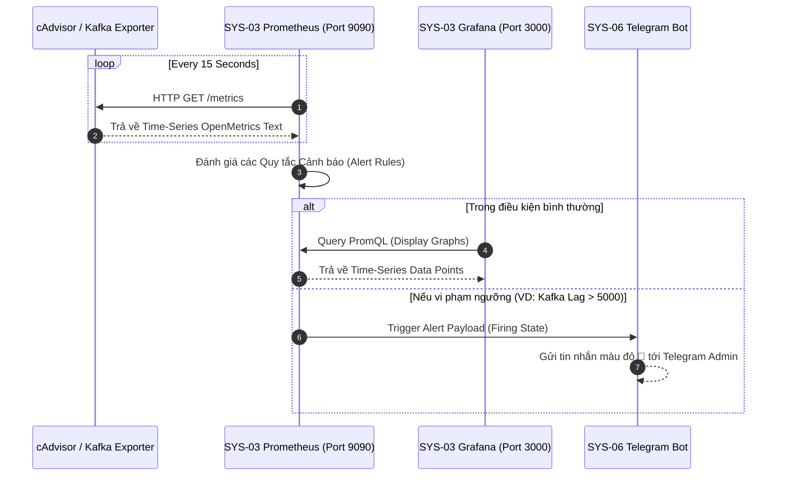

# 🖥️ SYS-03: INFRASTRUCTURE & OPERATIONS CENTER (SYS-OPS)

> **Mã Phân Hệ**: `SYS-03`  
> **Tên Phân Hệ**: Infrastructure & Operations Center  
> **Phiên bản tài liệu**: 2.0 (Chi tiết từ A-Z)  
> **Cổng truy cập mặc định**: Grafana (`http://localhost:3000`) | Prometheus (`http://localhost:9090`) *(Credentials: admin/admin)*  

---

## 🎯 1. MỤC TIÊU & MỤC ĐÍCH HỆ THỐNG

### 1.1. Mục tiêu chiến lược (Strategic Goal)
SYS-03 đóng vai trò là **Trung tâm giám sát vận hành hạ tầng (Systems Operations Center - SOC)** của nền tảng Data Platform. Phân hệ chịu trách nhiệm thu thập, phân tích và trực quan hóa thời gian thực toàn bộ các chỉ số đo lường sức khỏe (Health Metrics) của hệ điều hành Host, phần cứng CPU/RAM/Storage, các container Docker và đặc biệt là đường truyền dữ liệu **Kafka Streaming Consumer Lag**.

### 1.2. Mục đích vận hành (Operational Purpose)
1. **Giám sát sức khỏe hạ tầng (Infrastructure Monitoring)**: Theo dõi % CPU, RAM, Disk I/O, Network Bandwidth của 11 Docker Containers.
2. **Giám sát Kafka Consumer Lag (Zero-Latency Guarantee)**: Đo lường khoảng trễ giữa luồng Producer Binance và Consumer Spark Streaming để ngăn ngừa nghẽn dữ liệu (Data Bottleneck).
3. **Cảnh báo ngưỡng giới hạn (Threshold Alerting)**: Tự động kích hoạt thông báo khi một dịch vụ bị sập (Container Down), đĩa cứng đầy (> 85%), hoặc RAM vượt quá hạn mức.

---

## 👥 2. ĐỐI TƯỢNG SỬ DỤNG VÀ PHÂN QUYỀN (TARGET USERS & RBAC)

* **DevOps / SRE (Site Reliability Engineers)**: Theo dõi biểu đồ tài nguyên, phát hiện rò rỉ bộ nhớ (Memory Leak) và tối ưu hóa tài nguyên container.
* **System Administrators**: Nhận thông báo sự cố tức thời 24/7 và thực hiện quy trình ứng cứu sự cố (Incident Response).

---

## 🛠️ 3. CÔNG NGHỆ SỬ DỤNG VÀ LÝ DO LỰA CHỌN (TECH STACK & RATIONALE)

| Công nghệ | Vai trò | Lý do lựa chọn (Technical Justification) |
| :--- | :--- | :--- |
| **Grafana 10.x** | Dashboard Visualizer | Công cụ trực quan hóa chỉ số hạ tầng số 1 thế giới, giao diện mượt mà, hỗ trợ tạo Alerts và Dashboard biến thiên linh hoạt. |
| **Prometheus 2.x** | Time-Series Metrics DB | Cơ sở dữ liệu thời gian thực tối ưu hóa cho lưu trữ chỉ số metrics, sử dụng ngôn ngữ truy vấn PromQL cực kỳ mạnh mẽ. |
| **Google cAdvisor** | Container Exporter | Thu thập trực tiếp chỉ số tài nguyên của từng Docker Container từ Linux Cgroups kernel. |
| **Node Exporter** | Host Hardware Exporter | Thu thập chỉ số phần cứng máy chủ (CPU Temp, RAM Free, Disk Space, Network Interfaces). |
| **Kafka Exporter** | Message Broker Exporter | Trích xuất chỉ số Consumer Lag, Partition offsets và Message rate từ Apache Kafka. |

---

## ⚙️ 4. RÀNG BUỘC VÀ GIỚI HẠN KỸ THUẬT (CONSTRAINTS & SLA)

1. **Tần suất quét chỉ số (Scrape Interval)**:
   * Prometheus thu thập metrics từ các Exporters định kỳ **15 giây / lần**.
2. **Thời gian lưu giữ chỉ số (Data Retention)**:
   * Dữ liệu Metrics được lưu giữ trong đĩa đệm Prometheus tối đa **15 ngày** (Dung lượng giới hạn < 10GB).
3. **SLA Cảnh báo khẩn cấp (Alert SLA)**:
   * Thời gian từ khi phát sinh sự cố (VD: Container Down) đến khi tin nhắn Telegram được phát đi: **< 30 giây**.
4. **Hạn mức tài nguyên hệ thống**:
   * Prometheus và Grafana được giới hạn tổng dung lượng RAM sử dụng trên Host **< 512MB**.

---

## 📥 5. CHI TIẾT ĐẦU VÀO VÀ ĐẦU RA (INPUT & OUTPUT SPECIFICATIONS)

### 5.1. Input Specifications (Đầu vào)
* Dữ liệu Metrics chuẩn định dạng OpenMetrics/Prometheus Text format từ các đường dẫn HTTP:
  * `http://cadvisor:8080/metrics`
  * `http://node_exporter:9100/metrics`
  * `http://kafka_exporter:9308/metrics`
  * `http://fastapi_serving:8000/metrics`

### 5.2. Output Specifications (Đầu ra)
1. **Interactive Grafana Dashboards**:
   * Dashboard 1: *Kafka Streaming & Consumer Lag Center*
   * Dashboard 2: *Docker Containers Resource Usage (CPU/RAM)*
   * Dashboard 3: *Storage & Storage IOPS Monitor*
2. **Alert Triggers (Prometheus Alertmanager Rule Output)**:
   * Gửi tín hiệu JSON Alert Payload sang SYS-06 Telegram Bot Dispatcher khi vi phạm Rule.

---

## 🔄 6. QUY TRÌNH THỰC HIỆN TỪ A-Z (WORKFLOW & EXECUTION PROCESS)

### 6.1. Sơ đồ quy trình thu thập Metrics & Cảnh báo



---

## 💻 7. CẤU HÌNH HỆ THỐNG HOÀN CHỈNH (PRODUCTION CONFIGURATIONS)

### 7.1. File cấu hình Prometheus Scrape Target (`prometheus.yml`)

```yaml
global:
  scrape_interval: 15s
  evaluation_interval: 15s

rule_files:
  - "alert_rules.yml"

scrape_configs:
  - job_name: 'prometheus'
    static_configs:
      - targets: ['localhost:9090']

  - job_name: 'cadvisor'
    static_configs:
      - targets: ['cadvisor:8080']

  - job_name: 'node_exporter'
    static_configs:
      - targets: ['node_exporter:9100']

  - job_name: 'kafka_exporter'
    static_configs:
      - targets: ['kafka_exporter:9308']

  - job_name: 'fastapi_serving'
    metrics_path: '/metrics'
    static_configs:
      - targets: ['fastapi_serving:8000']
```

### 7.2. File định nghĩa Quy tắc Cảnh báo (`alert_rules.yml`)

```yaml
groups:
  - name: infrastructure_alert_rules
    rules:
      # 1. Cảnh báo Kafka Consumer Lag quá cao
      - alert: HighKafkaConsumerLag
        expr: sum(kafka_consumergroup_lag) > 5000
        for: 2m
        labels:
          severity: critical
        annotations:
          summary: "Kafka Consumer Lag exceeds threshold!"
          description: "Spark Streaming is lagging behind Binance stream by {{ $value }} messages."

      # 2. Cảnh báo Container bị Down
      - alert: ContainerDown
        expr: time() - container_last_seen > 30
        for: 1m
        labels:
          severity: critical
        annotations:
          summary: "Docker Container {{ $labels.name }} is DOWN!"
          description: "Container {{ $labels.name }} has been unreachable for > 30 seconds."

      # 3. Cảnh báo Dung lượng ổ đĩa cứng > 85%
      - alert: HighDiskUsage
        expr: (node_filesystem_size_bytes - node_filesystem_free_bytes) / node_filesystem_size_bytes * 100 > 85
        for: 5m
        labels:
          severity: warning
        annotations:
          summary: "Host Disk usage > 85%"
          description: "Free disk space is critically low (Used: {{ $value }}%). Clean MinIO buckets."
```

---

## 🖥️ 8. HƯỚNG DẪN VẬN HÀNH TRÊN GRAFANA UI

1. Truy cập `http://localhost:3000` với tài khoản `admin` / `admin`.
2. Truy cập **Dashboards** -> Chọn **Kafka Streaming & Infrastructure Monitor**.
3. Quan sát các ô chỉ số màu xanh nõn chuối (OK). Nếu có chỉ số chuyển màu đỏ (Alerting), di chuột vào Panel để kiểm tra chi tiết giá trị PromQL.
