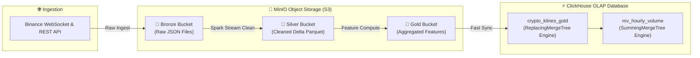

# 💾 SYS-05: LAKEHOUSE & DATABASE MANAGEMENT PORTAL

> **Mã Phân Hệ**: `SYS-05`  
> **Tên Phân Hệ**: Lakehouse & Database Management Portal  
> **Phiên bản tài liệu**: 2.0 (Chi tiết từ A-Z)  
> **Cổng truy cập mặc định**: MinIO Console (`http://localhost:9001`) | ClickHouse Web UI (`http://localhost:8123`) *(Credentials: minioadmin/minioadmin)*  

---

## 🎯 1. MỤC TIÊU & MỤC ĐÍCH HỆ THỐNG

### 1.1. Mục tiêu chiến lược (Strategic Goal)
SYS-05 đóng vai trò là **"Trung tâm quản trị kho dữ liệu doanh nghiệp" (Enterprise Storage & Data Catalog Engine)**. Phân hệ quản lý toàn bộ cấu trúc lưu trữ dữ liệu tài chính theo mô hình hiện đại **Data Lakehouse (Medallion Architecture)** kết hợp với cơ sở dữ liệu phân tích cột thời gian thực (Columnar Time-Series OLAP) **ClickHouse**.

### 1.2. Mục đích vận hành (Operational Purpose)
1. **Quản lý lưu trữ Medallion Architecture (3 Tầng Dữ liệu)**:
   * **Bronze Bucket**: Lưu trữ dữ liệu thô (Raw Data) nhận từ Binance APIs.
   * **Silver Bucket**: Lưu trữ dữ liệu đã làm sạch, chuẩn hóa schema dưới dạng định dạng **Delta Lake Parquet**.
   * **Gold Bucket**: Lưu trữ tập dữ liệu đặc trưng (Features) đã tính toán chỉ số MA, RSI, VWAP sẵn sàng cho huấn luyện AI.
2. **Duy trì tính năng Delta Lake**: Quản lý tính toàn vẹn dữ liệu (ACID Transactions), kiểm soát phiên bản dữ liệu (Schema Enforcement) và truy vấn ngược lịch sử (Time Travel).
3. **Phục vụ truy vấn OLAP siêu tốc**: Cung cấp giao diện truy vấn SQL ad-hoc cho Data Analysts với tốc độ phản hồi **< 10ms** trên hàng trăm triệu dòng dữ liệu.

---

## 👥 2. ĐỐI TƯỢNG SỬ DỤNG VÀ PHÂN QUYỀN (TARGET USERS & RBAC)

* **Data Administrators / DBAs**: Giám sát dung lượng ổ đĩa, phân quyền truy cập S3 Buckets, quản lý Index và Partition của ClickHouse.
* **Data Analysts / BI Engineers**: Thực hiện các câu lệnh SQL khám phá dữ liệu và dựng các báo cáo phân tích kinh doanh.

---

## 🛠️ 3. CÔNG NGHỆ SỬ DỤNG VÀ LÝ DO LỰA CHỌN (TECH STACK & RATIONALE)

| Công nghệ | Vai trò | Lý do lựa chọn (Technical Justification) |
| :--- | :--- | :--- |
| **MinIO Object Storage** | S3-Compatible Storage | Giải pháp lưu trữ đối tượng mã nguồn mở 100% miễn phí, tương thích hoàn toàn với AWS S3 API, tốc độ đọc/ghi đĩa I/O cực cao. |
| **Delta Lake Engine** | Storage Format Layer | Định dạng lưu trữ bảng hiện đại nhất, hỗ trợ ACID transactions, Time Travel rollback và khôi phục lỗi khi ghi dữ liệu streaming. |
| **ClickHouse OLAP DB** | Analytical Engine | Database phân tích theo cột (Columnar OLAP) tốt nhất hiện nay, khả năng nén dữ liệu 5x-10x, thực hiện phép tính Aggregation trên hàng triệu dòng dưới 10ms. |
| **PostgreSQL 15** | Relational Metadata DB | Lưu trữ Metadata hệ thống (Airflow DAG state, MLflow registry metadata). |

---

## ⚙️ 4. RÀNG BUỘC VÀ GIỚI HẠN KỸ THUẬT (CONSTRAINTS & SLA)

1. **Thời gian phản hồi truy vấn (Query SLA)**:
   * Single-key OLAP Query (ClickHouse): **< 10ms**.
   * Multi-table Aggregation Join Query: **< 100ms**.
2. **Tỷ lệ nén dữ liệu (Data Compression Ratio)**:
   * ClickHouse phải đạt tỷ lệ nén từ **5:1 đến 10:1** so với dữ liệu thô ban đầu để tiết kiệm dung lượng đĩa đệm Host.
3. **Chính sách lưu trữ (Data Retention Policy)**:
   * Raw Bronze Data JSON: Lưu trữ **30 ngày** (sau đó tự động xóa hoặc nén).
   * Silver & Gold Delta Lake Data: Lưu trữ **vĩnh viễn**.
4. **Hạn mức dung lượng MinIO**:
   * Giới hạn tối đa **100GB** trong môi trường phát triển cục bộ.

---

## 📥 5. CHI TIẾT ĐẦU VÀO VÀ ĐẦU RA (INPUT & OUTPUT SPECIFICATIONS)

### 5.1. Input Specifications (Đầu vào)
* Luồng dữ liệu Streaming từ Spark Ingestion -> Ghi file Parquet vào MinIO S3 `s3://crypto-silver/`.
* Luồng dữ liệu nạp lô Batch ETL từ Airflow -> Chèn trực tiếp vào bảng ClickHouse `crypto_klines_gold`.

### 5.2. Output Specifications (Đầu ra)
1. **MinIO Object Buckets**:
   * `crypto-bronze` (Raw JSON/CSV)
   * `crypto-silver` (Delta Parquet)
   * `crypto-gold` (Aggregated Feature Store)
2. **ClickHouse SQL Query Output**:
   * Tabular Result Set trả về cho SYS-01 Dashboard hoặc Client DBeaver.

---

## 🔄 6. QUY TRÌNH THỰC HIỆN TỪ A-Z (WORKFLOW & EXECUTION PROCESS)

### 6.1. Sơ đồ quy trình luồng dữ liệu Medallion Architecture



---

## 💻 7. CẤU HÌNH VÀ SCHEMA SQL HOÀN CHỈNH (PRODUCTION SQL DDL)

Dưới đây là file SQL khởi tạo cấu trúc bảng phân tích ClickHouse (`init_clickhouse_tables.sql`):

```sql
-- 1. Bảng chính lưu trữ nến OHLCV Real-time (ReplacingMergeTree chống trùng lặp)
CREATE TABLE IF NOT EXISTS default.crypto_klines_gold (
    symbol LowCardinality(String),
    open_time DateTime64(3, 'UTC'),
    close_time DateTime64(3, 'UTC'),
    open Float64,
    high Float64,
    low Float64,
    close Float64,
    volume Float64,
    quote_asset_volume Float64,
    number_of_trades UInt32,
    sma_20 Float64,
    rsi_14 Float64,
    updated_at DateTime DEFAULT now()
)
ENGINE = ReplacingMergeTree(updated_at)
PRIMARY KEY (symbol, open_time)
ORDER BY (symbol, open_time)
SETTINGS index_granularity = 8192;

-- 2. Materialized View tự động tổng hợp Volume theo từng giờ
CREATE MATERIALIZED VIEW IF NOT EXISTS default.mv_hourly_volume
ENGINE = SummingMergeTree()
PRIMARY KEY (symbol, toStartOfHour(open_time))
ORDER BY (symbol, toStartOfHour(open_time))
AS SELECT
    symbol,
    toStartOfHour(open_time) AS hourly_time,
    sum(volume) AS total_volume,
    count() AS total_klines
FROM default.crypto_klines_gold
GROUP BY symbol, hourly_time;
```

---

## 🖥️ 8. HƯỚNG DẪN QUẢN TRỊ TRÊN MINIO & CLICKHOUSE CONSOLE

1. **MinIO Object Storage Console**: Truy cập `http://localhost:9001` -> Đăng nhập `minioadmin` / `minioadmin` -> Kiểm tra dung lượng 3 Buckets (`crypto-bronze`, `crypto-silver`, `crypto-gold`).
2. **ClickHouse Web Query Test**: Truy cập `http://localhost:8123` hoặc sử dụng DBeaver kết nối cổng 8123 -> Chạy thử câu lệnh query test:
```sql
SELECT symbol, count() as total_rows, sum(volume) as total_vol 
FROM default.crypto_klines_gold 
GROUP BY symbol;
```
