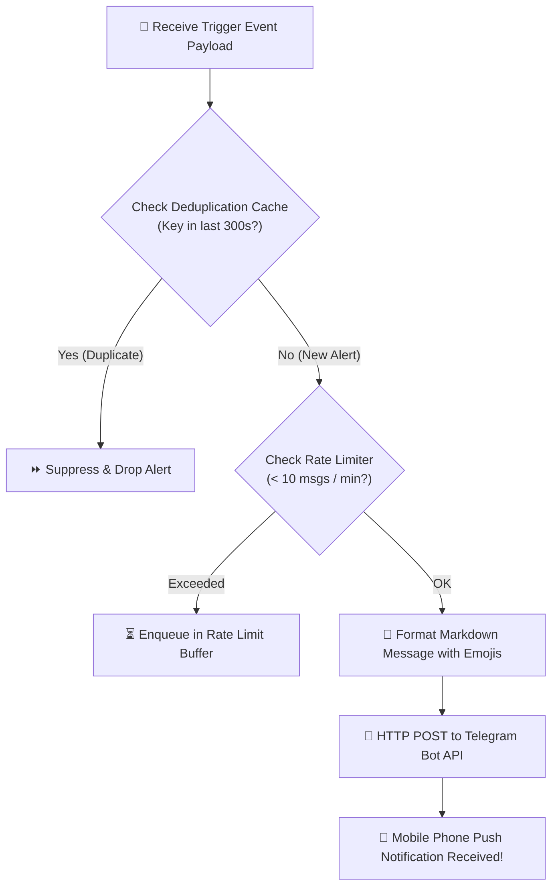

# 📱 SYS-06: OPERATIONAL ALERTING & NOTIFICATION SYSTEM

> **Mã Phân Hệ**: `SYS-06`  
> **Tên Phân Hệ**: Operational Alerting & Notification System  
> **Phiên bản tài liệu**: 2.0 (Chi tiết từ A-Z)  
> **Kênh thông báo mặc định**: Telegram Group / Slack Workspace / SMS Alert  

---

## 🎯 1. MỤC TIÊU & MỤC ĐÍCH HỆ THỐNG

### 1.1. Mục tiêu chiến lược (Strategic Goal)
SYS-06 đóng vai trò là **"Tuyến phòng thủ và kênh truyền thông thời gian thực" (Real-time Operational Alerting Channel)**. Phân hệ chịu trách nhiệm đóng gói, lọc trùng lặp và phát đi các thông báo về sự cố hạ tầng cũng như tín hiệu cảnh báo tài chính tới điện thoại di động của đội ngũ vận hành trong thời gian dưới 3 giây.

### 1.2. Mục đích vận hành (Operational Purpose)
1. **Phát cảnh báo sự cố hạ tầng (Infrastructure Failure Alerting)**: Thông báo ngay lập tức khi một Container Docker sập, đĩa đệm đầy (> 85%), hoặc Kafka Consumer Lag vượt ngưỡng an toàn.
2. **Cảnh báo bất thường thị trường (Market Anomaly Alerting)**: Phát thông báo khi mô hình Isolation Forest phát hiện hành vi thao túng thị trường (Pump & Dump, Volume spike > 300%).
3. **Cảnh báo gian lận giá trị lớn (Fraud Transaction Alerting)**: Phát thông báo khi mô hình LightGBM chặn giao dịch nghi vấn có Fraud Score > 0.85.
4. **Cơ chế lọc tin rác (Deduplication & Rate Limiting)**: Ngăn chặn hiện tượng ngập tin nhắn (Alert Fatigue) bằng cách lọc các tin nhắn trùng lặp trong dải cửa sổ 5 phút.

---

## 👥 2. ĐỐI TƯỢNG SỬ DỤNG VÀ PHÂN QUYỀN (TARGET USERS & RBAC)

* **On-call Engineers / DevOps**: Nhận cảnh báo hạ tầng cấp độ 🔴 CRITICAL để can thiệp hạ tầng tức thì.
* **Risk Managers / Traders**: Nhận tin nhắn cảnh báo biến động thị trường và các giao dịch nghi vấn bị khóa.

---

## 🛠️ 3. CÔNG NGHỆ SỬ DỤNG VÀ LÝ DO LỰA CHỌN (TECH STACK & RATIONALE)

| Công nghệ | Vai trò | Lý do lựa chọn (Technical Justification) |
| :--- | :--- | :--- |
| **Telegram Bot API** | Notification Engine | Nền tảng nhắn tin miễn phí tốt nhất, hỗ trợ push notification tức thì tới smartphone, tùy biến giao diện Markdown mượt mà. |
| **Slack Webhooks** | Enterprise Channel | Tích hợp kênh thông báo cho môi trường doanh nghiệp. |
| **Python `requests` / `httpx`** | HTTP Client | Khởi tạo cuộc gọi HTTP POST bất đồng bộ tới Telegram Gateway API. |
| **In-Memory Cache (Python Dict)** | Deduplication Filter | Bộ nhớ đệm lưu vết các mã Alert Key trong 300s để ngăn chặn spam tin nhắn. |

---

## ⚙️ 4. RÀNG BUỘC VÀ GIỚI HẠN KỸ THUẬT (CONSTRAINTS & SLA)

1. **Độ trễ phát tin nhắn (Delivery Latency SLA)**:
   * Thời gian phát tin nhắn Telegram từ khi sự cố được kích hoạt: **< 3 giây**.
2. **Hạn hạn mức tần suất (Rate Limiting Constraint)**:
   * Giới hạn tối đa **10 tin nhắn / phút** để tránh bị Telegram API khóa Token (Rate-limit ban).
3. **Cửa sổ chống lặp tin nhắn (Deduplication Window)**:
   * Cùng một sự cố (VD: `KafkaLagHigh`) chỉ được phát tin nhắn 1 lần trong mỗi **5 phút** (300 giây).

---

## 📥 5. CHI TIẾT ĐẦU VÀO VÀ ĐẦU RA (INPUT & OUTPUT SPECIFICATIONS)

### 5.1. Input Specifications (Đầu vào Event Payload JSON)
```json
{
  "alert_type": "MARKET_ANOMALY",
  "level": "CRITICAL",
  "symbol": "BTCUSDT",
  "event": "PUMP_AND_DUMP_DETECTED",
  "anomaly_score": 0.96,
  "volume_spike_pct": 340.5,
  "timestamp": "2026-08-07 00:14:02"
}
```

### 5.2. Output Specifications (Đầu ra Telegram Markdown Format)

#### A. Cảnh báo Cấp độ CRITICAL (Nghiêm trọng - Màu đỏ 🔴)
```markdown
🔴 [CRITICAL MARKET ALERT] - PUMP & DUMP DETECTED!
--------------------------------------------------
• Symbol: BTC/USDT
• Event Time: 2026-08-07 00:14:02 UTC
• Metric Change: Volume +340.5% in last 3 mins
• Anomaly Score: 0.96 (Isolation Forest)
• Suggested Action: Pause Trading / Review Risk Limit
--------------------------------------------------
🔗 View Live Dashboard: http://localhost:8501
```

#### B. Cảnh báo Cấp độ WARNING (Cảnh báo - Màu vàng ⚠️)
```markdown
⚠️ [WARNING RISK ALERT] - HIGH FRAUD TRANSACTION DETECTED
--------------------------------------------------
• Transaction ID: TX_994812
• Amount: $45,000.00 USD
• Fraud Score: 0.89 (LightGBM Model)
• Flagged Feature: High-frequency IP Geo-mismatch
• System Action: Transaction Temporarily Held
--------------------------------------------------
🔗 Review in MLOps Portal: http://localhost:5000
```

---

## 🔄 6. QUY TRÌNH THỰC HIỆN TỪ A-Z (WORKFLOW & EXECUTION PROCESS)

### 6.1. Sơ đồ quy trình Alert Dispatcher Engine



---

## 💻 7. MÃ NGUỒN TRIỂN KHAI HOÀN CHỈNH (PRODUCTION CODE IMPLEMENTATION)

Dưới đây là mã nguồn Python hoàn chỉnh của file `alert_dispatcher.py`:

```python
import requests
import json
import time
import os

# Cấu hình Token Bot Telegram & Chat ID Group từ Biến Môi Trường
TELEGRAM_BOT_TOKEN = os.getenv("TELEGRAM_BOT_TOKEN", "YOUR_TELEGRAM_BOT_TOKEN")
TELEGRAM_CHAT_ID = os.getenv("TELEGRAM_CHAT_ID", "YOUR_TELEGRAM_CHAT_ID")

# Bộ nhớ đệm lưu vết các Alert gần nhất để chống Spam (Deduplication Window = 300s)
recent_alerts_cache = {}

def send_telegram_alert(title: str, message: str, level: str = "INFO", deduplicate_key: str = None):
    """
    Hàm gửi tin nhắn cảnh báo qua Telegram Bot API với cơ chế chống Spam tin nhắn trùng lặp.
    """
    current_time = time.time()
    
    # 1. Kiểm tra Chống Spam (Deduplication Check)
    if deduplicate_key:
        if deduplicate_key in recent_alerts_cache:
            last_sent_time = recent_alerts_cache[deduplicate_key]
            if current_time - last_sent_time < 300:  # Không gửi lại nếu trùng trong 5 phút
                print(f"⏩ Alert '{deduplicate_key}' suppressed due to deduplication rule.")
                return False

    # 2. Gán Biểu tượng Icon theo Cấp độ
    icon_map = {
        "CRITICAL": "🔴",
        "WARNING": "⚠️",
        "INFO": "🟢"
    }
    icon = icon_map.get(level.upper(), "ℹ️")

    # 3. Format Tin nhắn Markdown
    formatted_text = (
        f"{icon} *[{level.upper()} ALERT]* - *{title}*\n"
        f"----------------------------------------\n"
        f"{message}\n"
        f"----------------------------------------\n"
        f"⏰ *Timestamp:* {time.strftime('%Y-%m-%d %H:%M:%S', time.localtime())}\n"
        f"🖥️ *Platform:* Mini Company FinTech Engine"
    )

    # 4. Gọi API Telegram
    url = f"https://api.telegram.org/bot{TELEGRAM_BOT_TOKEN}/sendMessage"
    payload = {
        "chat_id": TELEGRAM_CHAT_ID,
        "text": formatted_text,
        "parse_mode": "Markdown"
    }

    try:
        response = requests.post(url, json=payload, timeout=5)
        if response.status_code == 200:
            print(f"✅ Alert '{title}' dispatched to Telegram successfully.")
            if deduplicate_key:
                recent_alerts_cache[deduplicate_key] = current_time
            return True
        else:
            print(f"❌ Failed to send Telegram alert: {response.text}")
            return False
    except Exception as e:
        print(f"⚠️ Exception occurred while sending Telegram alert: {str(e)}")
        return False

# Kiểm thử độc lập Script
if __name__ == "__main__":
    send_telegram_alert(
        title="PUMP & DUMP DETECTED",
        message="• Symbol: BTCUSDT\n• Volume Spike: +340.5%\n• Isolation Forest Score: 0.96",
        level="CRITICAL",
        deduplicate_key="pump_btcusdt_0014"
    )
```

---

## 🧪 8. HƯỚNG DẪN KIỂM THỬ VÀ VẬN HÀNH (TESTING GUIDE)

1. Chat với `@BotFather` trên Telegram để tạo Bot mới -> Nhận `TELEGRAM_BOT_TOKEN`.
2. Tạo Telegram Group Chat -> Thêm Bot vào Group -> Chat câu `/start`.
3. Chạy lệnh python kiểm thử dispatcher: `python alert_dispatcher.py`.
4. Đảm bảo tin nhắn cảnh báo hiển thị chuẩn định dạng màu đỏ 🔴 trên điện thoại di động trong vòng 3 giây.
