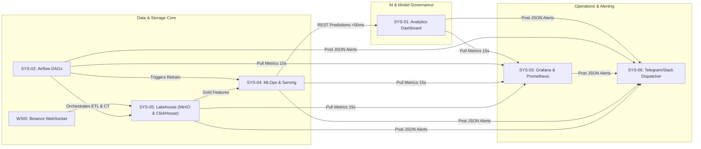

# 🌐 Systems-Graduation-Thesis: Enterprise Platform Ecosystem

This directory hosts the design, documentation, build plans, and source code for all **6 systems** comprising the **Financial Analytics & Fraud Detection Enterprise Platform** (Mini Company Architecture), based on `Plan/master_plan(update_2026_08_07).html`.

---

## 🗺️ 6-System Architecture & Implementation Status

| System Code | System Name | Default Ports | Core Technology Stack | Status | Documentation & Plans |
| :--- | :--- | :--- | :--- | :--- | :--- |
| **SYS-01** | **Business & Predictive Analytics Dashboard** | `8501` | Streamlit, Plotly Canvas, Clickhouse-connect, WebSockets | 📝 **Planning Completed** (Ready to Build) | [README](SYS-01/README.md) \| [CONTEXT](SYS-01/CONTEXT.md) \| [BUILD_PLAN](SYS-01/docs/BUILD_PLAN.md) |
| **SYS-02** | **Data Pipeline & Orchestration System** | `8080` | Apache Airflow 2.x, Python DAGs, Celery / Local Executor | ✅ **Built & Documented** | [README](SYS-02/CONTEXT.md) \| [Guide](SYS-02/docs/SYS02_Data_Pipeline_Orchestration_Guide.md) |
| **SYS-03** | **Infrastructure & Operations Center (SYS-OPS)** | `3000` / `9090` | Grafana 10, Prometheus 2.x, cAdvisor, Node/Kafka Exporter | 📝 **Planning Completed** (Ready to Build) | [README](SYS-03/README.md) \| [CONTEXT](SYS-03/CONTEXT.md) \| [BUILD_PLAN](SYS-03/docs/BUILD_PLAN.md) |
| **SYS-04** | **MLOps & Model Governance Center** | `5000` / `8000` | MLflow 2.x, FastAPI, PyTorch (LSTM), LightGBM, Isolation Forest | 📝 **Planning Completed** (Ready to Build) | [README](SYS-04/README.md) \| [CONTEXT](SYS-04/CONTEXT.md) \| [BUILD_PLAN](SYS-04/docs/BUILD_PLAN.md) |
| **SYS-05** | **Lakehouse & Database Management Portal** | `9001` / `8123` | MinIO S3 Console, ClickHouse OLAP, Delta Lake, PostgreSQL | ✅ **Built & Documented** | [CONTEXT](SYS-05/CONTEXT.md) \| [Full Guide](SYS-05/docs/SYS05_Full_System_Guide_A_to_Z.md) |
| **SYS-06** | **Operational Alerting & Notification System** | Bot Service / `8006` | Python Async Dispatcher, Telegram Bot API, Slack Webhook | ✅ **Built & Documented** | [README](SYS-06/README.md) \| [BUILD_PLAN](SYS-06/docs/BUILD_PLAN.md) |

---

## 🔄 Inter-System Collaboration Overview

---

## 📚 Detailed Planning References for Unbuilt Systems
For comprehensive technical requirements, end-to-end sequence workflows, inter-system connection specifications, tech stack comparisons with alternatives, and phase-by-phase implementation roadmaps, consult:
- **SYS-01 Planning**: [`SYS-01/docs/BUILD_PLAN.md`](SYS-01/docs/BUILD_PLAN.md)
- **SYS-03 Planning**: [`SYS-03/docs/BUILD_PLAN.md`](SYS-03/docs/BUILD_PLAN.md)
- **SYS-04 Planning**: [`SYS-04/docs/BUILD_PLAN.md`](SYS-04/docs/BUILD_PLAN.md)
