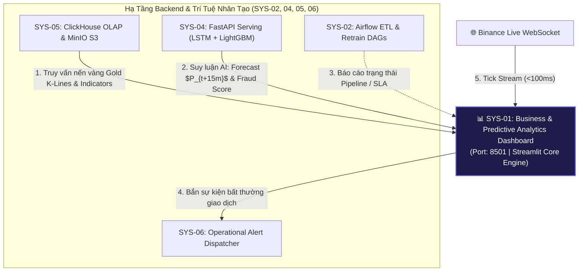
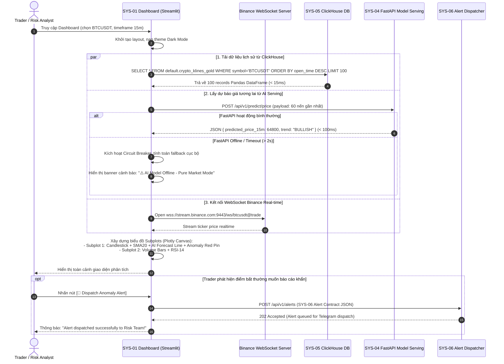

# 🏗️ SYS-01 BUILD PLAN: BUSINESS & PREDICTIVE ANALYTICS DASHBOARD

> **Mã phân hệ**: `SYS-01`  
> **Tên phân hệ**: Business & Predictive Analytics Dashboard  
> **Phiên bản tài liệu**: 2.0 (Planning & Implementation Specification)  
> **Cổng truy cập mặc định**: `http://localhost:8501`  
> **Tham chiếu gốc**: `Plan/master_plan(update_2026_08_07).html` & `Plan/systems_docs/01_Business_Predictive_Analytics_Dashboard.md`

---

## 📋 1. TỔNG QUAN & MỤC TIÊU HỆ THỐNG (SYSTEM OVERVIEW & OBJECTIVES)

### 1.1. Bối cảnh & Vai trò trong Nền tảng Enterprise Mini Company
Trong kiến trúc tổng thể 6 phân hệ của Đề án Tốt nghiệp Nền tảng Phân tích Tài chính & Phát hiện Gian lận (Financial Analytics & Fraud Detection Enterprise Platform), **SYS-01** đóng vai trò là **"Mặt tiền số" (The Digital Storefront & Front-facing Decision Center)**. 
Nếu SYS-02 là xương sống điều phối dữ liệu, SYS-05 là kho lưu trữ dữ liệu tập trung, SYS-04 là bộ não AI/MLOps, thì SYS-01 là điểm chạm duy nhất kết tinh giá trị kỹ thuật thành giá trị kinh doanh trực quan cho con người (Traders, Risk Managers, C-Levels).



### 1.2. Mục tiêu chiến lược (Strategic Goals)
1. **Thực thi tính trực quan hóa tài chính thời gian thực (Zero-Lag Visualization)**: Trực quan hóa biến động giá nến OHLCV đa khung giờ (1m, 15m, 1h) kết hợp trực tiếp dữ liệu tick từ Binance WebSocket.
2. **Lồng ghép dự báo AI (Predictive Overlay Integration)**: Biến các mô hình Deep Learning phức tạp (LSTM / PatchTST) thành đường xu hướng dự báo trực quan $P_{t+15m}, P_{t+60m}$ có khoảng tin cậy.
3. **Cảnh báo sớm thao túng giá (Market Anomaly Pinpoint)**: Gắn nhãn trực quan các hành vi Pump & Dump, Volume đột biến thông qua thuật toán Isolation Forest ngay trên đồ thị nến.
4. **Giám sát rủi ro gian lận giao dịch (Fraud Risk Cockpit)**: Bảng điều khiển tập trung theo dõi các giao dịch tài chính có điểm bất thường cao từ mô hình LightGBM (IEEE-CIS Fraud Detection).

---

## 🎯 2. YÊU CẦU KỸ THUẬT CHI TIẾT (REQUIREMENTS & SPECIFICATIONS)

### 2.1. Yêu cầu chức năng (Functional Requirements - FR)
* **FR-01 (Multi-Asset Selection)**: Hỗ trợ chuyển đổi linh hoạt giữa tối thiểu 3 đến 6 cặp tài sản chính: `BTCUSDT`, `ETHUSDT`, `SOLUSDT` (mở rộng `BNBUSDT`, `ADAUSDT`, `XRPUSDT`).
* **FR-02 (Multi-Timeframe Aggregation)**: Hỗ trợ xem nến ở các khung thời gian: `1m` (scalping), `15m` (intraday swing), `1h` (trend trading).
* **FR-03 (Technical Indicator Overlay)**: Tích hợp sẵn SMA-20, RSI-14, Volume Bar Chart có mã màu (xanh khi Close >= Open, đỏ khi Close < Open).
* **FR-04 (Predictive AI Path)**: Tích hợp nút bật/tắt (Toggle) hiển thị đường dự báo giá tương lai từ SYS-04 (đường nét đứt tím `#a855f7`).
* **FR-05 (Market Anomaly Markers)**: Tích hợp nút bật/tắt hiển thị Pin đỏ 🔴 trên các cây nến có khối lượng giao dịch hoặc biến động giá vượt ngưỡng phân vị 92% (hoặc Anomaly Score > 0.85).
* **FR-06 (Fraud Monitoring Table)**: Hiển thị danh sách 50 giao dịch gian lận gần nhất kèm theo Transaction ID, Số tiền ($), Điểm rủi ro (Fraud Probability), Phân loại rủi ro, và Trạng thái (`BLOCKED`, `FLAGGED_FOR_REVIEW`, `APPROVED`).
* **FR-07 (Manual & Auto Alert Dispatch)**: Trader có thể nhấn nút "Report Market Manipulation" để bắn ngay một payload cảnh báo khẩn cấp sang SYS-06.
* **FR-08 (Pipeline Health Indicator)**: Hiển thị widget nhỏ phản ánh trạng thái hoạt động của SYS-02 (Airflow), SYS-04 (FastAPI), SYS-05 (ClickHouse).

### 2.2. Yêu cầu phi chức năng (Non-Functional Requirements - NFR) & SLA
| Tiêu chí | Ngưỡng cam kết (SLA) | Giải pháp kỹ thuật |
| :--- | :--- | :--- |
| **Độ trễ cập nhật Tick** | `< 100ms` | Kết nối trực tiếp WebSocket Stream từ Client/Engine. |
| **Độ trễ truy vấn Database** | `< 15ms` | ClickHouse OLAP với MergeTree Engine, đánh index `(symbol, open_time)`. |
| **Độ trễ suy luận AI** | `< 200ms` | FastAPI Async I/O, cache tensor, batch size 60 nến. |
| **Giới hạn Render nến** | Tối đa 2,000 nến | Tránh hiện tượng giật lag Canvas và tràn bộ nhớ RAM trình duyệt. |
| **Bộ nhớ Server (Streamlit)** | `< 500MB RAM` | Giới hạn cache TTL 5s `@st.cache_data(ttl=5)` và `@st.cache_resource`. |
| **Tính sẵn sàng (Resilience)** | 99.5% Uptime | Cơ chế Circuit Breaker & Fallback dữ liệu giả lập (Dummy/Local Cache) khi backend offline. |

### 2.3. Phân quyền người dùng (Role-Based Access Control - RBAC)
* **Trader View**: Tập trung vào biểu đồ nến, đường xu hướng AI và chỉ báo kỹ thuật để tối ưu hóa vị thế vào lệnh.
* **Risk Officer View**: Tập trung vào bảng danh sách Fraud Detection, phân tích độ bất thường của dòng tiền và duyệt các lệnh bị khóa.
* **Management / Executive View**: Xem các thẻ KPI tổng hợp (24h Volume, Biến động giá %, Tỷ lệ giao dịch gian lận toàn hệ thống).

---

## 🔄 3. QUY TRÌNH HOẠT ĐỘNG TOÀN DIỆN (WORKFLOW & SEQUENCE DIAGRAM)

### 3.1. Sơ đồ tuần tự tương tác đa hệ thống (End-to-End Sequence Diagram)



### 3.2. Quy trình xử lý lỗi & Khả năng chịu lỗi (Circuit Breaker & Fallback Logic)
1. **Lỗi kết nối ClickHouse**:
   - Thử kết nối lại tối đa 2 lần với backoff 500ms.
   - Nếu vẫn thất bại: Tự động tải file snapshot Parquet/CSV lưu trữ cục bộ từ thư mục `data/fallback_klines/` để giao diện không bị sập (White Screen of Death).
2. **Lỗi kết nối FastAPI AI Server**:
   - Nếu API không phản hồi trong 2.0s, tự động ngắt kết nối (Timeout).
   - Sử dụng công thức Heuristic Fallback (Linear Regression đơn giản trên 20 nến gần nhất) để vẽ dải kỳ vọng nhẹ, đồng thời hiển thị huy hiệu màu vàng cảnh báo người dùng.
3. **Lỗi đứt đường truyền WebSocket**:
   - Thư viện client tự động retry kết nối sau 3s, 6s, 12s (Exponential Backoff) mà không cần người dùng F5 tải lại trang.

---

## 🔗 4. KẾT NỐI TƯƠNG TÁC TỚI CÁC HỆ THỐNG CÒN LẠI (INTER-SYSTEM INTEGRATION)

Bảng ma trận kết nối và giao thức tích hợp của SYS-01 với các phân hệ khác:

| Phân hệ đích | Giao thức / Port | Chi tiết Endpoint / Bảng kết nối | Dữ liệu trao đổi & Format | Xử lý lỗi (Failover Policy) |
| :--- | :--- | :--- | :--- | :--- |
| **SYS-05 (Lakehouse & DB)** | TCP Native HTTP (`8123`) | `default.crypto_klines_gold` | Truy vấn nến lịch sử, SMA-20, RSI-14. Trả về `pd.DataFrame`. | Fallback sang file snapshot Parquet/CSV local. |
| **SYS-04 (MLOps & Serving)** | REST HTTP POST (`8000`) | `/api/v1/predict/price`<br/>`/api/v1/predict/fraud` | Gửi: 60 nến OHLCV. Nhận: Giá dự báo 15m/60m, xu hướng, điểm gian lận. | Timeout 2s, chuyển sang chế độ Pure Market Data. |
| **SYS-06 (Alert Dispatcher)** | REST HTTP POST (`8006`) | `/api/v1/alerts` | Gửi JSON Alert Schema chuẩn (`CRITICAL`/`WARNING`). | Log lỗi cục bộ, không làm gián đoạn trải nghiệm Trader. |
| **SYS-02 (Orchestration)** | HTTP GET (`8080`) | `/health` hoặc `/api/v1/dags` | Kiểm tra trạng thái hoạt động của DAG ETL để hiển thị Badge trạng thái. | Hiển thị badge `Pipeline: Unknown`. |
| **SYS-03 (Ops Monitoring)** | HTTP Pull (`9090`) | `/metrics` (Prometheus Exporter) | SYS-03 sẽ chủ động cào chỉ số CPU/RAM và Request Count của SYS-01. | Tự động, không ảnh hưởng logic app. |
| **Binance External** | WSS (`9443`) | `wss://stream.binance.com:9443/ws/<pair>@trade` | Nhận tick giá giao dịch theo thời gian thực (JSON). | Tự động reconnect sau 3 giây. |

### Hợp đồng dữ liệu mẫu gửi tới SYS-06 (Alert Contract Sample):
```json
{
  "alert_type": "MARKET_ANOMALY",
  "level": "CRITICAL",
  "source_system": "SYS-01",
  "event": "MANUAL_PUMP_AND_DUMP_REPORT",
  "deduplicate_key": "market_anomaly:BTCUSDT:trader_report:20260919",
  "receiver_roles": ["trader", "risk_manager"],
  "channels": ["telegram"],
  "message": "Trader flagged abnormal volume spike on BTCUSDT at price $64,250. AI Anomaly Score: 0.94.",
  "metadata": {
    "symbol": "BTCUSDT",
    "trigger_price": 64250.50,
    "volume_15m": 1250.45,
    "anomaly_score": 0.94
  }
}
```

---

## 🛠️ 5. ĐÁNH GIÁ TECH STACK & CÁC LỰA CHỌN THAY THẾ (TECH STACK EVALUATION & ALTERNATIVES)

### 5.1. Tech Stack đề xuất chính (Primary Proposed Stack)
* **Core Web UI**: **Streamlit 1.3x** (Python-based Rapid Application Development)
* **Visual Rendering Engine**: **Plotly Graph Objects (`go.Candlestick`, `go.Scatter`, `make_subplots`)**
* **Database Driver**: **`clickhouse-connect`**
* **HTTP Client**: **`httpx` / `requests`** (với connection pooling và timeout)
* **Containerization**: **Docker (Python 3.10-slim)**

### 5.2. Bảng so sánh toàn diện các giải pháp thay thế tương đương

| Giải pháp Công nghệ | Ưu điểm (Pros) | Nhược điểm (Cons) | Mức độ phù hợp với Đồ án Tốt nghiệp |
| :--- | :--- | :--- | :--- |
| **Streamlit + Plotly (Lựa chọn chính đề xuất)** | - 100% Python, cực kỳ đồng bộ với hệ sinh thái Data Science & AI.<br/>- Tốc độ phát triển UI nhanh gấp 5 lần React/Vue.<br/>- Plotly hỗ trợ sẵn WebGL Financial Candlestick mượt mà.<br/>- Chi phí triển khai 0đ, nhẹ RAM (~200MB). | - Kiến trúc rerun script khi tương tác đòi hỏi phải dùng `@st.cache_data` cẩn thận để tránh giật giao diện.<br/>- Khó tùy biến CSS siêu phức tạp cấp độ Design System lớn. | ⭐⭐⭐⭐⭐ **9.8/10 (Tối ưu nhất cho Đề án)**: Cân bằng hoàn hảo giữa thời gian hoàn thành, chất lượng trực quan và sức mạnh phân tích dữ liệu. |
| **Next.js (React) + TradingView Lightweight Charts + FastAPI** | - Giao diện chuyên nghiệp như Binance / TradingView thực thụ.<br/>- Tối ưu hiệu năng Client-side cực cao, không bị rerun script.<br/>- Tùy biến CSS/Tailwind không giới hạn. | - Đòi hỏi viết cả Frontend (TypeScript/React) lẫn Backend API trung gian (BFF).<br/>- Tốn nhiều thời gian code giao diện, có thể làm loãng trọng tâm nghiên cứu AI/Data Engineering của đề tài.<br/>- Tăng độ phức tạp deployment (cần thêm container Node.js). | ⭐⭐⭐⭐ **8.5/10 (Phương án nâng cao)**: Rất xuất sắc nếu nhóm làm đồ án có thành viên chuyên sâu Frontend, tuy nhiên rủi ro vượt quá timeline 12 tuần. |
| **Plotly Dash** | - Thuần Python, khả năng kiểm soát Callback chi tiết hơn Streamlit.<br/>- Hỗ trợ tốt các ứng dụng tài chính phân tích sâu. | - Cú pháp Callback rườm rà, code dài hơn Streamlit nhiều lần.<br/>- Giao diện mặc định không hiện đại bằng Streamlit nếu không viết nhiều CSS. | ⭐⭐⭐ **7.5/10 (Khả thi nhưng cồng kềnh)**: Không mang lại lợi ích vượt trội so với Streamlit trong bài toán dashboard trực quan này. |
| **Apache Superset / Metabase** | - Dựng dashboard dạng kéo thả không cần code.<br/>- Kết nối ClickHouse và PostgreSQL cực mạnh có sẵn. | - Không hỗ trợ lồng ghép mô hình Deep Learning suy luận real-time theo tick WebSocket.<br/>- Nặng nề (Superset ngốn > 1.5GB RAM), khó nhúng các pin cảnh báo động của mô hình AI. | ⭐⭐ **5.0/10 (Không phù hợp)**: Phù hợp cho BI truyền thống, không phù hợp cho AI Predictive Analytics thời gian thực. |

---

## 📁 6. CẤU TRÚC THƯ MỤC TRIỂN KHAI DỰ KIẾN (DIRECTORY STRUCTURE)

Dưới đây là cấu trúc thư mục chuẩn bị build cho `Systems-Graduation-Thesis/SYS-01`:

```
SYS-01/
├── .env.example                  # Template biến môi trường
├── .gitignore                    # Bỏ qua virtualenv, pycache
├── Dockerfile                    # Multi-stage hoặc slim Python container
├── docker-compose.yml            # Khởi chạy độc lập hoặc trong mạng fintech_net
├── requirements.txt              # Danh sách thư viện Python
├── README.md                     # Giới thiệu phân hệ
├── CONTEXT.md                    # Thuật ngữ & Mô hình miền
├── docs/
│   └── BUILD_PLAN.md             # Tài liệu quy hoạch kỹ thuật chi tiết này
├── src/
│   ├── app.py                    # Streamlit Entrypoint
│   ├── config.py                 # Quản lý cấu hình & biến môi trường
│   ├── components/               # Các khối UI tái sử dụng
│   │   ├── __init__.py
│   │   ├── header_metrics.py     # Thẻ chỉ số 24h High/Low, Fraud rate
│   │   ├── financial_chart.py    # Candlestick + AI Overlay Plotly
│   │   ├── fraud_table.py        # Bảng giao dịch rủi ro
│   │   └── system_health_bar.py  # Badge trạng thái 6 systems
│   ├── connectors/               # Module kết nối ngoại vi
│   │   ├── __init__.py
│   │   ├── clickhouse_client.py  # Truy vấn ClickHouse an toàn
│   │   ├── fastapi_client.py     # Gọi suy luận SYS-04
│   │   ├── alert_client.py       # Bắn cảnh báo sang SYS-06
│   │   └── websocket_client.py   # Lắng nghe Binance WebSocket
│   └── utils/
│       ├── __init__.py
│       ├── indicator_calc.py     # Tính toán SMA, RSI nếu chưa có từ DB
│       └── formatters.py         # Định dạng tiền tệ, ngày giờ
└── tests/
    ├── __init__.py
    ├── test_connectors.py        # Mock test kết nối ClickHouse & FastAPI
    ├── test_indicators.py        # Test độ chính xác tính toán kỹ thuật
    └── test_chart_render.py      # Test khởi tạo đối tượng Plotly Figure
```

---

## 📅 7. LỘ TRÌNH TRIỂN KHAI THEO CÁC PHASE (STEP-BY-STEP ROADMAP)

* **Phase 00: Context & Environment Setup**: Khởi tạo biến môi trường `.env`, `requirements.txt` (Streamlit, Plotly, Clickhouse-connect, httpx), và thiết lập mạng Docker `fintech_net`.
* **Phase 01: Data Connectors & Caching**: Viết module `clickhouse_client.py` với kết nối có pool và fallback cache; viết `fastapi_client.py` gọi sang SYS-04.
* **Phase 02: Plotly Financial Chart Component**: Xây dựng module render biểu đồ 2 Subplots (Candlestick + Volume) hỗ trợ zoom/pan mượt mà trên Canvas.
* **Phase 03: AI Inference & Anomaly Overlay**: Tích hợp đường nét đứt dự báo $P_{t+15m}$ từ SYS-04 và gắn Pin đỏ 🔴 cho nến bất thường.
* **Phase 04: Fraud Risk Cockpit & SYS-06 Integration**: Xây dựng bảng giao dịch gian lận và nút bấm dispatch alert sang SYS-06.
* **Phase 05: Real-time WebSocket Ticker**: Tích hợp luồng live ticker từ Binance WebSocket để nhấp nháy giá thị trường tức thời.
* **Phase 06: Dockerize & Healthcheck**: Đóng gói Dockerfile, viết kiểm thử PyTest và cấu hình health check endpoint.

---

## 🧪 8. KẾ HOẠCH KIỂM THỬ & VẬN HÀNH (VERIFICATION & RUNBOOK)

### 8.1. Kiểm thử tự động (Automated PyTest)
- `test_clickhouse_query_fallback()`: Ngắt kết nối DB, kiểm tra hàm trả về DataFrame fallback hợp lệ mà không raise Exception.
- `test_ai_prediction_timeout()`: Mô phỏng timeout 2s của SYS-04, đảm bảo UI tiếp tục render mà không bị crash.
- `test_alert_payload_schema()`: Đảm bảo payload gửi sang SYS-06 tuân thủ nghiêm ngặt chuẩn JSON hợp đồng.

### 8.2. Kiểm thử vận hành thực tế (Operational Acceptance Criteria)
1. Truy cập `http://localhost:8501` trên trình duyệt: Giao diện nạp đầy đủ trong `< 1.5s`.
2. Chuyển đổi cặp tiền `BTCUSDT` -> `ETHUSDT`: Dữ liệu và biểu đồ nạp lại hoàn tất trong `< 1s`.
3. Nhấn bật/tắt checkbox AI Overlay: Đường nét đứt và các pin cảnh báo đỏ biến đổi mượt mà không bị reload toàn trang.
