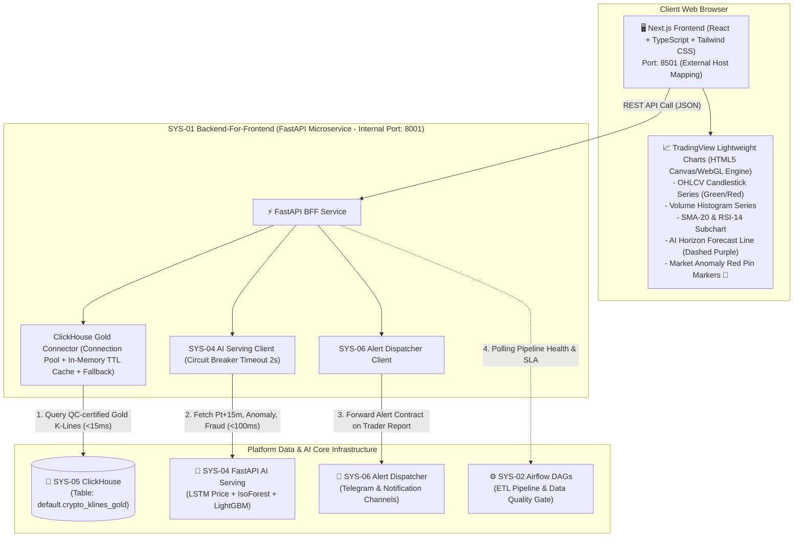

# 🏗️ DETAILED ENGINEERING BUILD PLAN: SYS-01 BUSINESS & PREDICTIVE ANALYTICS DASHBOARD
> **Subsystem Code**: `SYS-01`  
> **Subsystem Name**: Business & Predictive Analytics Dashboard  
> **Core Architecture**: **Decoupled Modern Fintech Stack (Next.js 14/15 Frontend + TradingView Lightweight Charts WebGL + FastAPI BFF)**  
> **Default Access Port**: `http://localhost:8501` (Mapped from Frontend Docker Container)  
> **Document Version**: 2.0 (Combo 4: Next.js + TradingView + FastAPI BFF)  
> **Document Language**: English (Vietnamese edition available at [BUILD_PLAN_VI.md](BUILD_PLAN_VI.md))

---

## 📋 1. SYSTEM OVERVIEW & STRATEGIC POSITIONING

### 1.1. Context & Role within the Enterprise Mini Company Platform
Within the 6-subsystem architecture of the **Financial Analytics & Fraud Detection Enterprise Platform**:
- **SYS-05**: Central Storage Lakehouse (MinIO S3 & ClickHouse OLAP).
- **SYS-02**: Data Orchestration Backbone (Apache Airflow ETL DAGs & Data Quality Gate).
- **SYS-04**: AI/MLOps Serving Center (LSTM Price Forecaster, Isolation Forest Anomaly, LightGBM Fraud Gatekeeper).
- **SYS-06**: Operational Alert & Incident Dispatcher (Telegram Bot & Notification Queues).
- **WSIS**: WebSocket Ingestion Service dedicated solely to **QA/QC Audit Reconciliation** against REST API batches.
- **SYS-01**: **"The Digital Storefront & Operational Decision Cockpit"** — The primary front-facing analytical interface synthesizing data engineering pipelines and AI models into real-time visual decision support for **Financial Traders, Risk Officers**, and **Executive Leadership (C-Levels)**.

### 1.2. Strict Data Integrity Invariant
> **CORE ARCHITECTURAL RULE**:  
> 1. All financial market data (OHLCV candlesticks, trading volumes, technical indicators SMA-20, RSI-14) displayed on SYS-01 are **100% queried from quality-certified data stored in SYS-05 ClickHouse (`default.crypto_klines_gold`)**.  
> 2. **SYS-01 strictly NEVER connects to or displays raw uncertified streams from WSIS**. WSIS exists purely for 15-minute tumbling-window cross-verification (QA/QC audit) within Airflow's Bronze ingestion layer.

---

## 🏛️ 2. SYSTEM ARCHITECTURE (COMBO 4 DESIGN)

The subsystem is architected as a **Decoupled Client / Backend-For-Frontend (BFF)** system:



---

## 🎯 3. DETAILED TECHNICAL & FUNCTIONAL SPECIFICATIONS

### 3.1. Asset Scope & Timeframes
* **6 Standardized Trading Pairs**: Aligned across the enterprise platform:
  1. `BTCUSDT` (Bitcoin / Tether)
  2. `ETHUSDT` (Ethereum / Tether)
  3. `BNBUSDT` (Binance Coin / Tether)
  4. `AAPLBUSDT` (Apple Tokenized Asset / Tether)
  5. `AMZNBUSDT` (Amazon Tokenized Asset / Tether)
  6. `DELLBUSDT` (Dell Technologies Tokenized Asset / Tether)
* **Aggregation Timeframes**: Supports `1m` (scalping), `15m` (standard AI forecast & Airflow window), `1h` (macro trend trading).

### 3.2. Functional Requirements (FR)
* **FR-01 (Interactive Candlestick & Volume)**: Sub-second rendering of OHLCV candles on TradingView Lightweight Charts, with bullish candles in green (`#22c55e`) and bearish candles in red (`#ef4444`). Synced Volume Histogram at the base.
* **FR-02 (Technical Indicators)**:
  - Overlay line for SMA-20 (Simple Moving Average) plotted directly on the price chart.
  - Sub-pane chart below displaying RSI-14 (Relative Strength Index) with Overbought (70) and Oversold (30) reference bands.
* **FR-03 (AI Predictive Overlay - SYS-04 LSTM Integration)**:
  - Projected price path rendered as a vibrant dashed purple trendline (`#a855f7`) projecting into $P_{t+15m}$ and $P_{t+60m}$.
  - Toggle switch allowing traders to show/hide the predictive horizon without reloading the chart.
* **FR-04 (Market Anomaly Markers - SYS-04 Isolation Forest Integration)**:
  - Visual pin red markers 🔴 (`position: 'aboveBar'`, `shape: 'circle'`) automatically rendered on candlesticks where the Isolation Forest model detected abnormal volatility spikes, pump-and-dump dynamics, or spoofing patterns.
  - Interactive toggle switch to enable/disable anomaly markers.
* **FR-05 (Fraud Risk Cockpit - SYS-04 LightGBM Integration)**:
  - Live table monitoring the last 50 transactions evaluated by LightGBM.
  - Color-coded risk status according to SYS-04's 3-tier threshold governance:
    - 🟢 `APPROVED` (Fraud Score $< 0.30$)
    - 🟡 `FLAGGED_FOR_REVIEW` ($0.30 \le \text{Fraud Score} < 0.75$)
    - 🔴 `BLOCKED` (Fraud Score $\ge 0.75$)
* **FR-06 (One-Click Emergency Alert Dispatch - SYS-06 Integration)**:
  - Dedicated *"🚨 Report Market Manipulation / Fraud"* button.
  - Opens a confirmation modal where traders can specify violation details and dispatch an immediate JSON Alert Contract to SYS-06's `/api/v1/alerts`, triggering real-time alerts to the Risk Team's Telegram channel.
* **FR-07 (System Health Status Bar)**:
  - Header widget displaying live connectivity and health status across all 6 subsystems (SYS-01 to SYS-06).

### 3.3. Non-Functional Requirements (NFR) & SLA
| Metric | SLA Target | Technical Implementation |
| :--- | :--- | :--- |
| **Chart Rendering Speed** | Smooth 60 FPS, No DOM Bloat | TradingView Lightweight Charts hardware-accelerated Canvas WebGL. |
| **Historical Data Latency** | `< 20ms` | ClickHouse OLAP with primary keys `(symbol, open_time)` + 5s TTL In-Memory Cache in BFF. |
| **AI Inference Latency** | `< 200ms` | Asynchronous REST calls to SYS-04 serving endpoints. |
| **Resilience & Fault Tolerance** | 99.9% UI Uptime | **Circuit Breaker** (2.0s timeout) for SYS-04 calls: Fallback to `Pure Market Mode` with degraded alert banner; zero white-screen crashes. |
| **Client Bundle Size** | `< 1.2MB` | Next.js dynamic imports, tree-shaking, and asset minification. |

---

## 📡 4. REST API CONTRACTS (FASTAPI BFF)

All endpoints are hosted on the internal FastAPI BFF service on port `8001`:

### 4.1. `GET /api/v1/market/klines`
* **Purpose**: Retrieve historical candlesticks, volume, and calculated indicators from SYS-05 ClickHouse Gold.
* **Query Params**:
  - `symbol` (str, required): e.g., `BTCUSDT`
  - `timeframe` (str, default: `15m`): `1m`, `15m`, `1h`
  - `limit` (int, default: `200`, max: `1000`)
* **Response Sample**:
```json
{
  "symbol": "BTCUSDT",
  "timeframe": "15m",
  "count": 200,
  "data": [
    {
      "time": 1723000000,
      "open": 64200.0,
      "high": 64500.0,
      "low": 64150.0,
      "close": 64450.0,
      "volume": 125.45,
      "sma_20": 64100.2,
      "rsi_14": 58.4
    }
  ]
}
```

### 4.2. `GET /api/v1/market/ai-forecast`
* **Purpose**: Obtain multi-horizon forward forecast prices from SYS-04 LSTM model.
* **Query Params**: `symbol` (str, required)
* **Response Sample**:
```json
{
  "symbol": "BTCUSDT",
  "timestamp_utc": "2026-10-05 15:30:00 UTC",
  "current_price": 64450.0,
  "forecast_15m": {
    "predicted_price": 64611.12,
    "predicted_delta_pct": 0.25,
    "direction": "BULLISH"
  },
  "forecast_60m": {
    "predicted_price": 64888.60,
    "predicted_delta_pct": 0.68,
    "direction": "BULLISH"
  },
  "ai_status": "ONLINE"
}
```

### 4.3. `GET /api/v1/market/anomalies`
* **Purpose**: Retrieve flagged anomalous candlestick timestamps from SYS-04 Isolation Forest.
* **Query Params**: `symbol` (str, required), `lookback` (int, default: `50`)
* **Response Sample**:
```json
{
  "symbol": "BTCUSDT",
  "anomalies": [
    {
      "time": 1722998200,
      "anomaly_score": 0.94,
      "risk_level": "HIGH",
      "reason": "ABNORMAL_VOLUME_SPIKE_PUMP"
    }
  ]
}
```

### 4.4. `GET /api/v1/fraud/recent-transactions`
* **Purpose**: Retrieve recent financial transactions classified by LightGBM.
* **Query Params**: `limit` (int, default: `50`)
* **Response Sample**:
```json
{
  "total": 50,
  "transactions": [
    {
      "transaction_id": "tx-99201",
      "timestamp": "2026-10-05 15:28:10 UTC",
      "amount_usd": 12500.0,
      "user_id": "usr-88219",
      "fraud_score": 0.88,
      "status": "BLOCKED",
      "risk_factors": ["High IP Distance", "Unusual Amount Spike"]
    }
  ]
}
```

### 4.5. `POST /api/v1/alerts/dispatch`
* **Purpose**: Dispatch manual trader anomaly reports to SYS-06 Alert Dispatcher.
* **Request Body**:
```json
{
  "alert_type": "MARKET_ANOMALY",
  "level": "CRITICAL",
  "symbol": "BTCUSDT",
  "trigger_price": 64450.0,
  "note": "Trader manual flag: Suspicious order spoofing and pump on 15m candle."
}
```
* **Response**: `202 Accepted` $\rightarrow$ `{"status": "DISPATCHED_TO_SYS06", "alert_id": "alt-55102"}`

---

## 📁 5. DIRECTORY STRUCTURE & FILE MANIFEST

The project structure for `SYS-01` is structured as follows:

```
SYS-01/
├── docker-compose.yml              # Multi-container orchestration: frontend (8501) & backend (8001)
├── README.md                       # Quickstart & operational runbook
├── CONTEXT.md                      # Ubiquitous domain terminology & invariants
├── docs/
│   ├── BUILD_PLAN_VI.md            # Detailed implementation plan (Vietnamese)
│   └── BUILD_PLAN_EN.md            # Detailed implementation plan (English - this file)
│
├── backend/                        # === BACKEND-FOR-FRONTEND (FastAPI) ===
│   ├── Dockerfile                  # Python 3.10-slim container
│   ├── requirements.txt            # fastapi, uvicorn, clickhouse-connect, httpx, pydantic, pandas
│   ├── .env.example                # Sample environment configuration
│   ├── .env                        # Local execution variables
│   └── app/
│       ├── main.py                 # FastAPI application, CORS & Lifespan handler
│       ├── config.py               # Microservices connection settings
│       ├── routers/
│       │   ├── market.py           # K-lines, indicators, AI forecast, anomaly points
│       │   ├── fraud.py            # Fraud transaction cockpit endpoints
│       │   ├── alerts.py           # Forward alerts to SYS-06
│       │   └── health.py           # Health checks & platform status
│       ├── connectors/
│       │   ├── clickhouse_gold.py  # Query ClickHouse Gold + snapshot fallback
│       │   ├── sys04_ai_client.py  # HTTP client calling SYS-04 with Circuit Breaker
│       │   └── sys06_alert_client.py # HTTP client dispatching alerts to SYS-06
│       └── utils/
│           ├── indicators.py       # Algorithmic calculation of SMA-20, RSI-14
│           └── fallback_data.py    # Offline candle snapshots when ClickHouse is absent
│
└── frontend/                       # === VISUALIZATION FRONTEND (Next.js + TradingView) ===
    ├── Dockerfile                  # Multi-stage Node.js 20-alpine container
    ├── package.json                # next, react, lightweight-charts, lucide-react, tailwindcss
    ├── tsconfig.json
    ├── tailwind.config.ts
    ├── next.config.mjs
    ├── public/
    │   └── favicon.ico
    └── src/
        ├── app/
        │   ├── layout.tsx          # Master layout with Dark Fintech Theme
        │   ├── page.tsx            # Main Analytics Dashboard
        │   └── globals.css         # Custom scrollbars & canvas wrappers
        ├── components/
        │   ├── header/
        │   │   ├── TopNavbar.tsx   # Top navigation, 6-pair selector, timeframe picker
        │   │   └── HealthBadge.tsx # Multi-system health status indicators
        │   ├── metrics/
        │   │   └── MetricCards.tsx # Key metrics: latest price, 15m forecast, fraud rate
        │   ├── chart/
        │   │   ├── TradingViewChart.tsx # Core WebGL Canvas component
        │   │   └── ChartControls.tsx    # Toggle switches for AI Forecast & Anomaly Pins
        │   ├── fraud/
        │   │   └── FraudTable.tsx  # 3-tier color-coded fraud transactions table
        │   └── modal/
        │       └── ReportAlertModal.tsx # Urgent alert dispatch modal to SYS-06
        ├── hooks/
        │   ├── useMarketData.ts    # Polling candles & indicator state manager
        │   └── useAiForecast.ts    # Fetching AI predictions & anomalies
        ├── lib/
        │   └── api.ts              # API client fetching from FastAPI BFF
        └── types/
            ├── market.ts           # Interfaces for Candlestick, Indicator, Forecast
            └── fraud.ts            # Interfaces for Fraud Record & Alert
```

---

## 🚀 6. IMPLEMENTATION ROADMAP (PHASE-BY-PHASE)

### Phase 1: Backend BFF Foundation & Fault-Tolerant Connectors
1. Scaffold `backend/` directory with `requirements.txt` and `.env.example`.
2. Implement `connectors/clickhouse_gold.py` to query certified candles from SYS-05 ClickHouse with 5s in-memory TTL caching and offline snapshot fallback.
3. Implement `connectors/sys04_ai_client.py` integrating SYS-04 inference endpoints (`/api/v1/models/lstm/predict`, `/anomaly/evaluate`, `/fraud/score`) equipped with a 2-second timeout Circuit Breaker.
4. Implement `connectors/sys06_alert_client.py` for alert forwarding to SYS-06.
5. Verify routers via FastAPI interactive documentation (`http://localhost:8001/docs`).

### Phase 2: Next.js Frontend Setup & Layout Architecture
1. Initialize Next.js App Router project configured with TypeScript and Tailwind CSS.
2. Build Dark Theme Fintech styling (deep slate `#0b0e14`, card `#151922`, borders `#222734`).
3. Construct `TopNavbar` supporting the 6 asset pairs (`BTCUSDT` to `DELLBUSDT`) and timeframes (`1m`, `15m`, `1h`).
4. Implement `HealthBadge` displaying live statuses of upstream subsystems.

### Phase 3: TradingView Lightweight Charts & AI Overlays Integration
1. Install `lightweight-charts` and build the reusable React component `TradingViewChart.tsx`.
2. Render Candlestick Series and synced Volume Series with dynamic color schemes.
3. Integrate SMA-20 overlay line and separate RSI-14 oscillator pane.
4. Render the dashed purple AI Forecast Trajectory (`#a855f7`) projecting $P_{t+15m}$ and $P_{t+60m}$.
5. Integrate the Markers API to pin red 🔴 markers on candlesticks flagged by Isolation Forest.
6. Provide toggle controls to dynamically toggle AI layers without reloading the chart canvas.

### Phase 4: Fraud Cockpit & Emergency Alert Workflow (SYS-06)
1. Construct `FraudTable.tsx` displaying transaction records categorized under the 3 governance tiers (`BLOCKED`, `FLAGGED_FOR_REVIEW`, `APPROVED`).
2. Build `ReportAlertModal.tsx`: Enabling traders to report anomalous market activity directly to SYS-06, verifying dispatch to the Telegram channel.

### Phase 5: Containerization, Ecosystem Hook & Verification
1. Author multi-stage `Dockerfile` for frontend and backend, configuring `docker-compose.yml` to bind port `8501:3000`.
2. Integrate SYS-01 into the platform orchestrator `start_ecosystem.ps1`.
3. Update links in the global `portal.html` navigation hub.
4. Execute chaos testing: Simulate outage of SYS-04 or SYS-05 to verify graceful degradation into `Pure Market Mode` without application failure.

---

## 🧪 7. TECHNICAL ACCEPTANCE CRITERIA

- [ ] **Data Quality Guarantee**: 100% of price and volume data originated from ClickHouse Gold; zero reliance on raw WSIS streams.
- [ ] **Chart Performance**: TradingView canvas renders smoothly at 60 FPS with interaction latency $< 50\text{ms}$.
- [ ] **AI Synchronization**: Dash purple forecast lines from LSTM and pin red markers from Isolation Forest render seamlessly.
- [ ] **Resilience Guarantee**: System transitions to `Degraded Mode` with clear warning banners when SYS-04 or SYS-05 is offline; zero white-screen crashes.
- [ ] **Alert Dispatching**: Triggering a manual alert dispatches a valid Alert Contract to SYS-06, received in Telegram in $< 1\text{s}$.
- [ ] **Containerization**: Executing `docker-compose up -d` launches the entire SYS-01 subsystem accessible at `http://localhost:8501`.
