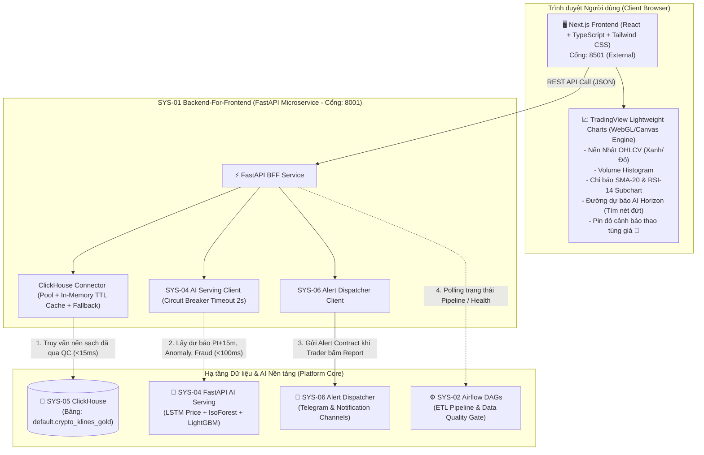

# 🏗️ KẾ HOẠCH XÂY DỰNG CHI TIẾT: SYS-01 BUSINESS & PREDICTIVE ANALYTICS DASHBOARD
> **Mã phân hệ**: `SYS-01`  
> **Tên phân hệ**: Business & Predictive Analytics Dashboard  
> **Kiến trúc cốt lõi**: **Decoupled Modern Fintech Stack (Next.js 14/15 Frontend + TradingView Lightweight Charts Canvas + FastAPI BFF)**  
> **Cổng truy cập mặc định**: `http://localhost:8501` (Mapping từ container Frontend)  
> **Phiên bản tài liệu**: 2.0 (Combo 4: Next.js + TradingView + FastAPI BFF)  
> **Ngôn ngữ tài liệu**: Tiếng Việt (Bản tiếng Anh xem tại [BUILD_PLAN_EN.md](BUILD_PLAN_EN.md))

---

## 📋 1. TỔNG QUAN HỆ THỐNG & ĐỊNH VỊ CHIẾN LƯỢC

### 1.1. Bối cảnh & Vai trò trong Nền tảng Enterprise
Trong toàn bộ hệ sinh thái Đề án Tốt nghiệp Nền tảng Phân tích Tài chính & Phát hiện Gian lận (**Financial Analytics & Fraud Detection Enterprise Platform**):
- **SYS-05**: Kho dữ liệu trung tâm (Lakehouse MinIO & ClickHouse OLAP).
- **SYS-02**: Xương sống điều phối luồng dữ liệu (Apache Airflow ETL DAGs & Data Quality Gate).
- **SYS-04**: Bộ não suy luận AI/MLOps phục vụ mô hình (LSTM Price Forecaster, Isolation Forest Anomaly, LightGBM Fraud Gatekeeper).
- **SYS-06**: Hệ thống cảnh báo & điều phối thông báo khẩn cấp (Telegram Dispatcher).
- **WSIS**: Dịch vụ thu thập WebSocket phục vụ **mục đích duy nhất là đối soát kiểm định chất lượng (QA/QC Audit Reconciliation)** với dữ liệu REST API.
- **SYS-01**: **"Mặt tiền số" (The Digital Storefront & Operational Decision Cockpit)** — Điểm chạm trực quan duy nhất kết tinh toàn bộ giá trị kỹ thuật dữ liệu và trí tuệ nhân tạo thành công cụ phân tích và hỗ trợ ra quyết định thời gian thực cho **Traders, Quản trị rủi ro (Risk Officers)** và **Ban điều hành (C-Level)**.

### 1.2. Nguyên tắc Bất biến về Tính Toàn Vẹn Dữ Liệu (Data Integrity Invariant)
> **QUY TẮC CỐT LÕI**:  
> 1. Toàn bộ dữ liệu tài chính (nến OHLCV, khối lượng giao dịch, chỉ báo kỹ thuật SMA-20, RSI-14) hiển thị trên SYS-01 **100% được truy vấn từ kho dữ liệu đã qua kiểm định chất lượng (Data Quality Gate) lưu tại SYS-05 ClickHouse (bảng `default.crypto_klines_gold`)**.  
> 2. **SYS-01 tuyệt đối không kết nối trực tiếp vào luồng WSIS** và không sử dụng dữ liệu chưa kiểm định từ WSIS để phân tích hiển thị. WSIS chỉ đóng vai trò đối soát kiểm định chéo trong chu kỳ 15 phút tại tầng Bronze của Airflow.

---

## 🏛️ 2. KIẾN TRÚC HỆ THỐNG (COMBO 4 ARCHITECTURE)

Hệ thống được thiết kế theo kiến trúc **Decoupled Architecture (Frontend / Backend-For-Frontend)** tách biệt hoàn toàn giữa hiển thị giao diện và xử lý tích hợp backend:



---

## 🎯 3. YÊU CẦU KỸ THUẬT & CHỨC NĂNG CHI TIẾT

### 3.1. Phạm vi Tài sản & Khung thời gian
* **6 Cặp tài sản chiến lược**: Chuẩn hóa đồng bộ với toàn hệ thống:
  1. `BTCUSDT` (Bitcoin / Tether)
  2. `ETHUSDT` (Ethereum / Tether)
  3. `BNBUSDT` (Binance Coin / Tether)
  4. `AAPLBUSDT` (Apple Tokenized Asset / Tether)
  5. `AMZNBUSDT` (Amazon Tokenized Asset / Tether)
  6. `DELLBUSDT` (Dell Technologies Tokenized Asset / Tether)
* **Khung thời gian (Timeframes)**: Hỗ trợ nến `1m` (scalping), `15m` (chu kỳ phân tích chuẩn đồng bộ với AI & Airflow), `1h` (phân tích xu hướng dài).

### 3.2. Yêu cầu Chức năng (Functional Requirements - FR)
* **FR-01 (Interactive Candlestick & Volume)**: Trực quan hóa nến OHLCV trên TradingView Lightweight Charts, phân biệt màu sắc nến tăng (xanh `#22c55e`) và nến giảm (đỏ `#ef4444`). Phía dưới gắn liền biểu đồ Volume Histogram.
* **FR-02 (Technical Indicators)**:
  - Đường SMA-20 (Simple Moving Average 20 chu kỳ) lồng trực tiếp trên biểu đồ giá.
  - Phân vùng biểu đồ phụ bên dưới hiển thị RSI-14 (Relative Strength Index) kèm 2 dải ngưỡng tham chiếu: Quá mua (Overbought: 70) và Quá bán (Oversold: 30).
* **FR-03 (AI Predictive Overlay - Tích hợp SYS-04 LSTM)**:
  - Hiển thị đường xu hướng nét đứt màu tím (`#a855f7`) biểu diễn quỹ đạo dự báo giá $P_{t+15m}$ và $P_{t+60m}$.
  - Có công tắc bật/tắt (Toggle Switch) cho phép ẩn/hiện layer dự báo mà không làm reload biểu đồ.
* **FR-04 (Market Anomaly Markers - Tích hợp SYS-04 Isolation Forest)**:
  - Khi mô hình Isolation Forest phát hiện nến có dấu hiệu bất thường (Pump & Dump, Volume tăng vọt vượt ngưỡng, Anomaly Score cao), biểu đồ tự động gắn một **Marker Pin đỏ 🔴** (`position: 'aboveBar'`) ngay trên đỉnh cây nến đó.
  - Có công tắc bật/tắt hiển thị Marker.
* **FR-05 (Fraud Risk Cockpit - Tích hợp SYS-04 LightGBM)**:
  - Bảng danh sách 50 giao dịch tài chính nghi vấn gần nhất.
  - Phân loại rõ ràng theo 3 tầng ngưỡng rủi ro của SYS-04:
    - 🟢 `APPROVED` (Điểm gian lận $< 0.30$)
    - 🟡 `FLAGGED_FOR_REVIEW` (Điểm gian lận $0.30 \le \text{score} < 0.75$)
    - 🔴 `BLOCKED` (Điểm gian lận $\ge 0.75$)
* **FR-06 (One-Click Emergency Alert Dispatch - Tích hợp SYS-06)**:
  - Nút bấm khẩn cấp *"🚨 Report Market Manipulation / Fraud"*.
  - Mở modal xác nhận cho phép Trader chọn loại vi phạm và ghi chú ngắn, sau đó backend lập tức đóng gói gửi sang endpoint `/api/v1/alerts` của SYS-06 để phát thông báo tức thì lên nhóm Telegram của Đội ngũ Rủi ro.
* **FR-07 (System Health Status Bar)**:
  - Thanh trạng thái mini ở đầu trang giám sát tình trạng hoạt động (Healthy / Degraded / Offline) của cả 6 phân hệ (SYS-01 đến SYS-06).

### 3.3. Yêu cầu Phi chức năng (Non-Functional Requirements) & SLA
| Tiêu chí | Ngưỡng cam kết (SLA) | Giải pháp kỹ thuật |
| :--- | :--- | :--- |
| **Độ mượt mà của biểu đồ** | 60 FPS, không nghẽn DOM | TradingView Lightweight Charts render trực tiếp bằng Canvas/WebGL. |
| **Tốc độ tải nến lịch sử** | `< 20ms` | ClickHouse OLAP đánh index `(symbol, open_time)` + In-memory TTL Cache (5s) ở BFF. |
| **Thời gian suy luận AI** | `< 200ms` | Tối ưu hóa REST async request sang SYS-04. |
| **Chống sập (Resilience & Failover)** | 99.9% Uptime cho UI | **Circuit Breaker** (Timeout 2s) khi gọi SYS-04: nếu AI tắt, UI tự chuyển sang `Pure Market Mode` kèm banner màu vàng, tuyệt đối không crash màn hình. |
| **Dung lượng tải Client** | `< 1.2MB Bundle** | Next.js code splitting và nén tài nguyên tự động. |

---

## 📡 4. ĐẶC TẢ HỢP ĐỒNG REST API (FASTAPI BFF)

Tất cả các endpoint được cung cấp bởi FastAPI BFF tại cổng nội bộ `8001`:

### 4.1. `GET /api/v1/market/klines`
* **Mục đích**: Lấy dữ liệu nến sạch, khối lượng và chỉ báo kỹ thuật từ SYS-05 ClickHouse.
* **Query Params**:
  - `symbol` (str, required): Ví dụ `BTCUSDT`
  - `timeframe` (str, default: `15m`): `1m`, `15m`, `1h`
  - `limit` (int, default: `200`, max: `1000`)
* **Phản hồi mẫu**:
```json
{
  "symbol": "BTCUSDT",
  "timeframe": "15m",
  "count": 200,
  "data": [
    {
      "time": 1723000000,
      "open": 64200.0,
      "high": 64500.0,
      "low": 64150.0,
      "close": 64450.0,
      "volume": 125.45,
      "sma_20": 64100.2,
      "rsi_14": 58.4
    }
  ]
}
```

### 4.2. `GET /api/v1/market/ai-forecast`
* **Mục đích**: Lấy kết quả dự báo giá tương lai từ mô hình LSTM của SYS-04.
* **Query Params**: `symbol` (str, required)
* **Phản hồi mẫu**:
```json
{
  "symbol": "BTCUSDT",
  "timestamp_utc": "2026-10-05 15:30:00 UTC",
  "current_price": 64450.0,
  "forecast_15m": {
    "predicted_price": 64611.12,
    "predicted_delta_pct": 0.25,
    "direction": "BULLISH"
  },
  "forecast_60m": {
    "predicted_price": 64888.60,
    "predicted_delta_pct": 0.68,
    "direction": "BULLISH"
  },
  "ai_status": "ONLINE"
}
```

### 4.3. `GET /api/v1/market/anomalies`
* **Mục đích**: Lấy danh sách các điểm nến bất thường được đánh cờ bởi Isolation Forest.
* **Query Params**: `symbol` (str, required), `lookback` (int, default: `50`)
* **Phản hồi mẫu**:
```json
{
  "symbol": "BTCUSDT",
  "anomalies": [
    {
      "time": 1722998200,
      "anomaly_score": 0.94,
      "risk_level": "HIGH",
      "reason": "ABNORMAL_VOLUME_SPIKE_PUMP"
    }
  ]
}
```

### 4.4. `GET /api/v1/fraud/recent-transactions`
* **Mục đích**: Lấy danh sách giao dịch đánh giá gian lận từ LightGBM.
* **Query Params**: `limit` (int, default: `50`)
* **Phản hồi mẫu**:
```json
{
  "total": 50,
  "transactions": [
    {
      "transaction_id": "tx-99201",
      "timestamp": "2026-10-05 15:28:10 UTC",
      "amount_usd": 12500.0,
      "user_id": "usr-88219",
      "fraud_score": 0.88,
      "status": "BLOCKED",
      "risk_factors": ["High IP Distance", "Unusual Amount Spike"]
    }
  ]
}
```

### 4.5. `POST /api/v1/alerts/dispatch`
* **Mục đích**: Chuyển tiếp cảnh báo khẩn cấp từ Trader sang SYS-06 Alert Dispatcher.
* **Request Body**:
```json
{
  "alert_type": "MARKET_ANOMALY",
  "level": "CRITICAL",
  "symbol": "BTCUSDT",
  "trigger_price": 64450.0,
  "note": "Trader manual flag: Suspicious order spoofing and pump on 15m candle."
}
```
* **Phản hồi mẫu**: `202 Accepted` $\rightarrow$ `{"status": "DISPATCHED_TO_SYS06", "alert_id": "alt-55102"}`

---

## 📁 5. CẤU TRÚC THƯ MỤC TRIỂN KHAI HOÀN CHỈNH

Dưới đây là cây thư mục của phân hệ `SYS-01`:

```
SYS-01/
├── docker-compose.yml              # Quản lý 2 container: frontend (8501) & backend (8001)
├── README.md                       # Tài liệu hướng dẫn sử dụng nhanh
├── CONTEXT.md                      # Thuật ngữ Ubiquitous Language & Domain Model
├── docs/
│   ├── BUILD_PLAN_VI.md            # Bản kế hoạch chi tiết tiếng Việt (file này)
│   └── BUILD_PLAN_EN.md            # Bản kế hoạch chi tiết tiếng Anh
│
├── backend/                        # === TẦNG BACKEND FOR FRONTEND (FastAPI) ===
│   ├── Dockerfile                  # Container Python 3.10-slim
│   ├── requirements.txt            # fastapi, uvicorn, clickhouse-connect, httpx, pydantic, pandas
│   ├── .env.example                # Cấu hình mẫu môi trường
│   ├── .env                        # Biến môi trường chạy cục bộ
│   └── app/
│       ├── main.py                 # FastAPI App, CORS, Lifespan handler
│       ├── config.py               # Quản lý URL SYS-02/04/05/06
│       ├── routers/
│       │   ├── market.py           # K-lines, indicators, AI forecast, anomaly points
│       │   ├── fraud.py            # Fraud transaction cockpit API
│       │   ├── alerts.py           # Forward alerts to SYS-06
│       │   └── health.py           # Health checks & platform status
│       ├── connectors/
│       │   ├── clickhouse_gold.py  # Query nến sạch từ ClickHouse + fallback cache
│       │   ├── sys04_ai_client.py  # HTTP Client gọi SYS-04 kèm Circuit Breaker
│       │   └── sys06_alert_client.py # HTTP Client gửi alert sang SYS-06
│       └── utils/
│           ├── indicators.py       # Thuật toán tính SMA-20, RSI-14
│           └── fallback_data.py    # Mock/Snapshot nến khi ClickHouse chưa bật
│
└── frontend/                       # === TẦNG TRỰC QUAN HÓA (Next.js + TradingView) ===
    ├── Dockerfile                  # Multi-stage Docker build cho Next.js
    ├── package.json                # next, react, lightweight-charts, lucide-react, tailwindcss
    ├── tsconfig.json
    ├── tailwind.config.ts
    ├── next.config.mjs
    ├── public/
    │   └── favicon.ico
    └── src/
        ├── app/
        │   ├── layout.tsx          # Master layout Dark Theme
        │   ├── page.tsx            # Dashboard tổng hợp
        │   └── globals.css         # CSS reset & custom scrollbars
        ├── components/
        │   ├── header/
        │   │   ├── TopNavbar.tsx   # Thanh điều hướng, đổi cặp tiền (6 pairs), timeframe
        │   │   └── HealthBadge.tsx # Huy hiệu trạng thái 6 hệ thống
        │   ├── metrics/
        │   │   └── MetricCards.tsx # Thẻ KPI giá, dự báo, fraud rate
        │   ├── chart/
        │   │   ├── TradingViewChart.tsx # Component Canvas WebGL chính
        │   │   └── ChartControls.tsx    # Nút gạt Toggle AI Forecast, Toggle Anomaly Pins
        │   ├── fraud/
        │   │   └── FraudTable.tsx  # Bảng danh sách giao dịch gian lận 3 tầng màu
        │   └── modal/
        │       └── ReportAlertModal.tsx # Modal gửi cảnh báo khẩn cấp sang SYS-06
        ├── hooks/
        │   ├── useMarketData.ts    # Polling nến định kỳ & quản lý trạng thái nến
        │   └── useAiForecast.ts    # Lấy dự báo AI & Marker bất thường
        ├── lib/
        │   └── api.ts              # Axios/Fetch client gọi sang FastAPI BFF
        └── types/
            ├── market.ts           # Interfaces cho Candlestick, Indicator, Forecast
            └── fraud.ts            # Interfaces cho Fraud Record & Alert
```

---

## 🚀 6. LỘ TRÌNH TRIỂN KHAI TỪNG GIAI ĐOẠN (STEP-BY-STEP ROADMAP)

### Phase 1: Xây Dựng Tầng Backend BFF (FastAPI) & Khả Năng Chống Sập
1. Tạo thư mục `backend/` với đầy đủ cấu hình môi trường `.env`, `requirements.txt`.
2. Lập trình `connectors/clickhouse_gold.py` truy vấn nến sạch từ SYS-05 ClickHouse, kèm cache TTL 5s và bộ nạp fallback snapshot khi DB offline.
3. Lập trình `connectors/sys04_ai_client.py` kết nối các endpoint suy luận của SYS-04 (`/api/v1/models/lstm/predict`, `/anomaly/evaluate`, `/fraud/score`) với Circuit Breaker (timeout 2s).
4. Lập trình `connectors/sys06_alert_client.py` gửi cảnh báo sang SYS-06.
5. Kiểm thử các router qua giao diện Swagger UI tại `http://localhost:8001/docs`.

### Phase 2: Khởi Tạo Dự Án Frontend Next.js & Master Layout
1. Khởi tạo dự án Next.js App Router với TypeScript và Tailwind CSS.
2. Xây dựng giao diện Dark Mode chuẩn Fintech (màu nền tối sâu `#0b0e14`, card `#151922`, viền `#222734`).
3. Dựng `TopNavbar` với dropdown lựa chọn 6 cặp tài sản và các nút chọn khung giờ `1m`, `15m`, `1h`.
4. Dựng thanh `HealthBadge` hiển thị trạng thái của các phân hệ.

### Phase 3: Tích Hợp Đồ Thị TradingView Lightweight Charts & AI Layers
1. Cài đặt thư viện `lightweight-charts` và đóng gói thành component React `TradingViewChart.tsx`.
2. Khởi tạo Candlestick Series (nến Nhật) và Volume Series (khối lượng đổi màu theo nến).
3. Thêm đường chỉ báo kỹ thuật SMA-20 và biểu đồ phụ bên dưới hiển thị RSI-14.
4. Tích hợp vẽ đường nét đứt dự báo giá $P_{t+15m}, P_{t+60m}$ (tím `#a855f7`) từ SYS-04 LSTM.
5. Tích hợp API Markers (`setMarkers`) gắn Pin đỏ 🔴 cho các cây nến có Anomaly Score cao từ Isolation Forest.
6. Thêm bộ công tắc bật/tắt (Toggle) hiển thị các lớp AI mà không gây gián đoạn biểu đồ.

### Phase 4: Fraud Risk Cockpit & Tương Tác Cảnh Báo Khẩn Cấp (SYS-06)
1. Xây dựng component `FraudTable.tsx` hiển thị danh sách giao dịch nghi vấn với 3 màu sắc trực quan (`BLOCKED`, `FLAGGED_FOR_REVIEW`, `APPROVED`).
2. Xây dựng `ReportAlertModal.tsx`: Khi Trader phát hiện nến thao túng, bấm nút *"🚨 Report Anomaly to Risk Team"*, chọn mức độ nghiêm trọng và bắn ngay JSON Alert Contract sang SYS-06 (nhận thông báo tức thì trên Telegram).

### Phase 5: Container Hóa, Kiểm Thử Tự Động & Đấu Nối Toàn Hệ Sinh Thái
1. Viết `Dockerfile` cho Backend và Frontend, cấu hình `docker-compose.yml` map cổng ngoài `8501:3000`.
2. Cập nhật script khởi động tổng thể `start_ecosystem.ps1` để tự động bật SYS-01 khi chạy toàn hệ thống.
3. Cập nhật liên kết trong trang điều hướng `portal.html`.
4. Thực hiện kiểm thử kịch bản ngoại lệ (Circuit Breaker Test): Chủ động tắt SYS-04 hoặc SYS-05 để xác nhận giao diện hiển thị banner thông báo mềm dẻo và không bị crash.

---

## 🧪 7. TIÊU CHUẨN NGHIỆM THU KỸ THUẬT (ACCEPTANCE CRITERIA)

- [ ] **Data Quality Standard**: Nến và chỉ báo 100% truy vấn từ ClickHouse Gold, không sử dụng luồng WSIS.
- [ ] **Chart Performance**: Biểu đồ TradingView cuộn phóng to/thu nhỏ mượt mà 60 FPS, phản hồi tương tác $< 50\text{ms}$.
- [ ] **AI Integration**: Hiển thị chính xác đường dự báo tím nét đứt từ LSTM và các marker pin đỏ từ Isolation Forest.
- [ ] **Resilience Guarantee**: Khi SYS-04 hoặc SYS-05 offline, hệ thống hiển thị cảnh báo `Degraded Mode` và dùng dữ liệu fallback, không bị sập trang.
- [ ] **Alert Dispatching**: Bấm nút gửi cảnh báo từ SYS-01 thành công, bot Telegram của SYS-06 nhận được tin nhắn cảnh báo trong vòng $< 1\text{s}$.
- [ ] **Docker Deployment**: Chạy lệnh `docker-compose up -d` là toàn bộ SYS-01 hoạt động trơn tru tại `http://localhost:8501`.
