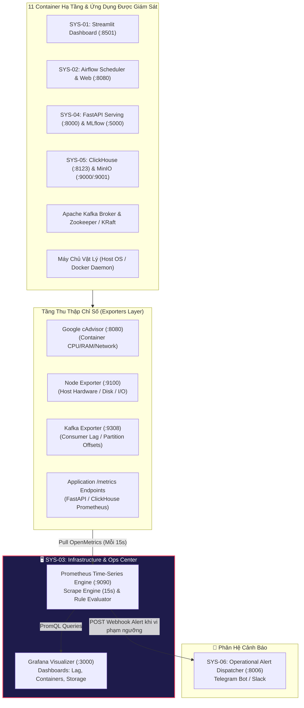
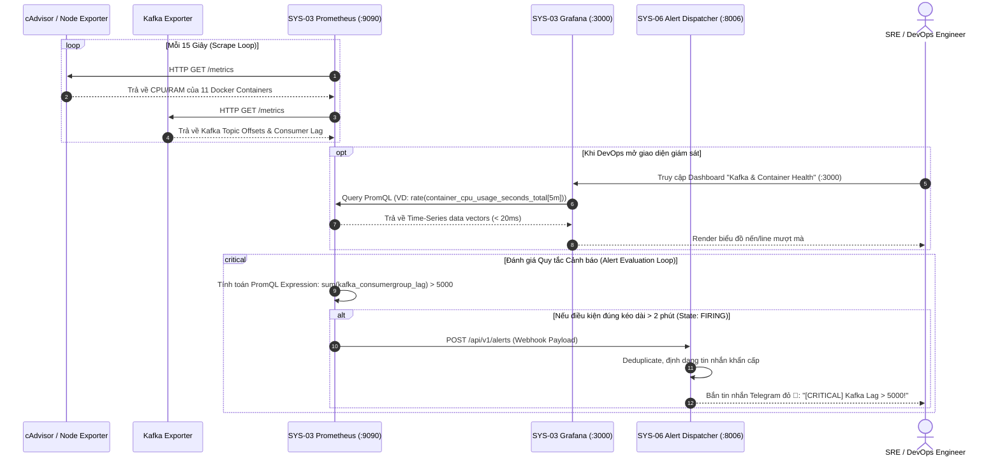

# 🏗️ SYS-03 BUILD PLAN: INFRASTRUCTURE & OPERATIONS CENTER (SYS-OPS)

> **Mã phân hệ**: `SYS-03`  
> **Tên phân hệ**: Infrastructure & Operations Center (SYS-OPS)  
> **Phiên bản tài liệu**: 2.0 (Planning & Implementation Specification)  
> **Cổng truy cập mặc định**: Grafana (`http://localhost:3000`) | Prometheus (`http://localhost:9090`)  
> **Tham chiếu gốc**: `Plan/master_plan(update_2026_08_07).html` & `Plan/systems_docs/03_Infrastructure_Operations_Center.md`

---

## 📋 1. TỔNG QUAN & MỤC TIÊU HỆ THỐNG (SYSTEM OVERVIEW & OBJECTIVES)

### 1.1. Bối cảnh & Vai trò trong Nền tảng Enterprise Mini Company
Một nền tảng xử lý dữ liệu tài chính thời gian thực và trí tuệ nhân tạo (FinTech Big Data & AI Platform) bao gồm 11 container hoạt động liên tục với tải lượng cao (high throughput). Nếu một nút thắt cổ chai (bottleneck) xảy ra tại Kafka hoặc ClickHouse mà không được phát hiện ngay lập tức, toàn bộ dữ liệu thị trường sẽ bị trễ, dẫn đến mô hình AI suy luận sai thời điểm.

**SYS-03** đóng vai trò là **Trung tâm điều hành an ninh và vận hành hạ tầng (Systems Operations Center - SOC / Site Reliability Hub)**. Phân hệ hoạt động độc lập, đảm bảo khả năng quan sát toàn diện (Full-Stack Observability) bao gồm: Metrics (chỉ số phần cứng/container), Traces (độ trễ luồng dữ liệu), và Alert Triggers (kích hoạt cảnh báo vi phạm ngưỡng SLA).



### 1.2. Mục tiêu chiến lược (Strategic Goals)
1. **Bảo toàn tính thời gian thực (Zero-Latency Guarantee)**: Theo dõi chặt chẽ chỉ số **Kafka Consumer Lag** giữa luồng nạp Binance Ingestion Worker và luồng xử lý Spark Streaming. Lag phải luôn duy trì `< 5,000 records`.
2. **Ngăn chặn rò rỉ tài nguyên (Memory Leak & OOM Prevention)**: Cảnh báo tự động khi dung lượng RAM của bất kỳ container nào (đặc biệt là Spark, ClickHouse, Airflow) vượt ngưỡng 85%.
3. **Giám sát dung lượng ổ đĩa lưu trữ (Disk Exhaustion Protection)**: Cảnh báo sớm khi phân vùng lưu trữ Lakehouse MinIO và ClickHouse đạt mức sử dụng `> 80%`.
4. **Tích hợp cảnh báo đa kênh tức thời**: Khi phát hiện bất thường hạ tầng, tự động đóng gói JSON Alert chuyển sang SYS-06 để gửi tin nhắn Telegram tới đội ngũ kỹ thuật trong vòng `< 30 giây`.

---

## 🎯 2. YÊU CẦU KỸ THUẬT CHI TIẾT (REQUIREMENTS & SPECIFICATIONS)

### 2.1. Yêu cầu chức năng (Functional Requirements - FR)
* **FR-01 (Automated Metrics Scraping)**: Tự động kéo (pull) định kỳ chỉ số từ tất cả Exporters và dịch vụ nội bộ qua giao thức HTTP OpenMetrics/Prometheus Text format.
* **FR-02 (Kafka Streaming Lag Monitoring)**: Trực quan hóa chi tiết Consumer Group `crypto-spark-group` trên các topic `crypto-trades` và `crypto-klines`.
* **FR-03 (Docker Container Performance Dashboard)**: Đo lường % CPU sử dụng, Megabytes RAM tiêu thụ, Tốc độ I/O đĩa cứng (Read/Write bytes/sec) và Băng thông mạng (Rx/Tx bytes) của từng container.
* **FR-04 (Host Hardware Dashboard)**: Đo lường tình trạng máy chủ vật lý: Nhiệt độ CPU, % Dung lượng ổ đĩa (Root Disk), RAM khả dụng và System Load Average (1m, 5m, 15m).
* **FR-05 (FastAPI Serving Performance)**: Đo lường thông lượng request (Request/sec), Tỷ lệ lỗi HTTP 5xx, và Phân vị độ trễ (P50, P95, P99 Latency) của SYS-04.
* **FR-06 (Automated Rule Evaluation & Alerting)**: Bộ máy đánh giá quy tắc (Rule Evaluation Engine) của Prometheus quét mỗi 15s để phát hiện sự cố.
* **FR-07 (Pre-provisioned Dashboards & Data Sources)**: Khởi động Grafana hoàn toàn tự động (Zero-Configuration) bằng file provisioning YAML/JSON, không cần thao tác bấm chuột cấu hình thủ công.

### 2.2. Yêu cầu phi chức năng (Non-Functional Requirements - NFR) & SLA
| Tiêu chí | Ngưỡng cam kết (SLA) | Giải pháp kỹ thuật |
| :--- | :--- | :--- |
| **Chu kỳ quét (Scrape Interval)** | `15 giây` | Cấu hình `scrape_interval: 15s` tối ưu giữa tính tức thời và tải CPU. |
| **Thời gian lưu trữ Metrics (Retention)** | `15 ngày` (hoặc tối đa `10GB`) | Flag `--storage.tsdb.retention.time=15d` của Prometheus. |
| **SLA Cảnh báo khẩn cấp (Alert SLA)** | `< 30 giây` từ khi phát sinh | `evaluation_interval: 15s` + Webhook HTTP POST sang SYS-06. |
| **Mức tiêu hao tài nguyên (Footprint)** | `< 512MB RAM` cho cả cụm | Prometheus cấu hình TSDB block size 2h, Grafana sử dụng SQLite siêu nhẹ. |
| **Tính độc lập & Cách ly** | 100% Isolated | Chạy trên container riêng, nếu các app nghiệp vụ bị sập, SYS-03 vẫn ghi nhận và cảnh báo được. |

---

## 🔄 3. QUY TRÌNH HOẠT ĐỘNG TOÀN DIỆN (WORKFLOW & SEQUENCE DIAGRAM)

### 3.1. Sơ đồ quy trình thu thập Metrics & Xử lý Cảnh báo tự động



### 3.2. Danh mục các Quy tắc Cảnh báo Trọng yếu (Critical Alert Rules)
1. **ContainerDownAlert**: Bắn ngay lập tức (`for: 1m`) nếu bất kỳ container cốt lõi nào (`clickhouse_server`, `minio_s3`, `airflow_scheduler`, `fastapi_serving`) có metric `up == 0`.
2. **HighKafkaConsumerLag**: Bắn cảnh báo nếu tổng Consumer Lag của Spark Streaming vượt `5,000 records` trong `2m`.
3. **HostDiskSpaceRunningOut**: Bắn cảnh báo cấp độ Warning nếu dung lượng đĩa cứng trống `< 15%`, cấp độ Critical nếu `< 5%`.
4. **ContainerHighMemory**: Bắn cảnh báo nếu một container sử dụng `> 85%` giới hạn RAM được cấp phát trong `3m`.
5. **HighModelServingLatency**: Bắn cảnh báo nếu thời gian phản hồi P95 của FastAPI Serving vượt `300ms` trong `2m`.

---

## 🔗 4. KẾT NỐI TƯƠNG TÁC TỚI CÁC HỆ THỐNG CÒN LẠI (INTER-SYSTEM INTEGRATION)

SYS-03 đóng vai trò là "máy đo nhịp tim" (Telemetry Collector) kết nối tới mọi hệ thống trong đề tài:

| Phân hệ / Nguồn đích | Giao thức / Port | Chi tiết Endpoint kết nối | Vai trò & Dữ liệu thu thập |
| :--- | :--- | :--- | :--- |
| **SYS-01 (Dashboard)** | HTTP (`8501`) | `cadvisor:8080` (Cgroups) | Giám sát CPU/RAM của ứng dụng Streamlit, tránh rò rỉ bộ nhớ cache. |
| **SYS-02 (Airflow)** | HTTP (`8080`) / StatsD | `airflow_webserver:8080/health` | Giám sát tình trạng scheduler heartbeat, worker task concurrency. |
| **SYS-04 (MLOps/Serving)** | HTTP (`8000`) | `fastapi_serving:8000/metrics` | Thu thập Prometheus metric: latency, throughput, error rate, GPU/CPU inference. |
| **SYS-05 (Lakehouse/DB)** | HTTP (`8123` / `9000`) | `clickhouse:9363/metrics`<br/>`minio:9000/minio/v2/metrics/cluster` | Giám sát số lượng query đồng thời, dung lượng disk partition, IOPS. |
| **Apache Kafka Broker** | HTTP (`9308`) | `kafka_exporter:9308/metrics` | Lấy chỉ số `kafka_consumergroup_lag`, `kafka_topic_partitions`. |
| **Host OS Máy chủ** | HTTP (`9100`) | `node_exporter:9100/metrics` | Giám sát tài nguyên phần cứng vật lý toàn bộ máy chủ. |
| **SYS-06 (Alert Dispatcher)**| HTTP POST (`8006`) | `sys06_alert_dispatcher:8006/api/v1/alerts` | Điểm đến duy nhất khi có Alert vi phạm: đẩy JSON webhook để dispatch Telegram. |

### Hợp đồng Webhook JSON gửi sang SYS-06 (Alertmanager to SYS-06):
```json
{
  "alert_type": "INFRASTRUCTURE_FAILURE",
  "level": "CRITICAL",
  "source_system": "SYS-03",
  "event": "HIGH_KAFKA_CONSUMER_LAG",
  "deduplicate_key": "infra:kafka:consumer_lag:spark_group",
  "receiver_roles": ["devops", "sre", "data_engineer"],
  "channels": ["telegram"],
  "message": "Kafka Consumer Lag for group 'crypto-spark-group' exceeded 5,000 messages (current: 7,420). Risk of real-time data delay!",
  "metadata": {
    "consumer_group": "crypto-spark-group",
    "topic": "crypto-trades",
    "current_lag": 7420,
    "threshold": 5000,
    "duration": "2m"
  }
}
```

---

## 🛠️ 5. ĐÁNH GIÁ TECH STACK & CÁC LỰA CHỌN THAY THẾ (TECH STACK EVALUATION & ALTERNATIVES)

### 5.1. Tech Stack đề xuất chính (Primary Proposed Stack)
* **Metrics Collector & TSDB**: **Prometheus 2.45+ (LTS)** (Ngôn ngữ PromQL, pull-based architecture siêu chuẩn).
* **Metrics Visualization**: **Grafana 10.x** (Mã nguồn mở, giao diện Dark Theme chuyên nghiệp, hỗ trợ auto-provisioning).
* **Container Metrics Harvester**: **Google cAdvisor** (Đọc trực tiếp Linux Cgroups, không cần can thiệp code ứng dụng).
* **Host Metrics Harvester**: **Node Exporter** (Chuẩn công nghiệp cho giám sát phần cứng Linux).
* **Kafka Telemetry Harvester**: **Kafka Exporter** (Trích xuất partition offsets chính xác tuyệt đối).

### 5.2. Bảng so sánh toàn diện các giải pháp thay thế tương đương

| Giải pháp Công nghệ | Ưu điểm (Pros) | Nhược điểm (Cons) | Mức độ phù hợp với Đồ án Tốt nghiệp |
| :--- | :--- | :--- | :--- |
| **Prometheus + Grafana (Lựa chọn chính đề xuất)** | - Tiêu chuẩn số 1 thế giới cho hệ sinh thái Microservices & Docker.<br/>- Nhẹ tài nguyên cực đỉnh: cả Prometheus + Grafana chỉ tốn ~350MB RAM.<br/>- Đầy đủ Exporters dựng sẵn cho Kafka, Linux, Node, Database.<br/>- Tự động hóa qua Provisioning YAML (1-click run). | - Chỉ tối ưu cho số liệu thời gian (Metrics Time-series), không lưu Log chi tiết dạng văn bản (text log). | ⭐⭐⭐⭐⭐ **10/10 (Tiêu chuẩn vàng)**: Đạt điểm tối đa về tính khoa học, độ tin cậy và sự tối ưu tài nguyên cho máy tính cá nhân. |
| **ELK / EFK Stack (Elasticsearch, Logstash/Fluentd, Kibana)** | - Giám sát Log văn bản sâu từ tất cả container.<br/>- Khả năng tìm kiếm từ khóa mạnh mẽ. | - Ngốn RAM khủng khiếp: Elasticsearch một mình đã yêu cầu tối thiểu 2GB - 4GB RAM.<br/>- Nếu chạy chung với 11 Docker container khác trên máy 16GB RAM sẽ dễ gây Out-Of-Memory (OOM). | ⭐⭐⭐ **6.0/10 (Quá nặng cho đồ án)**: Không phù hợp khi mục tiêu trọng tâm của SYS-03 là giám sát độ trễ (Lag) và tài nguyên thời gian thực. |
| **VictoriaMetrics + Grafana** | - Tương thích 100% chuẩn PromQL.<br/>- Tốc độ nén và lưu trữ tốt hơn Prometheus truyền thống, tốn ít RAM hơn nữa. | - Tài liệu cộng đồng và các tutorial cho đồ án sinh viên ít hơn Prometheus chuẩn.<br/>- Thừa thãi với quy mô 1 máy chủ demo 11 container. | ⭐⭐⭐⭐ **8.5/10 (Phương án thay thế tốt)**: Hoàn toàn có thể thay thế Prometheus nếu máy chủ bị hạn chế RAM dưới 8GB. |
| **OpenTelemetry (OTel) Collector + SigNoz** | - Hợp nhất Metrics, Traces và Logs vào một công cụ hiện đại.<br/>- Đạt chuẩn tương lai Cloud-Native. | - Cấu hình phức tạp, đòi hỏi phải nhúng SDK trace vào từng dịch vụ mã nguồn (Python, Spark, ClickHouse).<br/>- Giao diện SigNoz vẫn đang phát triển, đòi hỏi ClickHouse backend riêng biệt. | ⭐⭐⭐ **7.0/10 (Phức tạp quá mức cần thiết)**: Làm tăng khối lượng công việc phi chức năng không cần thiết cho đồ án. |
| **Cloud APM (Datadog / New Relic / Grafana Cloud)** | - Cực kỳ mạnh mẽ, giao diện đẹp, cài đặt 1 câu lệnh agent. | - Có phí hoặc giới hạn nghiêm ngặt ở bản Free Tier.<br/>- Đòi hỏi internet liên tục, không độc lập (air-gapped) trên môi trường demo bảo vệ đồ án offline. | ⭐⭐ **4.0/10 (Không khuyến nghị)**: Không phù hợp tiêu chí mã nguồn mở và tự chủ 100% của đề tài tốt nghiệp. |

---

## 📁 6. CẤU TRÚC THƯ MỤC TRIỂN KHAI DỰ KIẾN (DIRECTORY STRUCTURE)

Dưới đây là cấu trúc thư mục chuẩn bị build cho `Systems-Graduation-Thesis/SYS-03`:

```
SYS-03/
├── .env.example                          # Template cấu hình cổng và secret
├── .gitignore                            # Bỏ qua dữ liệu tsdb data
├── docker-compose.yml                    # Khởi chạy Prometheus, Grafana, cAdvisor, Node/Kafka Exporter
├── README.md                             # Giới thiệu phân hệ
├── CONTEXT.md                            # Thuật ngữ & Mô hình miền
├── docs/
│   └── BUILD_PLAN.md                     # Tài liệu quy hoạch kỹ thuật chi tiết này
├── prometheus/
│   ├── prometheus.yml                    # Cấu hình Scrape Targets (15s)
│   └── alert_rules.yml                   # Định nghĩa quy tắc cảnh báo (Container down, Lag > 5000)
├── grafana/
│   ├── provisioning/
│   │   ├── datasources/
│   │   │   └── prometheus_datasource.yml # Tự động kết nối tới Prometheus mà không cần bấm tay
│   │   └── dashboards/
│   │       └── dashboards.yml            # Tự động nạp danh sách file JSON Dashboard
│   └── dashboards/
│       ├── 01_system_overview.json       # Dashboard tổng quan 11 containers CPU/RAM
│       ├── 02_kafka_streaming_lag.json   # Dashboard chuyên sâu độ trễ Kafka Streaming
│       └── 03_fastapi_serving_perf.json  # Dashboard hiệu năng phục vụ AI Inference
└── tests/
    ├── __init__.py
    ├── test_prometheus_syntax.py         # Kiểm tra cú pháp file YAML promtool check config
    ├── test_alert_rules.py               # Unit test các biểu thức PromQL quy tắc cảnh báo
    └── test_exporters_connectivity.py    # Kiểm tra healthcheck các cổng Exporters
```

---

## 📅 7. LỘ TRÌNH TRIỂN KHAI THEO CÁC PHASE (STEP-BY-STEP ROADMAP)

* **Phase 00: Telemetry Architecture & Exporters Mapping**: Xác định chi tiết IP/Port của từng service trong Docker network `fintech_net`.
* **Phase 01: Core Exporters Provisioning**: Viết `docker-compose.yml` cho cAdvisor, Node Exporter và Kafka Exporter; kiểm tra endpoint `/metrics`.
* **Phase 02: Prometheus Core Engine & Scraping Configuration**: Cấu hình `prometheus.yml`, thiết lập scrape interval 15s cho toàn bộ 11 container.
* **Phase 03: Alert Rules & SYS-06 Webhook Integration**: Soạn thảo `alert_rules.yml`, cấu hình webhook đẩy cảnh báo JSON sang SYS-06 Dispatcher.
* **Phase 04: Grafana Datasource & Dashboard Provisioning**: Viết các file JSON dashboard tự động nạp cho Kafka Lag và Container Metrics.
* **Phase 05: Simulated Load & Failure Testing**: Kích hoạt script mô phỏng nghẽn Kafka hoặc tắt thử ClickHouse để xác minh biểu đồ Grafana đổi màu và cảnh báo bắn về Telegram.
* **Phase 06: Verification & Final Polish**: Tối ưu hóa tài nguyên RAM `< 500MB`, hoàn thiện tài liệu hướng dẫn vận hành.

---

## 🧪 8. KẾ HOẠCH KIỂM THỬ & VẬN HÀNH (VERIFICATION & RUNBOOK)

### 8.1. Kiểm thử cú pháp & tính toàn vẹn cấu hình (Automated Linting)
```bash
# Kiểm tra tính hợp lệ của file cấu hình Prometheus
docker run --rm -v $(pwd)/prometheus:/etc/prometheus prom/prometheus promtool check config /etc/prometheus/prometheus.yml

# Kiểm tra tính hợp lệ của các biểu thức cảnh báo PromQL
docker run --rm -v $(pwd)/prometheus:/etc/prometheus prom/prometheus promtool check rules /etc/prometheus/alert_rules.yml
```

### 8.2. Tiêu chuẩn nghiệm thu vận hành (Operational Acceptance Criteria)
1. Mở `http://localhost:3000`: Đăng nhập Grafana tự động hoặc bằng `admin:admin`, thấy ngay 3 Dashboards sẵn sàng hoạt động.
2. Kiểm tra chỉ số `kafka_consumergroup_lag`: Giá trị hiển thị đúng dữ liệu thực tế từ Kafka cluster.
3. Thử nghiệm kịch bản sự cố (Chaos Test): Chạy `docker stop clickhouse_server` -> Trong vòng **30 giây**, một thông báo màu đỏ xuất hiện trên SYS-06 và Telegram thông báo `ContainerDown: clickhouse_server`.
