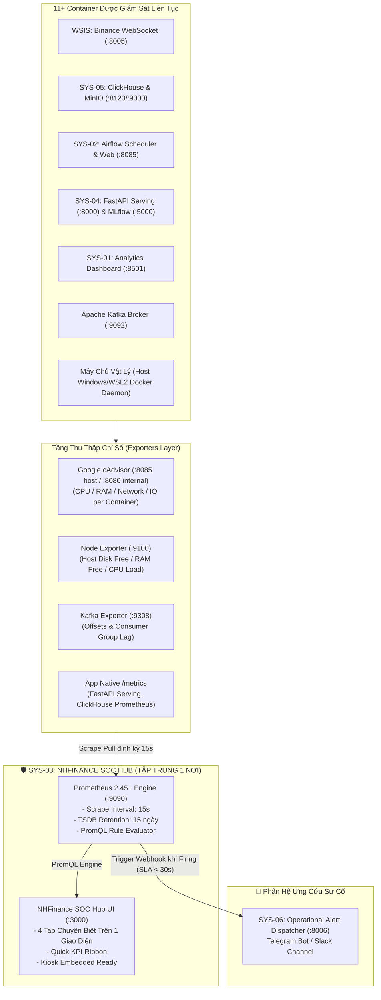
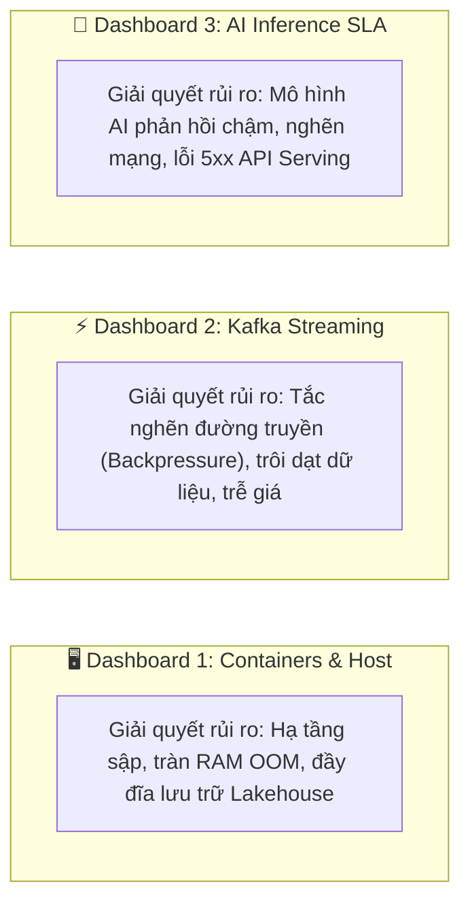

# 🛡️ KẾ HOẠCH TOÀN DIỆN XÂY DỰNG PHÂN HỆ SYS-03
## NHFinance Infrastructure & Operations Center (NHFinance SOC Hub)

> **Mã phân hệ**: `SYS-03`  
> **Tên phân hệ**: Infrastructure & Operations Center (SYS-OPS / Site Reliability & Telemetry Hub)  
> **Thương hiệu định danh**: **NHFinance SOC Hub** (Hội tụ toàn bộ Dashboard về một nơi duy nhất)  
> **Phiên bản kế hoạch**: `3.0-Production-Ready (Single Pane of Glass Architecture)`  
> **Cổng truy cập mặc định**:
> - **NHFinance SOC Hub (Grafana Unified Operations)**: `http://localhost:3000` *(Credentials: admin/admin)*
> - **Prometheus Time-Series Engine**: `http://localhost:9090`
> - **Cổng Exporters nội bộ**: cAdvisor (`:8085` host / `:8080` docker), Node Exporter (`:9100`), Kafka Exporter (`:9308`)  
> **Phạm vi áp dụng**: Độc quyền nội bộ thư mục phân hệ `Systems-Graduation-Thesis/SYS-03/`

---

## 📋 MỤC LỤC TÀI LIỆU QUY HOẠCH
1. [Phần 1: Bối Cảnh, Vai Trò & Mục Tiêu Chiến Lược](#-phần-1-bối-cảnh-vai-trò--mục-tiêu-chiến-lược)
2. [Phần 2: Đặc Tả Chi Tiết 3 Dashboard Nghiệp Vụ Chuyên Sâu](#-phần-2-đặc-tả-chi-tiết-3-dashboard-nghiệp-vụ-chuyên-sâu)
3. [Phần 3: Kiến Trúc "NHFinance SOC Hub" - Hội Tụ Về Một Nơi Duy Nhất](#-phần-3-kiến-trúc-nhfinance-soc-hub---hội-tụ-về-một-nơi-duy-nhất)
4. [Phần 4: Lựa Chọn Tech Stack & Cấu Hình Cổng Mạng (Port Mapping)](#-phần-4-lựa-chọn-tech-stack--cấu-hình-cổng-mạng-port-mapping)
5. [Phần 5: Hệ Thống Quy Tắc Cảnh Báo (Alert Rules) & Tích Hợp SYS-06](#-phần-5-hệ-thống-quy-tắc-cảnh-báo-alert-rules--tích-hợp-sys-06)
6. [Phần 6: Cấu Trúc Thư Mục Triển Khai Nội Bộ SYS-03](#-phần-6-cấu-trúc-thư-mục-triển-khai-nội-bộ-sys-03)
7. [Phần 7: Lộ Trình 6 Phase Triển Khai Sẵn Sàng Thực Thi (Roadmap)](#-phần-7-lộ-trình-6-phase-triển-khai-sẵn-sàng-thực-thi-roadmap)
8. [Phần 8: Kế Hoạch Kiểm Thử Tự Động & Tiêu Chuẩn Nghiệm Thu (Acceptance Criteria)](#-phần-8-kế-hoạch-kiểm-thử-tự-động--tiêu-chuẩn-nghiệm-thu-acceptance-criteria)

---

## 🎯 PHẦN 1: BỐI CẢNH, VAI TRÒ & MỤC TIÊU CHIẾN LƯỢC

### 1.1. Bối cảnh & Vị trí trong Hệ sinh thái Enterprise
Nền tảng **Financial Analytics & Fraud Detection Enterprise Platform** vận hành song song trên 11+ Docker containers liên tục nạp, biến đổi, huấn luyện và phục vụ dữ liệu tài chính thời gian thực từ Binance.
Nếu một nút thắt cổ chai (*bottleneck*) xảy ra tại Kafka hoặc ClickHouse mà không được phát hiện ngay lập tức:
- Dữ liệu thị trường sẽ bị trễ lũy kế (*consumer lag gia tăng*).
- Giá nến và tính toán chỉ báo kỹ thuật hiển thị sai lệch.
- Mô hình AI suy luận rủi ro và phát hiện gian lận sai thời điểm.

**SYS-03** đóng vai trò là **"Trung tâm điều hành an ninh và vận hành hạ tầng" (Systems Operations Center - SOC / Site Reliability Hub)**, đóng vai trò như chiếc **máy đo điện tim** của toàn bộ công ty:
- Thu thập và chuẩn hóa toàn bộ Telemetry (Metrics chuỗi thời gian) từ phần cứng, container, broker và ứng dụng AI.
- Đánh giá liên tục các chỉ số cam kết chất lượng dịch vụ (SLA Guardrails).
- Báo động tự động (< 30s) sang [SYS-06](file:///e:/Graduation_Thesis/Systems-Graduation-Thesis/SYS-06) khi có bất thường.



### 1.2. Bốn Mục tiêu chiến lược cốt lõi
1. **Kiểm soát độ trễ nạp dữ liệu (Zero-Latency Guarantee)**: Giám sát Kafka Consumer Lag giữa luồng nạp Binance và luồng xử lý Spark Streaming, cam kết **Lag < 5,000 records**.
2. **Bảo vệ an toàn tài nguyên máy chủ (OOM & Crash Prevention)**: Cảnh báo tự động trước khi container chạm ngưỡng **85% RAM limit** hoặc CPU quá tải kéo dài.
3. **Bảo vệ kho lưu trữ dữ liệu (Disk Exhaustion Protection)**: Giám sát phân vùng lưu trữ MinIO S3 và ClickHouse OLAP, cảnh báo sớm khi ổ cứng đầy **> 80%**.
4. **Giám sát chất lượng phục vụ mô hình AI (Model Serving SLA)**: Theo dõi độ trễ suy luận AI P95, cam kết **P95 < 50ms**, tỷ lệ lỗi HTTP 5xx = 0%.

---

## 📊 PHẦN 2: ĐẶC TẢ CHI TIẾT 3 DASHBOARD NGHIỆP VỤ CHUYÊN SÂU

Để quản trị toàn diện mà không bị phân tán thông tin, hệ thống phân định rõ ràng 3 lớp rủi ro tương ứng với **3 Dashboard chuyên biệt**:



### 2.1. Dashboard 1: Infrastructure & Docker Containers Health
* **Vấn đề cốt lõi giải quyết**: Trả lời câu hỏi *"Hạ tầng phần cứng và các container có đang sống khỏe không? Có container nào bị dừng đột ngột, ngốn kiệt RAM hay làm đầy ổ cứng không?"*
* **Đối tượng theo dõi**: 11 container Docker trong mạng `fintech_net` và hệ điều hành máy chủ vật lý (Host OS).
* **Các chỉ số kỹ thuật cụ thể**:
  1. **Container Up/Down Matrix**: Bảng ma trận trạng thái tức thời (Online / Offline / Restarting) của từng service.
  2. **CPU Utilization Percentage**: Tỷ lệ % CPU tiêu thụ của từng container theo công thức PromQL:
     $$\text{rate}(\text{container\_cpu\_usage\_seconds\_total}[5m]) \times 100$$
  3. **Memory Working Set vs Limit**: Đo lường dung lượng RAM thực tế tiêu thụ so với giới hạn định mức, cảnh báo nguy cơ bị Linux Kernel kích hoạt *OOM Killer*.
  4. **Host Disk Space Free %**: Tỷ lệ dung lượng ổ cứng còn trống của máy chủ chứa phân vùng dữ liệu MinIO (`crypto-bronze`, `crypto-silver`) và bảng ClickHouse.
  5. **Network I/O & Disk I/O Throughput**: Tốc độ đọc/ghi đĩa cứng (Bytes/s) và lưu lượng mạng ra/vào từng container.

### 2.2. Dashboard 2: Kafka Streaming & Backpressure Center
* **Vấn đề cốt lõi giải quyết**: Trả lời câu hỏi *"Dòng dữ liệu tài chính Binance có bị nghẽn (tắc đường) không? Spark Streaming có bắt kịp tốc độ giao dịch cực nhanh của sàn không?"*
* **Đối tượng theo dõi**: Cụm Apache Kafka Broker, các Topics (`crypto-trades`, `crypto-klines`) và Consumer Group (`crypto-spark-group`).
* **Các chỉ số kỹ thuật cụ thể**:
  1. **Kafka Consumer Lag (Chỉ số huyết mạch)**: Đo lường tổng số bản tin đang bị ứ đọng trên toàn bộ các partitions chưa được consumer tiêu thụ.
  2. **Ngưỡng SLA Visual Threshold**: Đường tham chiếu cảnh báo đỏ ở mức **5,000 records** (khi vượt ngưỡng, panel đổi sang màu đỏ rực).
  3. **Partition Offset Progress**: So sánh vị trí con trỏ Log End Offset (Producer nạp vào) và Current Offset (Spark đã xử lý).
  4. **Message Ingestion & Consumption Rate**: Biểu đồ so sánh tốc độ nạp (msg/s) và tốc độ rút (msg/s) để phát hiện hiện tượng *Backpressure* (nạp nhanh hơn xử lý).

### 2.3. Dashboard 3: AI Model Serving & Query Engine Performance
* **Vấn đề cốt lõi giải quyết**: Trả lời câu hỏi *"Mô hình AI dự đoán giá LSTM và phát hiện gian lận LightGBM (SYS-04) phục vụ có nhanh không? Tốc độ truy vấn kho dữ liệu ClickHouse có đạt chuẩn không?"*
* **Đối tượng theo dõi**: FastAPI Model Serving Engine (Port 8000), MLflow Server (Port 5000), ClickHouse OLAP Engine (Port 8123).
* **Các chỉ số kỹ thuật cụ thể**:
  1. **Inference Latency Percentiles (P50, P95, P99)**: Phân vị thời gian phản hồi API phục vụ AI. Cam kết SLA P95 phải $\le 50\text{ms}$.
  2. **Throughput (Requests Per Second - RPS)**: Tần suất các truy vấn dự báo giá và chấm điểm gian lận từ người dùng hoặc hệ thống khác.
  3. **HTTP Status Code Breakdown**: Phân loại tỷ lệ phản hồi 2xx (Thành công), 4xx (Sai định dạng), và 5xx (Lỗi hệ thống).
  4. **ClickHouse Active Query Count & Execution Time**: Số lượng truy vấn phân tích đồng thời và thời gian thực thi trung bình (SLA ClickHouse < 10ms).

---

## 🏢 PHẦN 3: KIẾN TRÚC "NHFINANCE SOC HUB" - HỘI TỤ VỀ MỘT NƠI DUY NHẤT

### 3.1. Triết lý "Single Pane of Glass" (Đồng bộ với NHFinance Admin Portal)
Người dùng và ban giám khảo không cần phải nhớ nhiều đường link phức tạp hay chuyển đổi qua lại giữa các cửa sổ riêng lẻ. Phân hệ SYS-03 được tổ chức thành **NHFinance SOC Hub** - một trung tâm vận hành tập trung:
* Toàn bộ 3 Dashboard nghiệp vụ cùng bảng tin cảnh báo sự cố được tích hợp vào **1 địa chỉ truy cập duy nhất**: `http://localhost:3000`.
* Giao diện Dark Theme hiện đại, đồng nhất thương hiệu và trải nghiệm với **NHFinance Admin Portal** (`http://localhost:8090`).
* Tích hợp **Kiosk/Embedded Mode**: Cho phép nhúng trực tiếp toàn bộ màn hình điều hành vào Admin Portal mà không để lộ các thanh công cụ quản trị phức tạp của Grafana.

```
+--------------------------------------------------------------------------------------------------------------------+
|  NHFINANCE SOC HUB - ENTERPRISE OPERATIONS CENTER                                                      [15s Sync]  |
+--------------------------------------------------------------------------------------------------------------------+
|  [QUICK KPI RIBBON]                                                                                                |
|  • Containers: 11/11 UP  |  • Kafka Lag: 142 msgs (OK)  |  • AI P95: 18.2ms (OK)  |  • Alerts: 0  |  • User: Admin   |
+--------------------------------------------------------------------------------------------------------------------+
|  [NAVIGATION TABS]                                                                                                 |
|  [ 🟢 1. Containers ]  [ ⚡ 2. Kafka Lag ]  [ 🧠 3. AI SLA ]  [ 🚨 4. Alert Logs ]  [ 👤 5. Profile & RBAC Sync ]  |
+--------------------------------------------------------------------------------------------------------------------+
|                                                                                                                    |
|   NỘI DUNG HIỂN THỊ TƯƠNG ỨNG THEO TAB ĐƯỢC CHỌN (100% TRỰC QUAN HÓA THỜI GIAN THỰC)                               |
|                                                                                                                    |
|   - Không chuyển trang, không reload lại trình duyệt                                                               |
|   - Tự động quét và cập nhật số liệu mỗi 15 giây                                                                   |
|   - Thanh chỉ thị màu trực quan (Xanh: Bình thường | Vàng: Cảnh báo | Đỏ: Nguy hiểm)                                |
|   - Tab 5: Đồng bộ thông tin Profile, Chức vụ & Quyền hạn trực tiếp từ NHFinance Admin Portal                     |
|                                                                                                                    |
+--------------------------------------------------------------------------------------------------------------------+
```

### 3.2. Đặc Tả Chi Tiết Tab 5: Profile & RBAC Security (Đồng Bộ Admin Portal)
Để đảm bảo tính nhất quán danh tính trên toàn bộ nền tảng Enterprise, **Tab 5 (Profile & RBAC Sync)** tích hợp đồng bộ dữ liệu người dùng từ kho tài khoản tập trung (`Admin_Portal/backend/app/data/profiles.json`):

1. **Thông tin định danh người dùng (Operator Identity Card)**:
   - **Tài khoản**: `nhfinanceadmin` (Super Admin), `data_engineer` (Data Platform Lead), `aieingineer` (AI Engineer).
   - **Trường dữ liệu đồng bộ**: Full Name, Username, Email liên lạc nội bộ, Role, Status (`ACTIVE`/`INACTIVE`), Last Login, Last Activity.
   - **Trạng thái kết nối**: Đèn xanh Online/Offline theo thời gian thực (Timezone GMT+7 Hà Nội).
2. **Ma trận Phân quyền Vận hành SOC (SOC Operational RBAC Matrix)**:
   - `view_telemetry_metrics`: Cho phép theo dõi realtime 3 dashboards (Toàn bộ roles).
   - `acknowledge_system_alerts`: Cho phép xác nhận và phản hồi thông báo sự cố (Super Admin, DevOps, Data Engineer).
   - `manage_soc_dashboards`: Phân quyền chỉnh sửa hoặc tạo thêm metric panels (Super Admin).
   - `export_incident_audit`: Xuất nhật ký sự cố và vi phạm SLA phục vụ báo cáo tuân thủ (Audit Trail).
3. **Cơ chế Đồng bộ Phiên (Session & SSO Sync)**:
   - Sử dụng chung cơ chế giải mã JSON Web Token (JWT) hoặc cookie xác thực với Admin Portal (`:8090`).
   - Đảm bảo khi quản trị viên đăng nhập tại Admin Portal, chuyển sang SOC Hub sẽ giữ nguyên phiên làm việc và danh tính mà không cần đăng nhập lại.

### 3.3. Cấu hình Grafana Provisioning Tự Động (Zero-Touch Setup)
Hệ thống loại bỏ hoàn toàn việc click chuột cấu hình thủ công. Toàn bộ thiết lập được tự động hóa thông qua mã nguồn:
1. **Datasource Provisioning**: Tự động kết nối tới Prometheus (`http://prometheus:9090`) khi container vừa khởi động.
2. **Dashboard Provisioning**: Tự động nạp sẵn các file JSON Dashboard vào thư mục mặc định của Grafana.
3. **Anonymous Viewer Access**: Cho phép xem ngay lập tức giao diện SOC Hub mà không bắt buộc người chấm thi phải đăng nhập tài khoản.


---

## 🛠️ PHẦN 4: LỰA CHỌN TECH STACK & CẤU HÌNH CỔNG MẠNG (PORT MAPPING)

### 4.1. Bảng lựa chọn công nghệ
| Thành phần | Công nghệ lựa chọn | Vai trò trong SYS-03 | Lý do lựa chọn tối ưu cho đề tài |
| :--- | :--- | :--- | :--- |
| **Time-Series Engine** | **Prometheus 2.45+ LTS** | Quét (Scrape) và lưu trữ Metrics | Cơ chế Pull cực nhẹ (~150MB RAM), cú pháp PromQL mạnh mẽ, chuẩn mở OpenMetrics. |
| **Visualization Platform** | **Grafana 10.x** | Giao diện hiển thị NHFinance SOC Hub | Hỗ trợ cấu hình tự động (Provisioning) 100% bằng code, giao diện Dark Mode FinTech đỉnh cao. |
| **Container Collector** | **Google cAdvisor** | Thu thập chỉ số Docker Containers | Đọc trực tiếp Linux Cgroups từ Docker Engine, không cần sửa đổi mã nguồn ứng dụng. |
| **Host System Collector**| **Node Exporter** | Thu thập phần cứng Host | Tiêu chuẩn đo lường CPU, RAM, Disk, Load Average của hệ điều hành. |
| **Streaming Collector** | **Kafka Exporter** | Thu thập chỉ số Apache Kafka | Trích xuất chính xác partition offsets và consumer lag của Kafka. |

### 4.2. Ma trận cổng mạng (Port Mapping) nội bộ và đối ngoại
```
Docker Network: fintech_net (Bridge Network dùng chung toàn hệ sinh thái)
```
* **Dịch vụ đối ngoại (Host Access)**:
  * `http://localhost:3000`: **NHFinance SOC Hub (Grafana)**
  * `http://localhost:9090`: **Prometheus Web Query Console**
  * `http://localhost:8085`: **cAdvisor Metrics Web Inspector**
* **Dịch vụ nội bộ (Internal Docker Targets)**:
  * `cadvisor:8080/metrics`
  * `node_exporter:9100/metrics`
  * `kafka_exporter:9308/metrics`
  * `fastapi_serving:8000/metrics` (kết nối SYS-04)
  * `clickhouse:9363/metrics` (kết nối SYS-05)

---

## 🚨 PHẦN 5: HỆ THỐNG QUY TẮC CẢNH BÁO (ALERT RULES) & TÍCH HỢP SYS-06

### 5.1. Danh mục 5 Quy tắc Cảnh báo Trọng yếu (`alert_rules.yml`)
Prometheus liên tục đánh giá các biểu thức PromQL mỗi **15 giây**. Nếu vi phạm kéo dài quá thời gian chờ (*for duration*), hệ thống chuyển sang trạng thái **FIRING**:

| STT | Tên Cảnh Báo (Alert Name) | Biểu thức PromQL | Thời gian giữ | Mức độ | Ý nghĩa vận hành |
| :---: | :--- | :--- | :---: | :---: | :--- |
| **1** | **ServiceDown** | `up == 0` | `1m` | `CRITICAL` | Bất kỳ container cốt lõi nào (ClickHouse, MinIO, Airflow, FastAPI) bị tắt. |
| **2** | **HighKafkaConsumerLag** | `sum(kafka_consumergroup_lag) > 5000` | `2m` | `CRITICAL` | Spark Streaming bị chậm hơn luồng Binance > 5,000 bản tin, có nguy cơ trễ giá. |
| **3** | **ContainerHighMemory** | `(container_memory_usage_bytes / container_spec_memory_limit_bytes) > 0.85` | `3m` | `WARNING` | Container vượt 85% hạn mức RAM, có nguy cơ bị sập do OOM. |
| **4** | **HostDiskSpaceLow** | `(node_filesystem_free_bytes / node_filesystem_size_bytes) < 0.15` | `5m` | `WARNING` | Dung lượng ổ đĩa máy chủ còn trống < 15%, cần dọn dẹp log/data. |
| **5** | **HighModelServingLatency**| `histogram_quantile(0.95, sum(rate(http_request_duration_seconds_bucket[5m])) by (le)) > 0.05` | `2m` | `WARNING` | Độ trễ suy luận AI P95 vượt 50ms theo cam kết SLA. |

### 5.2. Hợp đồng Webhook tích hợp với SYS-06
Khi một cảnh báo được kích hoạt, Prometheus Alertmanager tự động thực hiện **HTTP POST** sang cổng tiếp nhận của SYS-06 (`http://sys06_alert_dispatcher:8006/api/v1/alerts`):

```json
{
  "alert_type": "INFRASTRUCTURE_FAILURE",
  "level": "CRITICAL",
  "source_system": "SYS-03",
  "event": "HIGH_KAFKA_CONSUMER_LAG",
  "deduplicate_key": "infra:kafka:consumer_lag:crypto-spark-group",
  "receiver_roles": ["devops", "sre", "data_engineer"],
  "channels": ["telegram"],
  "message": "🚨 [SYS-03 ALERT] Kafka Consumer Lag for 'crypto-spark-group' exceeded 5,000 records (Current: 6,850). Risk of real-time pipeline latency!",
  "metadata": {
    "consumer_group": "crypto-spark-group",
    "topic": "crypto-trades",
    "threshold": 5000,
    "current_value": 6850,
    "duration": "2m"
  }
}
```

---

## 📁 PHẦN 6: CẤU TRÚC THƯ MỤC TRIỂN KHAI NỘI BỘ SYS-03

Toàn bộ quá trình triển khai được gói gọn **100% bên trong thư mục `SYS-03`**:

```
Systems-Graduation-Thesis/SYS-03/
├── .env                                  # Cấu hình biến môi trường cục bộ (Grafana creds, ports)
├── .env.example                          # Template mẫu biến môi trường
├── .gitignore                            # Loại trừ data TSDB cục bộ
├── docker-compose.yml                    # Định nghĩa dịch vụ: Prometheus, Grafana, cAdvisor, Node/Kafka Exporter
├── README.md                             # Tài liệu tổng quan phân hệ SYS-03
├── CONTEXT.md                            # Domain Model & Từ điển thuật ngữ vận hành
├── docs/
│   ├── BUILD_PLAN.md                     # Tài liệu kế hoạch gốc v2.0
│   ├── PLANNING_SYS03_SOC_HUB.md         # Bản quy hoạch toàn diện từ A-Z này (v3.0)
│   └── SYS03_Operations_Guide_A_to_Z.md  # Sách hướng dẫn vận hành và nghiệm thu hoàn chỉnh
├── prometheus/
│   ├── prometheus.yml                    # Cấu hình Scrape Targets (15s interval) cho 11 containers
│   └── alert_rules.yml                   # 5 quy tắc cảnh báo chuẩn PromQL
├── grafana/
│   ├── provisioning/
│   │   ├── datasources/
│   │   │   └── prometheus_datasource.yml # Auto-provisioning Prometheus datasource (Zero-config)
│   │   └── dashboards/
│   │       └── dashboards.yml            # Auto-provisioning danh sách Dashboards
│   └── dashboards/
│       ├── 01_system_overview.json       # Dashboard 1: 11 Containers Health, CPU, RAM, Disk
│       ├── 02_kafka_streaming_lag.json   # Dashboard 2: Kafka Streaming Lag & Backpressure
│       └── 03_fastapi_serving_perf.json  # Dashboard 3: AI Inference Latency, RPS & SLA
└── tests/
    ├── __init__.py
    ├── test_prometheus_syntax.py         # Kiểm tra tính hợp lệ cú pháp file cấu hình prometheus.yml
    ├── test_alert_rules.py               # Kiểm tra biểu thức PromQL của 5 quy tắc cảnh báo
    └── test_exporters_connectivity.py    # Kiểm tra tính sẵn sàng của các endpoint Exporter
```

---

## 🚀 PHẦN 7: LỘ TRÌNH 6 PHASE TRIỂN KHAI SẴN SÀNG THỰC THI (ROADMAP)

Triển khai lần lượt theo 6 phase khép kín, đảm bảo làm đến đâu chạy chắc đến đó:

* **Phase 01: Chuẩn bị Cấu hình Môi trường & Hạ tầng Exporters**
  - Tạo `.env`, `.env.example`.
  - Soạn thảo `docker-compose.yml` khởi tạo cAdvisor, Node Exporter, Kafka Exporter trên network `fintech_net`.
* **Phase 02: Xây dựng Prometheus Core Engine & Scraping Targets**
  - Soạn thảo `prometheus/prometheus.yml` gom đầy đủ targets (cAdvisor, Node Exporter, Kafka Exporter, FastAPI, ClickHouse).
  - Cấu hình scrape interval tối ưu: **15 giây**.
* **Phase 03: Thiết lập Hệ thống Quy tắc Cảnh báo (Alert Rules) & SYS-06 Adapter**
  - Soạn thảo `prometheus/alert_rules.yml` chứa 5 quy tắc chuẩn.
  - Cấu hình Webhook gửi tín hiệu sang `sys06_alert_dispatcher:8006`.
* **Phase 04: Xây dựng Giao diện "NHFinance SOC Hub" & 3 Dashboards Grafana**
  - Cấu hình file datasource provisioning tự động kết nối Prometheus.
  - Thiết kế 3 file JSON Dashboard hoàn chỉnh với theme Dark Mode FinTech.
  - Cấu hình chế độ nhúng an toàn (Allow Embedding) phục vụ tích hợp Portal.
* **Phase 05: Kiểm Thử Tự Động & Kịch Bản Chaos Test (Giả Lập Sự Cố)**
  - Viết test suite Python (`pytest`) kiểm tra cú pháp và kết nối mạng.
  - Chạy kịch bản Chaos Test: Tắt thử container ClickHouse để xác minh tin nhắn Telegram được bắn về trong < 30s.
* **Phase 06: Đóng Gói Sách Hướng Dẫn Vận Hành & Bàn Giao**
  - Soạn thảo tài liệu `SYS03_Operations_Guide_A_to_Z.md`.
  - Cập nhật tài liệu `README.md` chính của SYS-03.

---

## 🧪 PHẦN 8: KẾ HOẠCH KIỂM THỬ TỰ ĐỘNG & TIÊU CHUẨN NGHIỆM THU

### 8.1. Kiểm thử tự động (Automated Verification)
1. **Kiểm tra cú pháp cấu hình Prometheus**:
   - Sử dụng công cụ `promtool` để xác thực tính hợp lệ của `prometheus.yml` và `alert_rules.yml`.
2. **Kiểm thử kết nối mạng Exporter**:
   - Chạy script pytest kiểm tra các cổng `8085`, `9100`, `9308`, `9090`, `3000`.

### 8.2. Tiêu chuẩn nghiệm thu vận hành (Acceptance Criteria)
1. Mở `http://localhost:3000`: Giao diện **NHFinance SOC Hub** hiển thị ngay lập tức, không báo lỗi thiếu Datasource, nạp đủ 3 Dashboards.
2. Kiểm tra chỉ số Kafka Lag: Hiển thị đúng dữ liệu thực tế từ Kafka cluster và hiển thị đường cảnh báo đỏ ở mức 5,000 records.
3. Thử nghiệm kịch bản sự cố (Chaos Test): Chạy `docker stop clickhouse_server` -> Trong vòng **30 giây**, một thông báo màu đỏ xuất hiện trên SYS-06 và gửi tin nhắn Telegram tới nhóm DevOps.
4. Tổng dung lượng RAM của toàn bộ cụm SYS-03 (Prometheus + Grafana + Exporters) duy trì **< 500MB RAM**.

---

> **TRẠNG THÁI HIỆN TẠI**: Bản quy hoạch chi tiết đã được đồng bộ và sẵn sàng 100%. Khi được kích hoạt lệnh bắt đầu, hệ thống sẽ tiến hành khởi công ngay từ **Phase 01**.
