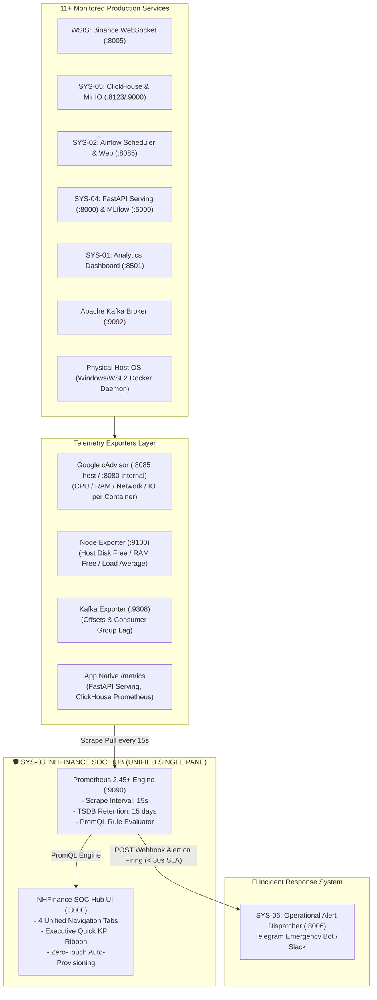
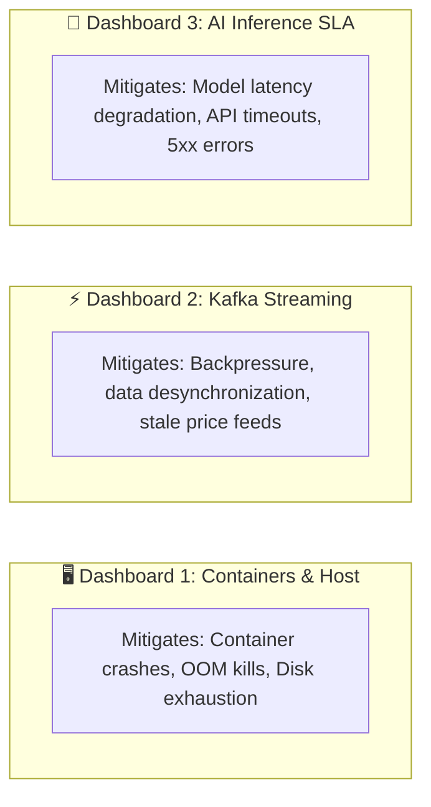

# 🛡️ MASTER ENGINEERING PLAN: SYS-03
## NHFinance Infrastructure & Operations Center (NHFinance SOC Hub)

> **System Code**: `SYS-03`  
> **System Name**: Infrastructure & Operations Center (SYS-OPS / Site Reliability & Telemetry Hub)  
> **Operational Brand**: **NHFinance SOC Hub** (Unified Single Pane of Glass Architecture)  
> **Specification Version**: `3.0-Production-Ready (Decoupled & Unified Operations Hub)`  
> **Default Service Ports**:
> - **NHFinance SOC Hub (Grafana Unified Operations UI)**: `http://localhost:3000` *(Credentials: admin/admin)*
> - **Prometheus Time-Series Engine**: `http://localhost:9090`
> - **Internal Telemetry Exporters**: cAdvisor (`:8085` host / `:8080` docker), Node Exporter (`:9100`), Kafka Exporter (`:9308`)  
> **Working Directory Scope**: Strictly internal to `Systems-Graduation-Thesis/SYS-03/`

---

## 📋 TABLE OF CONTENTS
1. [Section 1: Ecosystem Context, Role & Strategic Objectives](#-section-1-ecosystem-context-role--strategic-objectives)
2. [Section 2: Detailed Specifications of 3 Core Observability Dashboards](#-section-2-detailed-specifications-of-3-core-observability-dashboards)
3. [Section 3: NHFinance SOC Hub Unified Architecture (Single Pane of Glass)](#-section-3-nhfinance-soc-hub-unified-architecture-single-pane-of-glass)
4. [Section 4: Technology Stack Rationale & Port Topology](#-section-4-technology-stack-rationale--port-topology)
5. [Section 5: Automated Alert Rules & SYS-06 Webhook Integration](#-section-5-automated-alert-rules--sys-06-webhook-integration)
6. [Section 6: Implementation Directory Structure (SYS-03)](#-section-6-implementation-directory-structure-sys-03)
7. [Section 7: 6-Phase Step-by-Step Implementation Roadmap](#-section-7-6-phase-step-by-step-implementation-roadmap)
8. [Section 8: Automated Verification, Chaos Engineering & Acceptance Criteria](#-section-8-automated-verification-chaos-engineering--acceptance-criteria)

---

## 🎯 SECTION 1: ECOSYSTEM CONTEXT, ROLE & STRATEGIC OBJECTIVES

### 1.1. Context & Role within the Enterprise Platform
The **Financial Analytics & Fraud Detection Enterprise Platform** operates concurrently across 11+ production Docker containers processing, aggregating, and serving high-frequency financial tick streams from Binance.
If an unmonitored bottleneck emerges at Apache Kafka or ClickHouse:
- Downstream market data will experience compounding delay (*growing consumer lag*).
- K-line price candles and technical indicators will desynchronize.
- AI models (LSTM Forecaster & LightGBM Fraud Detector) will infer on stale, out-of-order data.

**SYS-03** serves as the **Systems Operations Center (SOC) & Site Reliability Engineering (SRE) Hub**, acting as the **electrocardiogram (ECG) and central nervous system** of the enterprise:
- Collecting and standardizing time-series telemetry across hardware, container runtimes, message brokers, and inference APIs.
- Continuously evaluating strict Service Level Agreement (SLA) guardrails via PromQL.
- Immediately dispatching automated incident payloads (< 30 seconds) to [SYS-06](file:///e:/Graduation_Thesis/Systems-Graduation-Thesis/SYS-06) for Telegram/Slack escalation.



### 1.2. Four Strategic Goals & SLA Guardrails
1. **Zero-Latency Ingestion Guarantee**: Continuously track Kafka Consumer Lag between Binance Ingestion and Spark Streaming workers, guaranteeing **Lag < 5,000 records** at all times.
2. **Crash & OOM Prevention**: Proactively warn before any core container breaches **85% memory allocation limits** or exhibits runaway CPU usage.
3. **Lakehouse Storage Protection**: Monitor storage mount volumes for MinIO S3 and ClickHouse OLAP, alerting when disk saturation exceeds **80% capacity**.
4. **AI Model Serving SLA Enforcement**: Supervise FastAPI inference latency percentiles, ensuring **P95 Latency < 50ms** and HTTP 5xx error rate = 0%.

---

## 📊 SECTION 2: DETAILED SPECIFICATIONS OF 3 CORE OBSERVABILITY DASHBOARDS

To guarantee complete operational control without cognitive overload, telemetry is categorized into **3 dedicated business dashboards**:



### 2.1. Dashboard 1: Infrastructure & Docker Containers Health
* **Core Problem Solved**: Answers *"Are our underlying host hardware and 11 containers healthy? Has any container stopped unexpectedly, leaked RAM, or saturated disk capacity?"*
* **Monitoring Scope**: All 11 containers in `fintech_net` plus the physical Host OS.
* **Key Technical Panels & Metrics**:
  1. **Container Up/Down Matrix**: Real-time status grid (Online / Offline / Restarting) per container.
  2. **CPU Utilization Percentage**: Normalized CPU load per container using PromQL:
     $$\text{rate}(\text{container\_cpu\_usage\_seconds\_total}[5m]) \times 100$$
  3. **Memory Working Set vs Allocated Limit**: RAM consumption measured against container hard limits to detect memory leaks before Linux kernel triggers *OOM Killer*.
  4. **Host Disk Space Free %**: Root filesystem availability protecting MinIO object storage (`crypto-bronze`, `crypto-silver`) and ClickHouse table partitions.
  5. **Network & Disk I/O Saturation**: Read/Write bytes per second and network packet drops across containers.

### 2.2. Dashboard 2: Kafka Streaming & Backpressure Center
* **Core Problem Solved**: Answers *"Is market data from Binance flowing without backpressure? Is Spark Streaming keeping up with Binance's high-frequency tick volume?"*
* **Monitoring Scope**: Apache Kafka Broker, target topics (`crypto-trades`, `crypto-klines`), and consumer group (`crypto-spark-group`).
* **Key Technical Panels & Metrics**:
  1. **Kafka Consumer Group Lag (Vital Metric)**: Total unconsumed records pending in broker partitions for `crypto-spark-group`.
  2. **Visual SLA Threshold**: A distinct red threshold line at **5,000 records** (triggers visual alarm and color transitions).
  3. **Partition Offset Alignment**: Comparison between Producer Log End Offset and Consumer Committed Offset.
  4. **Throughput Comparison (Ingestion vs Consumption Rate)**: Real-time msg/sec comparison to instantly detect pipeline *Backpressure* (when ingestion outpaces downstream workers).

### 2.3. Dashboard 3: AI Model Serving & Query Engine Performance
* **Core Problem Solved**: Answers *"Are our LSTM Price Forecaster and LightGBM Fraud Detector (SYS-04) responding within SLA? Is ClickHouse query throughput optimal?"*
* **Monitoring Scope**: FastAPI Model Serving Engine (Port 8000), MLflow Server (Port 5000), ClickHouse OLAP (Port 8123).
* **Key Technical Panels & Metrics**:
  1. **Inference Latency Percentiles (P50, P95, P99)**: Millisecond response times for `/api/v1/models/lstm/predict` and `/api/v1/models/fraud/score`. Strict SLA: $\text{P95} \le 50\text{ms}$.
  2. **Request Throughput (RPS)**: Query rates driven by SYS-01 dashboards and external consumers.
  3. **HTTP Status Code Ratio**: Proportion of 2xx Success, 4xx Bad Requests, and 5xx Server Errors.
  4. **ClickHouse Active Queries & Execution Duration**: Concurrent query volume and execution speed (ClickHouse SLA < 10ms).

---

## 🏢 SECTION 3: NHFINANCE SOC HUB UNIFIED ARCHITECTURE (SINGLE PANE OF GLASS)

### 3.1. Unified User Experience (Single Pane of Glass)
Rather than forcing operators to memorize multiple disconnected URLs, SYS-03 consolidates all views into a cohesive **NHFinance SOC Hub**:
* All 3 dashboards and incident feeds are centralized under **a single entrypoint**: `http://localhost:3000`.
* Styled in an executive FinTech Dark Theme matching [NHFinance Admin Portal](file:///e:/Graduation_Thesis/Systems-Graduation-Thesis/Admin_Portal) (`http://localhost:8090`).
* Equipped with an **Executive Quick KPI Ribbon** and seamless tab switching.
* Built-in **Kiosk/Embedded Mode**: Allows clean iframe embedding into the Admin Portal without displaying Grafana's editing controls.

```
+--------------------------------------------------------------------------------------------------------------------+
|  NHFINANCE SOC HUB - ENTERPRISE OPERATIONS CENTER                                                      [15s Sync]  |
+--------------------------------------------------------------------------------------------------------------------+
|  [QUICK KPI RIBBON]                                                                                                |
|  • Containers: 11/11 UP  |  • Kafka Lag: 142 msgs (OK)  |  • AI P95: 18.2ms (OK)  |  • Alerts: 0  |  • User: Admin   |
+--------------------------------------------------------------------------------------------------------------------+
|  [NAVIGATION TABS]                                                                                                 |
|  [ 🟢 1. Containers ]  [ ⚡ 2. Kafka Lag ]  [ 🧠 3. AI SLA ]  [ 🚨 4. Alert Logs ]  [ 👤 5. Profile & RBAC Sync ]  |
+--------------------------------------------------------------------------------------------------------------------+
|                                                                                                                    |
|   ACTIVE TAB CONTENT RENDERED WITH ZERO PAGE RELOADS                                                               |
|                                                                                                                    |
|   - Seamless switching with state retention                                                                        |
|   - Automated 15-second background sync                                                                            |
|   - Three-state color coding (Green: Normal | Amber: Warning | Red: Critical)                                        |
|   - Tab 5: Profile, Role & Permission details synchronized directly with NHFinance Admin Portal                   |
|                                                                                                                    |
+--------------------------------------------------------------------------------------------------------------------+
```

### 3.2. Detailed Specification: Tab 5 - Profile & RBAC Security (Admin Portal Synchronized)
To maintain consistent operator identity and access governance across the Enterprise Platform, **Tab 5 (Profile & RBAC Sync)** integrates directly with the platform's central credential registry (`Admin_Portal/backend/app/data/profiles.json`):

1. **Operator Identity Card**:
   - **Accounts**: `nhfinanceadmin` (Super Admin), `data_engineer` (Data Platform Lead), `aieingineer` (AI Engineer).
   - **Synchronized Attributes**: Full Name, Username, Corporate Email, Role, Status (`ACTIVE`/`INACTIVE`), Last Login, and Last Activity.
   - **Real-Time Connectivity Indicator**: Visual green Online badge calculated against activity timestamps (Vietnam GMT+7 Timezone).
2. **SOC Operational RBAC Matrix**:
   - `view_telemetry_metrics`: Access to monitor real-time panels across all 3 dashboards (All Roles).
   - `acknowledge_system_alerts`: Acknowledge and resolve firing incidents (Super Admin, DevOps, Data Engineer).
   - `manage_soc_dashboards`: Administrative privileges to customize PromQL queries or panel layouts (Super Admin).
   - `export_incident_audit`: Export historical SLA violation logs for compliance and audit trail records.
3. **Session & SSO Synchronization**:
   - Reuses the shared JWT token / authorization header schema established by Admin Portal (`:8090`).
   - SREs and Administrators logging into the Admin Portal maintain single sign-on parity when pivoting to the SOC Hub.

### 3.3. Zero-Touch Declarative Provisioning
Manual UI setup is completely eliminated. The system bootstraps automatically on container startup:
1. **Datasource Provisioning**: Auto-links Prometheus (`http://prometheus:9090`) upon launch.
2. **Dashboard Provisioning**: Auto-loads pre-compiled JSON dashboard definitions from `/var/lib/grafana/dashboards`.
3. **Anonymous Viewer Access**: Enabled by default, allowing examiners to inspect operations instantly without credential prompts.


---

## 🛠️ SECTION 4: TECHNOLOGY STACK RATIONALE & PORT TOPOLOGY

### 4.1. Technology Selection Matrix
| Component | Selected Technology | Architectural Role | Technical Justification |
| :--- | :--- | :--- | :--- |
| **Time-Series Engine** | **Prometheus 2.45+ LTS** | Metric scraping, storage & rule evaluation | Ultra-lightweight memory footprint (~150MB RAM), powerful PromQL query language, open standard. |
| **SOC Visualizer** | **Grafana 10.x** | Unified NHFinance SOC Hub UI | Industry-standard observability UI, zero-touch YAML/JSON provisioning, responsive kiosk mode. |
| **Container Collector** | **Google cAdvisor** | Docker container resource telemetry | Inspects Linux kernel Cgroups directly without modifying application codebases. |
| **Host System Collector**| **Node Exporter** | Host hardware & OS telemetry | Industry-standard collector for CPU load, RAM allocation, and storage filesystems. |
| **Broker Collector** | **Kafka Exporter** | Message broker telemetry | Extracts exact partition log offsets and consumer group lag from Apache Kafka. |

### 4.2. Network Topology & Port Mappings
```
Docker Network: fintech_net (Shared Ecosystem Bridge Network)
```
* **External Host Bindings**:
  * `http://localhost:3000`: **NHFinance SOC Hub (Grafana)**
  * `http://localhost:9090`: **Prometheus Engine & Query Console**
  * `http://localhost:8085`: **cAdvisor Metrics Web Explorer**
* **Internal Docker Service Targets**:
  * `cadvisor:8080/metrics`
  * `node_exporter:9100/metrics`
  * `kafka_exporter:9308/metrics`
  * `fastapi_serving:8000/metrics` (SYS-04 connection)
  * `clickhouse:9363/metrics` (SYS-05 connection)

---

## 🚨 SECTION 5: AUTOMATED ALERT RULES & SYS-06 WEBHOOK INTEGRATION

### 5.1. Five Production-Grade Alert Rules (`alert_rules.yml`)
Prometheus evaluates these rules every **15 seconds**. If a rule remains active beyond its threshold duration, it enters the **FIRING** state:

| No. | Alert Name | PromQL Expression | Hold Duration | Severity | Operational Rationale |
| :---: | :--- | :--- | :---: | :---: | :--- |
| **1** | **ServiceDown** | `up == 0` | `1m` | `CRITICAL` | Triggers immediately when a core service (ClickHouse, MinIO, Airflow, FastAPI) terminates. |
| **2** | **HighKafkaConsumerLag** | `sum(kafka_consumergroup_lag) > 5000` | `2m` | `CRITICAL` | Spark consumer lag exceeds 5,000 records, risking downstream real-time price delay. |
| **3** | **ContainerHighMemory** | `(container_memory_usage_bytes / container_spec_memory_limit_bytes) > 0.85` | `3m` | `WARNING` | Container exceeds 85% allocated memory limit, nearing OOM kill threshold. |
| **4** | **HostDiskSpaceLow** | `(node_filesystem_free_bytes / node_filesystem_size_bytes) < 0.15` | `5m` | `WARNING` | Free host disk capacity drops below 15%, warning of lakehouse storage saturation. |
| **5** | **HighModelServingLatency**| `histogram_quantile(0.95, sum(rate(http_request_duration_seconds_bucket[5m])) by (le)) > 0.05` | `2m` | `WARNING` | Model inference P95 latency exceeds the 50ms SLA boundary. |

### 5.2. Webhook Payload Contract to SYS-06 Alert Dispatcher
When an alert transitions to FIRING, Alertmanager dispatches an HTTP POST payload to `http://sys06_alert_dispatcher:8006/api/v1/alerts`:

```json
{
  "alert_type": "INFRASTRUCTURE_FAILURE",
  "level": "CRITICAL",
  "source_system": "SYS-03",
  "event": "HIGH_KAFKA_CONSUMER_LAG",
  "deduplicate_key": "infra:kafka:consumer_lag:crypto-spark-group",
  "receiver_roles": ["devops", "sre", "data_engineer"],
  "channels": ["telegram"],
  "message": "🚨 [SYS-03 ALERT] Kafka Consumer Lag for 'crypto-spark-group' exceeded 5,000 records (Current: 6,850). Risk of real-time pipeline latency!",
  "metadata": {
    "consumer_group": "crypto-spark-group",
    "topic": "crypto-trades",
    "threshold": 5000,
    "current_value": 6850,
    "duration": "2m"
  }
}
```

---

## 📁 SECTION 6: IMPLEMENTATION DIRECTORY STRUCTURE (SYS-03)

All implementation artifacts are contained **strictly within `SYS-03`**:

```
Systems-Graduation-Thesis/SYS-03/
├── .env                                  # Environment variables (credentials, ports)
├── .env.example                          # Example environment configuration
├── .gitignore                            # Ignores TSDB time-series data
├── docker-compose.yml                    # Defines Prometheus, Grafana, cAdvisor, Node/Kafka Exporters
├── README.md                             # System overview documentation
├── CONTEXT.md                            # Ubiquitous domain language & terminology
├── docs/
│   ├── BUILD_PLAN.md                     # Technical reference specification v2.0
│   ├── PLANNING_SYS03_SOC_HUB.md         # Master Engineering Plan (Vietnamese v3.0)
│   ├── PLANNING_SYS03_SOC_HUB_EN.md      # Master Engineering Plan (English v3.0)
│   └── SYS03_Operations_Guide_A_to_Z.md  # Step-by-step Operational Runbook
├── prometheus/
│   ├── prometheus.yml                    # Scrape target definitions (15s interval)
│   └── alert_rules.yml                   # 5 PromQL alert rule definitions
├── grafana/
│   ├── provisioning/
│   │   ├── datasources/
│   │   │   └── prometheus_datasource.yml # Zero-touch Prometheus connection
│   │   └── dashboards/
│   │       └── dashboards.yml            # Automated dashboard registry
│   └── dashboards/
│       ├── 01_system_overview.json       # Dashboard 1: 11 Containers Health, CPU, RAM, Disk
│       ├── 02_kafka_streaming_lag.json   # Dashboard 2: Kafka Streaming Lag & Backpressure
│       └── 03_fastapi_serving_perf.json  # Dashboard 3: AI Inference Latency, RPS & SLA
└── tests/
    ├── __init__.py
    ├── test_prometheus_syntax.py         # Config syntax verification with promtool
    ├── test_alert_rules.py               # PromQL rule validity testing
    └── test_exporters_connectivity.py    # Exporter port and HTTP health checking
```

---

## 🚀 SECTION 7: 6-PHASE STEP-BY-STEP IMPLEMENTATION ROADMAP

Work is executed sequentially across 6 distinct phases:

* **Phase 01: Environment & Exporters Infrastructure**
  - Create `.env` and `.env.example`.
  - Author `docker-compose.yml` defining cAdvisor, Node Exporter, and Kafka Exporter on `fintech_net`.
* **Phase 02: Prometheus Core Engine & Scraping Targets**
  - Construct `prometheus/prometheus.yml` capturing all targets (cAdvisor, Node Exporter, Kafka Exporter, FastAPI, ClickHouse).
  - Configure optimal scrape interval: **15 seconds**.
* **Phase 03: Alert Rules System & SYS-06 Webhook Adapter**
  - Implement `prometheus/alert_rules.yml` defining all 5 standard rules.
  - Wire outbound webhook dispatching to `sys06_alert_dispatcher:8006`.
* **Phase 04: NHFinance SOC Hub UI & 3 Provisioned Dashboards**
  - Create automated Grafana datasource and dashboard provisioning manifests.
  - Generate 3 production JSON dashboards in dark FinTech styling.
  - Configure anonymous embedding permissions.
* **Phase 05: Automated Test Suite & Chaos Engineering**
  - Write and run Python `pytest` tests validating configs and port availability.
  - Execute Chaos Test: Stop ClickHouse or inject mock lag to verify Telegram alerts arrive in < 30 seconds.
* **Phase 06: Operational Runbook & Final Acceptance**
  - Author `SYS03_Operations_Guide_A_to_Z.md`.
  - Update `SYS-03/README.md` to finalize system readiness.

---

## 🧪 SECTION 8: AUTOMATED VERIFICATION, CHAOS ENGINEERING & ACCEPTANCE CRITERIA

### 8.1. Automated Verification
1. **Prometheus Configuration Syntax Validation**:
   - Utilize `promtool` to verify `prometheus.yml` and `alert_rules.yml`.
2. **Exporter Connectivity Suite**:
   - Execute pytest test cases verifying ports `8085`, `9100`, `9308`, `9090`, and `3000`.

### 8.2. Operational Acceptance Criteria
1. Accessing `http://localhost:3000` immediately opens **NHFinance SOC Hub** without missing datasources, rendering all 3 dashboards cleanly.
2. Kafka Consumer Lag metrics reflect real-time broker states with the red threshold active at 5,000 records.
3. **Chaos Test Passing**: Running `docker stop clickhouse_server` causes a red alert notification to arrive on Telegram via SYS-06 within **30 seconds**.
4. Combined memory consumption of all SYS-03 services (Prometheus + Grafana + Exporters) remains strictly **< 500MB RAM**.

---

> **STATUS**: Both Vietnamese and English specifications are synchronized and 100% complete. Ready to proceed to **Phase 01** upon approval.
