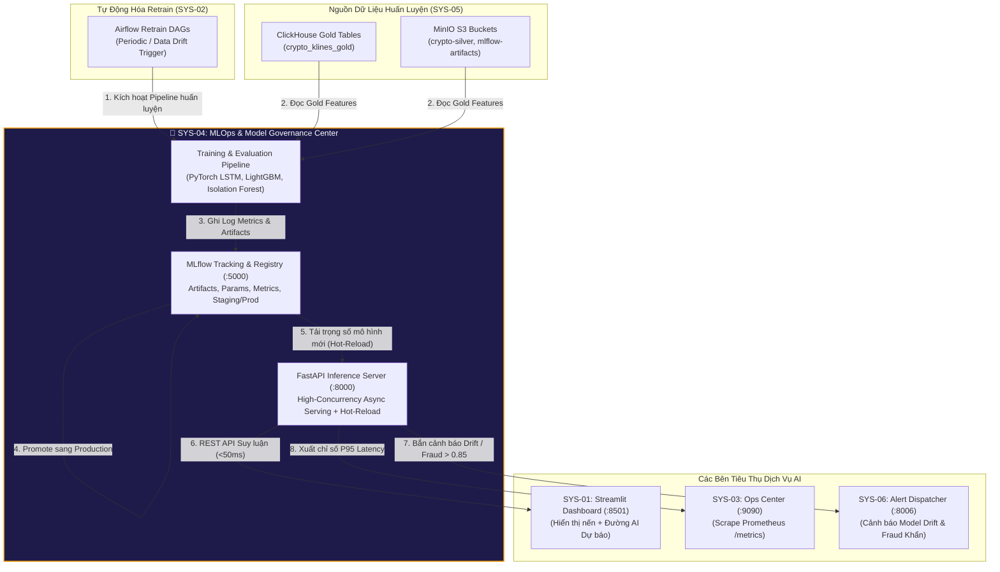
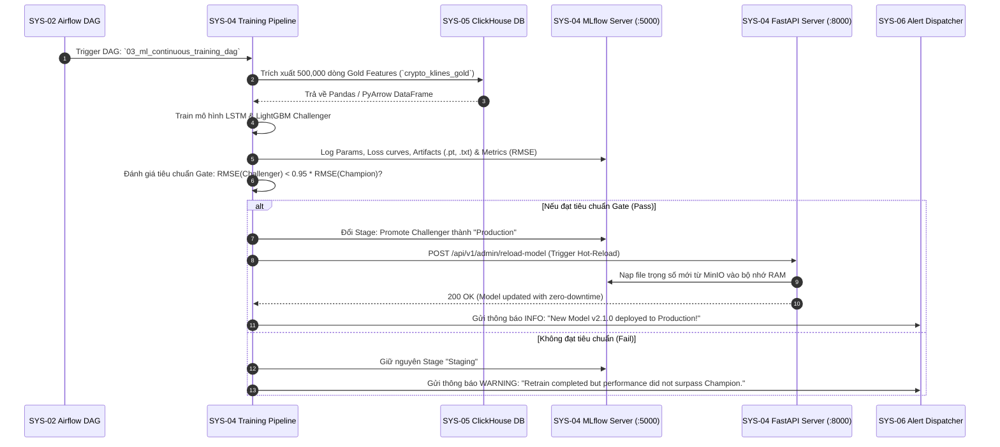
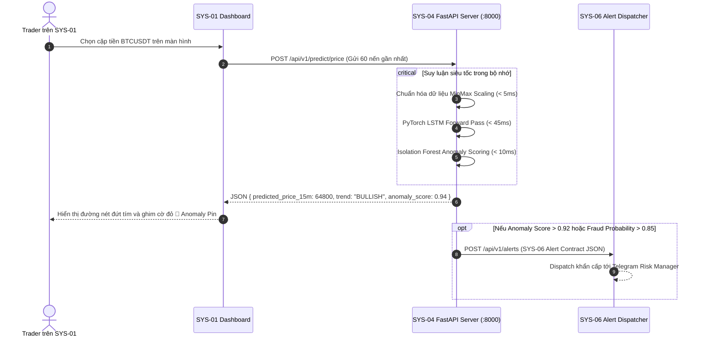

# 🏗️ SYS-04 BUILD PLAN: MLOPS & MODEL GOVERNANCE CENTER

> **Mã phân hệ**: `SYS-04`  
> **Tên phân hệ**: MLOps & Model Governance Center  
> **Phiên bản tài liệu**: 2.0 (Planning & Implementation Specification)  
> **Cổng truy cập mặc định**: MLflow Registry (`http://localhost:5000`) | FastAPI Serving (`http://localhost:8000`)  
> **Tham chiếu gốc**: `Plan/master_plan(update_2026_08_07).html` & `Plan/systems_docs/04_MLOps_Model_Governance_Center.md`

---

## 📋 1. TỔNG QUAN & MỤC TIÊU HỆ THỐNG (SYSTEM OVERVIEW & OBJECTIVES)

### 1.1. Bối cảnh & Vai trò trong Nền tảng Enterprise Mini Company
Trong một nền tảng FinTech cấp độ doanh nghiệp, bài toán Trí tuệ nhân tạo (AI/ML) không chỉ dừng lại ở việc huấn luyện một file Jupyter Notebook tĩnh. Hệ thống cần giải quyết trọn vẹn chu trình sống của mô hình (Machine Learning Lifecycle - MLOps): từ khai phá đặc trưng (Feature Store), theo dõi thí nghiệm (Experiment Tracking), quản lý vòng đời và phiên bản mô hình (Model Registry & Governance), đến phục vụ suy luận trực tuyến với độ trễ dưới 50ms (Real-time Serving) và nạp trọng số mới mà không làm gián đoạn dịch vụ (Zero-downtime Hot-Reload).

**SYS-04** đóng vai trò là **"Bộ não trí tuệ nhân tạo và trung tâm quản trị mô hình" (MLOps & Model Governance Hub)**. Phân hệ chịu trách nhiệm cung cấp năng lực thông minh cho toàn bộ 5 hệ thống còn lại.



### 1.2. Ba bài toán Machine Learning cốt lõi & Tập dữ liệu chính thức (Core AI Models & Datasets)
1. **Dự báo giá ngắn hạn (Price Trend Forecasting)**:
   - *Thuật toán*: **LSTM (Long Short-Term Memory)** hoặc Time-Series Transformer (PatchTST).
   - *Tập dữ liệu chính thức*: [`AI Models/Dataset/LSTM Price Forecaster/data/klines_15m_all_6pairs_3months.parquet`](file:///e:/Graduation_Thesis/Systems-Graduation-Thesis/SYS-04/AI%20Models/Dataset/LSTM%20Price%20Forecaster/data/klines_15m_all_6pairs_3months.parquet) (**44,652 nến 15m**, 6 pairs: BTC, ETH, AAPLB, BNB, AMZNB, DELLB từ 01/07/2026 đến 30/09/2026).
   - *Đầu vào*: Chuỗi 60 cây nến gần nhất `[open, high, low, close, volume]` $\rightarrow$ Tensor shape `(1, 60, 5)`.
   - *Đầu ra*: Dự báo mức giá tại $t+15m$ và $t+60m$, xác định xu hướng (`BULLISH` / `BEARISH`), và khoảng tin cậy 95%.
2. **Phát hiện gian lận giao dịch (Credit Card & Transaction Fraud Detection)**:
   - *Thuật toán*: **LightGBM / XGBoost Classifier**.
   - *Tập dữ liệu chính thức*: [`AI Models/Dataset/LightGBM Fraud Detector/processed/train_full.parquet`](file:///e:/Graduation_Thesis/Systems-Graduation-Thesis/SYS-04/AI%20Models/Dataset/LightGBM%20Fraud%20Detector/processed/train_full.parquet) (**590,540 dòng $\times$ 434 cột**, 80.11 MB) và `test_full.parquet` (**506,691 dòng**, 69.72 MB).
   - *Đầu vào*: Vector đặc trưng giao dịch (TransactionAmt, Card attributes, Time delta, C1-C14 counts, V1-V339 features).
   - *Đầu ra*: Xác suất gian lận (`fraud_probability`), phân loại nguy cơ (`LOW`, `MEDIUM`, `HIGH`), và hành động kiến nghị (`APPROVE`, `REVIEW`, `BLOCK`).
3. **Phát hiện dị thường biến động nến thị trường (Bar-Derived Market Anomaly Detection)**:
   - *Thuật toán*: **Isolation Forest** (Unsupervised Learning).
   - *Tập dữ liệu chính thức*: [`AI Models/Dataset/Isolation Forest Anomaly/data/features_microstructure_15m_all_6pairs_2months.parquet`](file:///e:/Graduation_Thesis/Systems-Graduation-Thesis/SYS-04/AI%20Models/Dataset/Isolation%20Forest%20Anomaly/data/features_microstructure_15m_all_6pairs_2months.parquet) (**35,010 dòng**, 2.91 MB, 8 đặc trưng nến vi cấu trúc từ 01/08/2026 đến 30/09/2026).
   - *Đầu vào*: Vector 8 đặc trưng nến (`price_velocity`, `price_velocity_1h`, `volume_surge_ratio`, `trades_surge_ratio`, `volatility_parkinson`, `bar_range_bps`, `taker_buy_ratio`, `quote_net_flow_ratio`).
   - *Phạm vi & Hợp đồng*: Mô hình học trên đặc trưng chuỗi nến & khối lượng; không chứa dữ liệu chênh lệch giá sổ lệnh (L2 Spread) hay Order-book Depth Imbalance, không tuyên bố phát hiện thao túng sổ lệnh.
   - *Đầu ra*: Điểm bất thường (Anomaly Score $\in [0.0, 1.0]$) để gắn pin đỏ 🔴 cảnh báo biến động nến cực đoan trên SYS-01.

---

## 🎯 2. YÊU CẦU KỸ THUẬT CHI TIẾT (REQUIREMENTS & SPECIFICATIONS)

### 2.1. Yêu cầu chức năng (Functional Requirements - FR)
* **FR-01 (Experiment Tracking & Logging)**: Ghi lại đầy đủ siêu tham số (Learning rate, Batch size, Hidden units), đồ thị hàm mất mát (Loss curve), và chỉ số đánh giá (RMSE, MAE, AUC-ROC, F1-Score) cho từng lần chạy thí nghiệm.
* **FR-02 (Centralized Model Registry)**: Đánh mã phiên bản ngữ nghĩa (`v1.0.0`, `v1.1.0`), gán nhãn trạng thái vòng đời (`None`, `Staging`, `Production`, `Archived`).
* **FR-03 (Automated Model Promotion Gate)**: Mô hình Challenger chỉ được phê duyệt thay thế mô hình Champion hiện tại nếu thỏa mãn:
  - Bài toán Price Forecast: **RMSE giảm ít nhất 5%** so với phiên bản trước.
  - Bài toán Fraud Detection: **AUC-ROC đạt tối thiểu >= 0.94** trên tập Validation độc lập.
* **FR-04 (Sub-50ms REST API Serving)**: Cung cấp API chuẩn OpenAPI 3.0 phục vụ dự đoán giá và phát hiện gian lận theo thời gian thực.
* **FR-05 (Zero-Downtime Hot-Reload)**: Endpoint `/api/v1/admin/reload-model` cho phép tải lại file trọng số mới từ MinIO/MLflow vào bộ nhớ RAM của Uvicorn worker mà không cần khởi động lại container Docker.
* **FR-06 (Model Drift Detection & Auto Alert)**: Giám sát phân phối dữ liệu đầu vào (Kolmogorov-Smirnov test hoặc Population Stability Index - PSI). Nếu phát hiện Data Drift hoặc Model Drift, tự động gửi cảnh báo sang SYS-06 và kích hoạt DAG retrain trên SYS-02.

### 2.2. Yêu cầu phi chức năng (Non-Functional Requirements - NFR) & SLA
| Tiêu chí | Ngưỡng cam kết (SLA) | Giải pháp kỹ thuật |
| :--- | :--- | :--- |
| **Độ trễ suy luận Fraud (P95)** | `< 50ms` | LightGBM C++ core binary, vectorization numpy, không nạp đĩa. |
| **Độ trễ suy luận LSTM (P95)** | `< 200ms` (Batch=60) | ONNX Runtime hoặc PyTorch TorchScript JIT compile. |
| **Thông lượng xử lý (Throughput)** | `> 500 req/sec` | FastAPI Async I/O, chạy 4 Uvicorn worker processes. |
| **Thời gian Hot-Reload** | `< 2 giây` | Đọc trực tiếp serialized artifacts từ MinIO S3 qua mạng nội bộ. |
| **Mức tiêu hao tài nguyên (Footprint)**| `< 1.2GB RAM` cho cả cụm | FastAPI (~300MB) + MLflow SQLite Backend (~150MB) + PyTorch Model weights (~200MB). |

---

## 🔄 3. QUY TRÌNH HOẠT ĐỘNG TOÀN DIỆN (WORKFLOW & SEQUENCE DIAGRAMS)

### 3.1. Quy trình Huấn luyện & Quản trị Vòng đời Mô hình (MLOps CT Pipeline)



### 3.2. Quy trình Phục vụ Suy luận Trực tuyến (Real-time Inference Sequence)



---

## 🔗 4. KẾT NỐI TƯƠNG TÁC TỚI CÁC HỆ THỐNG CÒN LẠI (INTER-SYSTEM INTEGRATION)

Bảng ma trận kết nối và giao thức tích hợp của SYS-04 với các phân hệ khác:

| Phân hệ đích | Giao thức / Port | Chi tiết Endpoint / Nguồn kết nối | Dữ liệu trao đổi & Mục đích | Xử lý sự cố (Resilience) |
| :--- | :--- | :--- | :--- | :--- |
| **SYS-05 (Lakehouse/DB)** | TCP Native (`8123`) & S3 API (`9000`) | `crypto_klines_gold`<br/>Bucket `mlflow-artifacts` | Trích xuất dataset nến & lưu trữ file nhị phân mô hình AI. | Thử kết nối lại với backoff, nạp file cached nếu mất mạng. |
| **SYS-02 (Airflow)** | HTTP REST (`8000`) | `/api/v1/admin/reload-model` | Airflow gọi webhook để kích hoạt Hot-Reload sau khi train xong. | Trả mã HTTP 503 nếu reload lỗi, Airflow tự retry task. |
| **SYS-01 (Dashboard)** | HTTP REST (`8000`) | `/api/v1/predict/price`<br/>`/api/v1/predict/fraud` | Cung cấp kết quả dự báo giá và xác suất gian lận cho UI. | Trả kết quả fallback an toàn nếu tensor đầu vào bất thường. |
| **SYS-03 (Ops Monitoring)** | HTTP GET (`8000`) | `/metrics` (Prometheus Exporter) | Xuất thông số hiệu năng phục vụ AI: P95 Latency, Error Rate. | Nhẹ, chạy trên luồng phụ không ảnh hưởng suy luận. |
| **SYS-06 (Alert Dispatcher)** | HTTP POST (`8006`) | `/api/v1/alerts` | Bắn cảnh báo tức thời khi phát hiện giao dịch gian lận hoặc Data Drift. | Non-blocking async background task trong FastAPI. |

### Hợp đồng Request & Response chi tiết của API Suy luận:
#### 1. Endpoint `/api/v1/predict/price`
- **Request Body (JSON)**:
```json
{
  "symbol": "BTCUSDT",
  "recent_ohlcv": [
    [64100.0, 64200.0, 64050.0, 64150.0, 120.5],
    [64150.0, 64300.0, 64100.0, 64250.5, 340.2]
  ]
}
```
- **Response Body (JSON - SLA < 200ms)**:
```json
{
  "symbol": "BTCUSDT",
  "current_price": 64250.50,
  "predicted_price_15m": 64800.00,
  "predicted_price_60m": 65200.00,
  "trend": "BULLISH",
  "confidence_interval_95": [64500.00, 65100.00],
  "anomaly_score": 0.88,
  "is_anomaly": true,
  "model_version": "v2.0.0"
}
```

#### 2. Endpoint `/api/v1/predict/fraud`
- **Request Body (JSON)**:
```json
{
  "transaction_id": "TX_994812",
  "amount": 45000.00,
  "features": [1.45, -0.88, 2.15, 0.04, -1.12, 0.45, 0.0, 1.0, 24.5]
}
```
- **Response Body (JSON - SLA < 50ms)**:
```json
{
  "transaction_id": "TX_994812",
  "amount": 45000.00,
  "fraud_probability": 0.9412,
  "is_fraud": true,
  "risk_level": "HIGH",
  "action": "BLOCK_TRANSACTION",
  "model_version": "v1.4.0"
}
```

---

## 🛠️ 5. ĐÁNH GIÁ TECH STACK & CÁC LỰA CHỌN THAY THẾ (TECH STACK EVALUATION & ALTERNATIVES)

### 5.1. Tech Stack đề xuất chính (Primary Proposed Stack)
* **MLOps Experiment & Registry**: **MLflow 2.x** (Lưu trữ metadata vào SQLite/Postgres, artifacts vào MinIO S3).
* **Model Serving Web Framework**: **FastAPI + Uvicorn ASGI** (Pydantic data validation, high-concurrency async).
* **Deep Learning Framework**: **PyTorch 2.x** (Mô hình LSTM Time-Series, tối ưu hóa bằng TorchScript).
* **Gradient Boosting Framework**: **LightGBM 4.x** (Cực nhanh trên dữ liệu bảng tabular IEEE-CIS).
* **Anomaly Engine**: **Scikit-Learn (Isolation Forest)**.
* **Telemetry**: **`prometheus-fastapi-instrumentator`** (Tự động sinh endpoint `/metrics`).

### 5.2. Bảng so sánh toàn diện các giải pháp thay thế tương đương

| Giải pháp Công nghệ | Ưu điểm (Pros) | Nhược điểm (Cons) | Mức độ phù hợp với Đồ án Tốt nghiệp |
| :--- | :--- | :--- | :--- |
| **MLflow + FastAPI (Lựa chọn chính đề xuất)** | - Tiêu chuẩn công nghiệp phổ biến nhất, mã nguồn mở 100%.<br/>- FastAPI nhẹ (~100MB RAM), tốc độ phản hồi cực nhanh (< 10ms framework overhead).<br/>- Tích hợp trực tiếp với Python AI ecosystem.<br/>- Dễ dàng kiểm thử với PyTest và đóng gói Docker. | - Cơ chế Hot-reload phải tự hiện thực logic nạp lại weights qua API nội bộ (tuy nhiên logic này rất ngắn và an toàn). | ⭐⭐⭐⭐⭐ **10/10 (Lựa chọn hoàn hảo)**: Phù hợp tuyệt đối với cấu hình máy cá nhân 16GB-32GB RAM, thời gian phát triển nhanh và kiến trúc rất thanh thoát. |
| **BentoML** | - Chuyên biệt hóa cho đóng gói và serving mô hình AI.<br/>- Hỗ trợ Adaptive Batching tự động. | - Tích hợp Model Registry chưa trực quan bằng MLflow UI.<br/>- Đòi hỏi học thêm cú pháp Service Framework riêng của BentoML. | ⭐⭐⭐⭐ **8.0/10 (Phương án tốt)**: Rất tốt cho serving, nhưng khâu quản trị phiên bản và experiment tracking vẫn phải phụ thuộc vào công cụ khác. |
| **Triton Inference Server (NVIDIA)** | - Hiệu năng phục vụ đỉnh cao trên GPU/CPU, hỗ trợ dynamic batching cực mạnh.<br/>- Hỗ trợ đa backend (TensorRT, ONNX, PyTorch). | - Cực kỳ nặng: Image Docker > 8GB, cấu hình Model Repository phức tạp.<br/>- Tối ưu cho cụm server GPU doanh nghiệp lớn, quá tải đối với máy tính cá nhân làm đồ án tốt nghiệp. | ⭐⭐⭐ **6.5/10 (Quá tải cho đồ án)**: Khó triển khai mượt mà trong môi trường Docker compose cá nhân. |
| **Kubeflow / Ray Serve** | - Nền tảng phân tán cấp Enterprise toàn diện trên Kubernetes.<br/>- Tự động scale out pod suy luận. | - Bắt buộc phải có cụm Kubernetes (K8s) hoạt động.<br/>- Tốn tài nguyên RAM khủng khiếp (> 8GB RAM chỉ để chạy control plane).<br/>- Không khả thi để chạy song song cùng 11 container khác trên máy local. | ⭐⭐ **4.0/10 (Không khả thi trên Local)**: Không phù hợp với tài nguyên máy tính cá nhân. |
| **TorchServe** | - Được phát triển chính thức bởi AWS và PyTorch.<br/>- Quản lý mô hình dạng file `.mar`. | - Khó cấu hình tùy biến các logic nghiệp vụ phức tạp ngoài suy luận thuần túy.<br/>- Tài liệu cộng đồng ít phong phú hơn FastAPI. | ⭐⭐⭐ **7.0/10 (Khả thi nhưng hạn chế)**: Không linh hoạt bằng FastAPI khi cần tích hợp thêm Anomaly Detection và Alert Dispatching. |

---

## 📁 6. CẤU TRÚC THƯ MỤC TRIỂN KHAI DỰ KIẾN (DIRECTORY STRUCTURE)

Dưới đây là cấu trúc thư mục chuẩn bị build cho `Systems-Graduation-Thesis/SYS-04`:

```
SYS-04/
├── .env.example                      # Cấu hình cổng 5000, 8000, S3 MinIO endpoint
├── .gitignore                        # Bỏ qua checkpoints, model weights .pt, .pkl
├── Dockerfile                        # Multi-stage Python 3.10 slim container
├── docker-compose.yml                # Khởi chạy MLflow Server & FastAPI Serving
├── requirements.txt                  # fastapi, uvicorn, mlflow, torch, lightgbm, scikit-learn
├── README.md                         # Giới thiệu phân hệ
├── CONTEXT.md                        # Thuật ngữ & Mô hình miền
├── docs/
│   └── BUILD_PLAN.md                 # Tài liệu quy hoạch kỹ thuật chi tiết này
├── src/
│   ├── serving/                      # Ứng dụng FastAPI Serving
│   │   ├── main.py                   # FastAPI app entrypoint
│   │   ├── config.py                 # Nạp biến môi trường & đường dẫn
│   │   ├── schemas.py                # Pydantic Request/Response models
│   │   ├── model_manager.py          # Quản lý nạp model trong RAM & Hot-Reload
│   │   └── routers/
│   │       ├── predict_price.py      # Router suy luận LSTM Price
│   │       ├── predict_fraud.py      # Router suy luận LightGBM Fraud
│   │       └── admin.py              # Router Hot-Reload & Healthcheck
│   ├── training/                     # Pipelines huấn luyện mô hình
│   │   ├── train_lstm_price.py       # Huấn luyện mô hình chuỗi thời gian
│   │   ├── train_fraud_lgbm.py       # Huấn luyện mô hình phát hiện gian lận
│   │   └── train_anomaly_iforest.py  # Huấn luyện mô hình Isolation Forest
│   └── utils/
│       ├── clickhouse_loader.py      # Trích xuất dữ liệu huấn luyện từ SYS-05
│       ├── mlflow_helper.py          # Wrapper log metrics, params, artifacts
│       └── alert_notifier.py         # Bắn cảnh báo Model Drift sang SYS-06
└── tests/
    ├── __init__.py
    ├── test_model_inference.py       # Test độ chính xác tensor shape & latency < 50ms
    ├── test_hot_reload.py            # Test tính năng nạp lại trọng số không sập server
    └── test_schemas_validation.py    # Test bắt lỗi dữ liệu đầu vào không hợp lệ
```

---

## 📅 7. LỘ TRÌNH TRIỂN KHAI THEO CÁC PHASE (STEP-BY-STEP ROADMAP)

* **Phase 00: Environment & Model Contracts**: Khởi tạo biến môi trường, định nghĩa Pydantic schemas và chuẩn hóa hợp đồng dữ liệu với SYS-01.
* **Phase 01: Core MLflow Tracking Setup**: Thiết lập MLflow server lưu trữ SQLite metadata và artifact store trên MinIO S3 bucket `mlflow-artifacts`.
* **Phase 02: Model Training Pipelines**: Viết các script huấn luyện chuẩn mực cho LSTM (dự báo giá nến), LightGBM (phát hiện gian lận IEEE-CIS) và Isolation Forest (phát hiện Pump & Dump).
* **Phase 03: FastAPI Real-Time Serving**: Xây dựng service FastAPI bất đồng bộ, nạp sẵn trọng số mô hình vào RAM và tối ưu hóa thời gian suy luận `< 50ms`.
* **Phase 04: Zero-Downtime Hot-Reload Logic**: Cài đặt endpoint `/api/v1/admin/reload-model` cho phép nạp phiên bản mới từ MLflow mà không ngắt kết nối client.
* **Phase 05: Telemetry & Alert Integrations**: Tích hợp Prometheus metrics cho SYS-03 và cấu hình webhook bắn cảnh báo Model Drift sang SYS-06.
* **Phase 06: Containerization & Latency Benchmark**: Đóng gói Docker Compose, chạy script benchmark tải giả lập (100 req/s) để xác nhận hệ thống đáp ứng nghiêm ngặt SLA.

---

## 🧪 8. KẾ HOẠCH KIỂM THỬ & VẬN HÀNH (VERIFICATION & RUNBOOK)

### 8.1. Kiểm thử hiệu năng & Độ trễ (Latency Benchmark Test)
```bash
# Sử dụng công cụ Locust hoặc Apache Benchmark (ab) kiểm tra SLA < 50ms
ab -n 1000 -c 10 -p tests/payload_fraud.json -T application/json http://localhost:8000/api/v1/predict/fraud
```

### 8.2. Tiêu chuẩn nghiệm thu vận hành (Operational Acceptance Criteria)
1. Mở `http://localhost:5000`: Giao diện MLflow hiển thị đầy đủ các thí nghiệm, các tham số loss/RMSE và mô hình đang ở trạng thái `Production`.
2. Mở Swagger Docs `http://localhost:8000/docs`: Thử nghiệm trực tiếp endpoint `/api/v1/predict/price` với 60 nến giả lập -> Kết quả trả về trong **< 150ms**.
3. Thử nghiệm tính năng Hot-Reload: Gọi lệnh `POST /api/v1/admin/reload-model` -> Trọng số mô hình được cập nhật tức thì với mã trạng thái `200 OK` mà không có request nào của người dùng bị rớt.
