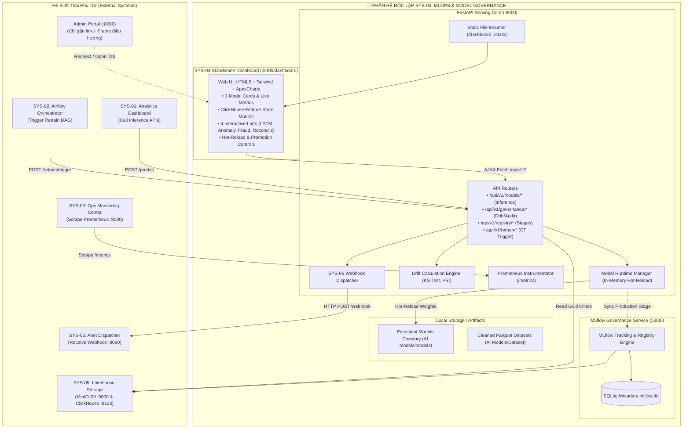

# 🧠 KẾ HOẠCH TOÀN DIỆN XÂY DỰNG PHÂN HỆ SYS-04
## MLOps & Model Governance Center (NHFinance Enterprise Platform)

> **Mã phân hệ**: `SYS-04`  
> **Tên phân hệ**: MLOps & Model Governance Center  
> **Phiên bản kế hoạch**: `3.2-Production-Ready (Decoupled Architecture with Standalone Full-Stack SYS-04 Dashboard)`  
> **Cổng dịch vụ định danh**:
> - **FastAPI Model Serving Engine & REST APIs**: `http://localhost:8000` (Swagger UI: `http://localhost:8000/docs`)
> - **SYS-04 Standalone MLOps Governance Dashboard**: `http://localhost:8000/dashboard` (hoặc cổng riêng `8004`)
> - **MLflow Tracking & Model Registry**: `http://localhost:5000`
> **Phạm vi áp dụng**: Độc quyền nội bộ phân hệ `Systems-Graduation-Thesis/SYS-04/`

---

## 📌 PHẦN 1: TỔNG QUAN HIỆN TRẠNG & MỤC TIÊU HOÀN THIỆN SYS-04

### 1.1. Hiện trạng đã hoàn tất (Baseline Assets - 100%)
1. **Dữ liệu huấn luyện (Training Datasets)**:
   - `LSTM Price Forecaster`: 44,652 nến 15m (3 tháng, 6 pairs: BTC, ETH, BNB, AAPLB, AMZNB, DELLB) đã làm sạch và chuẩn hóa.
   - `Isolation Forest Anomaly`: 35,010 nến 15m (8 đặc trưng vi cấu trúc volume/volatility/flow).
   - `LightGBM Fraud Detector`: 590,540 giao dịch IEEE-CIS (434 cột đặc trưng) đã tiền xử lý.
2. **Trọng số & Artifacts Mô hình (Trained Models)**:
   - Mô hình PyTorch TorchScript JIT (.torchscript/.pt) cho 6 cặp tài sản.
   - Mô hình Scikit-Learn Isolation Forest (.joblib) cho 6 cặp tài sản.
   - Mô hình LightGBM Classifier (.joblib) + Transformer (.joblib) phát hiện gian lận.
3. **Core Serving Logic (API 3 Model Endpoints)**:
   - Endpoint dự báo giá 15m/60m Multi-Horizon LSTM (`/api/v1/models/lstm/predict`).
   - Endpoint đánh giá rủi ro vi cấu trúc thị trường Anomaly (`/api/v1/models/anomaly/evaluate`).
   - Endpoint chấm điểm gian lận 3-Tier LightGBM (`/api/v1/models/fraud/score`).

### 1.2. Mục tiêu chiến lược: Tách biệt hoàn toàn (Decouple) SYS-04 thành Phân hệ Độc lập
Theo định hướng kiến trúc Microservices chuẩn hóa:
- **Tách phần AI Models ra khỏi Admin Portal**: Toàn bộ giao diện điều hành mô hình (Executive Governance Banner, Feature Store Monitor, 4 Interactive AI Labs, Model Registry Controls, Drift Analytics) sẽ được **tách thành một Web Dashboard độc lập** thuộc sở hữu độc quyền của `SYS-04` (đặt tại `SYS-04/frontend/` và phục vụ trực tiếp tại `http://localhost:8000/dashboard`).
- **Admin Portal (`:8090`)**: Chỉ đóng vai trò là Cổng điều hướng tập trung (Hub Gateway), dẫn link hoặc nhúng iFrame tới Dashboard của SYS-04, loại bỏ hoàn toàn sự phụ thuộc mã nguồn (tight-coupling) giữa Admin Portal và backend SYS-04.

| Thành phần | Trạng thái hiện tại | Yêu cầu hoàn thiện trong Kế hoạch này |
| :--- | :--- | :--- |
| **Giao diện Web UI** | Phụ thuộc trong Admin Portal (tab AI Models) | **Tách thành Standalone Web Dashboard riêng cho SYS-04** (`/dashboard`) |
| **Cấu trúc mã nguồn Serving** | File đơn `server.py` (>400 dòng) | Refactor thành cấu trúc Modular chuẩn Enterprise (`src/serving/`) |
| **MLflow Server (Port 5000)** | Chưa có container độc lập | Dựng container MLflow UI kết nối MinIO S3 (`mlflow-artifacts`) & SQLite |
| **Model Registry Governance** | Trọng số đọc trực tiếp từ disk | Tích hợp quản lý phiên bản `None` -> `Staging` -> `Production` -> `Archived` |
| **Champion - Challenger Gate** | Thủ công | Tự động hóa cổng đánh giá mô hình mới (RMSE giảm $\ge 5\%$, AUC $\ge 0.94$) |
| **Data & Model Drift Engine** | Chưa có module tính toán | Xây dựng REST API tính kiểm định Kolmogorov-Smirnov (KS-Test) & chỉ số PSI |
| **Alerting Dispatcher sang SYS-06** | Chưa kết nối | Tự động bắn Webhook sự cố / Drift bất thường sang SYS-06 (`:8080`) |
| **Telemetry & Observability** | Chưa có `/metrics` | Tích hợp `prometheus-fastapi-instrumentator` cho SYS-03 (`:9090`) scrape P95 latency |
| **Continuous Retraining Trigger** | Chưa có adapter | API tiếp nhận yêu cầu retrain từ Airflow DAG (SYS-02) và đọc Gold từ ClickHouse (SYS-05) |
| **Containerization** | Chỉ có 1 service Docker | Docker Compose hoàn chỉnh chạy song song 2 dịch vụ (FastAPI: 8000 & MLflow: 5000) |

---

## 🎯 PHẦN 2: BẢN CHẤT NGỮ NGHĨA & ĐẦU RA 3 CORE AI MODELS (TẠI SAO LÀ PREDICT / EVALUATE / SCORE?)

Sự phân định thành 3 động từ ngữ nghĩa xuất phát từ bản chất toán học và nghiệp vụ FinTech:

```mermaid
flowchart TD
    subgraph S1["1. LSTM Price Forecaster"]
        D1["Dự báo chuỗi thời gian (Regression)"] --> V1["Dùng động từ: predict"]
        V1 --> O1["Đầu ra: Mức giá tương lai t+15m, t+60m & Xu hướng"]
    end

    subgraph S2["2. Isolation Forest Anomaly"]
        D2["Thẩm định trạng thái nến (Unsupervised)"] --> V2["Dùng động từ: evaluate"]
        V2 --> O2["Đầu ra: Anomaly Score 0.0-1.0 & Hành động phòng thủ"]
    end

    subgraph S3["3. LightGBM Fraud Detector"]
        D3["Chấm điểm rủi ro giao dịch (Risk Triage)"] --> V3["Dùng động từ: score"]
        V3 --> O3["Đầu ra: Xác suất gian lận & Phân luồng 3 cấp"]
    end
```



### 2.1. Chi tiết ý nghĩa ngữ nghĩa của 3 động từ:
1. **`predict` (Dự đoán tương lai - LSTM)**:
   - Mô hình ngoại suy (extrapolate) để tìm ra **giá trị số thực của tương lai** tại các mốc thời gian $t+15m$ và $t+60m$. Trong khoa học dữ liệu, việc tính toán giá trị chuỗi thời gian chưa xảy ra luôn được gọi là **Prediction/Forecasting**.
2. **`evaluate` (Thẩm định trạng thái hiện tại - Isolation Forest)**:
   - Mô hình không dự báo tương lai, cũng không phân loại nhãn đúng/sai. Nó **thẩm định (evaluate)** 8 đặc trưng vi cấu trúc của cây nến hiện tại để đánh giá xem thị trường có đang trong tình trạng nguy hiểm (Pump & Dump, biến động cực đoan) hay không để kích hoạt phòng thủ.
3. **`score` (Chấm điểm rủi ro chính sách - LightGBM)**:
   - Trong nghiệp vụ tài chính/ngân hàng, hệ thống không chỉ trả về nhãn nhị phân True/False, mà cần **chấm điểm rủi ro (Risk Score)** từ $0.0$ đến $1.0$ để đưa vào **Chính sách phân luồng 3 cấp (3-Tier Policy Gate)**: Cho phép chuyển tiền (`APPROVE`), Giữ tiền kiểm duyệt (`REVIEW`), hoặc Chặn lập tức (`BLOCK`).

### 2.2. Đặc tả JSON Payload đầu ra chi tiết của 3 Model:

#### A. Đầu ra của `/api/v1/models/lstm/predict`:
```json
{
  "symbol": "BTCUSDT",
  "timestamp_utc": "2026-10-05 00:15:00 UTC",
  "current_close_price": 76520.50,
  "forecast_15m": { "predicted_price": 76712.35, "predicted_delta_pct": 0.25, "direction": "BULLISH" },
  "forecast_60m": { "predicted_price": 77041.10, "predicted_delta_pct": 0.68, "direction": "BULLISH" },
  "forecast_advisory": {
    "governance_mode": "ADVISORY_ANALYTICS_ONLY",
    "projected_horizon_15m": { "projected_price_usd": 76712.35, "expected_return_pct": 0.25, "trend_bias": "BULLISH" },
    "projected_horizon_60m": { "projected_price_usd": 77041.10, "expected_return_pct": 0.68, "trend_bias": "BULLISH" },
    "disclaimer": "Advisory decision support only. Unattended trading prohibited."
  },
  "inference_latency_ms": 1.15
}
```

#### B. Đầu ra của `/api/v1/models/anomaly/evaluate`:
```json
{
  "symbol": "BTCUSDT",
  "timestamp_utc": "2026-10-05 00:15:00 UTC",
  "risk_guard": {
    "governance_mode": "ASYNC_RISK_GUARD_FILTER",
    "outlier_alert_triggered": false,
    "calibrated_anomaly_score": 0.184,
    "risk_level": "LOW",
    "recommended_actions": {
      "widen_orderbook_spread": false,
      "throttle_max_leverage": false,
      "send_admin_alert": false,
      "auto_ban_user_account": false
    }
  },
  "telemetry": { "inference_latency_ms": 23.4 }
}
```

#### C. Đầu ra của `/api/v1/models/fraud/score`:
```json
{
  "model": "LightGBM Fraud Detector (v1.2.0-production)",
  "user_id": "usr-88219",
  "amount_usd": 45000.00,
  "timestamp": "2026-10-05T00:15:00Z",
  "scoring_results": {
    "fraud_probability": 0.8942,
    "risk_percentage": "89.42%",
    "decision": "BLOCK_TRANSACTION",
    "badge_color": "rose",
    "action": "Instant rejection. Transaction flagged as high-confidence fraud."
  },
  "governance_rule": "3-Tier Decision Gate (BLOCK >= 0.75, REVIEW >= 0.30, APPROVE < 0.30)",
  "inference_latency_ms": 1.45
}
```

---

## 🖥️ PHẦN 3: ĐẦU RA KỲ VỌNG TOÀN DIỆN CỦA SYS-04 (EXPECTATION OUTPUTS)

### 3.1. Nhóm 1: Ba cổng giao diện Web trực quan (Web UIs & Dashboards)

1. **Cổng 1: NHFinance MLOps & Model Governance Center (`http://localhost:8000/` hoặc `http://localhost:8000/dashboard`)**:
   - **Định vị**: Trung tâm Chỉ huy & Quản trị AI độc lập cấp Doanh nghiệp (tương đương Admin Operations Gateway hay SOC Hub), đóng vai trò là Command Center tập trung lưu trữ toàn bộ dashboards, phòng thí nghiệm tương tác và công cụ điều hành của SYS-04.
   - **Phong cách thiết kế**: Enterprise Cockpit UI (Dark/Light mode, Font JetBrains Mono & Plus Jakarta Sans, Tailwind CSS, ApexCharts, FontAwesome 6).
   - **Cấu trúc 6 Phân hệ Màn hình (Tabs / Views) cốt lõi bên trong Center**:
     * **View 1 - 🏛️ Executive Cockpit & Governance Invariants**:
       - Trạng thái hoạt động thời gian thực của 3 mô hình (`3/3 PRODUCTION READY`).
       - Ma trận sức khỏe các dịch vụ vệ tinh (FastAPI Serving :8000, MLflow :5000, ClickHouse :8123, MinIO S3 :9000, SYS-06 Dispatcher :8080).
       - Thẻ cam kết Pháp quy AI (Governance Invariants): *LSTM Advisory Only*, *IsoForest Zero Account Ban Guarantee*, *LightGBM 3-Tier Policy Gate*.
       - Live KPI Gauges: P95 Latency (<15ms/50ms), Throughput (req/s), Memory Footprint.
     * **View 2 - 🧪 Interactive AI Live Inference Labs**:
       - *Lab 1 (LSTM Price Forecaster)*: Biểu đồ nến TradingView-style kết hợp đường nét đứt tím dự phóng giá tại $t+15m$ và $t+60m$ cho 6 cặp Crypto/RWA.
       - *Lab 2 (IsoForest Market Anomaly Guard)*: Đồng hồ Gauge đo Anomaly Score, kiểm tra 8 đặc trưng vi cấu trúc nến, khuyến nghị giãn spread & giảm đòn bẩy.
       - *Lab 3 (LightGBM Fraud Gatekeeper)*: Nhập thuộc tính giao dịch, nhận diện rủi ro tức thì qua badge 3 cấp (APPROVE xanh lá, REVIEW vàng, BLOCK đỏ).
       - *Lab 4 (Historical 1h Reconciliation Tracker)*: Đối chiếu tự động giữa giá AI dự báo trong quá khứ so với giá thị trường thực tế sau 1 giờ.
     * **View 3 - 📦 Model Registry & Lifecycle Management**:
       - Danh mục mô hình đồng bộ trực tiếp từ MLflow Registry với các trạng thái (`Production`, `Staging`, `Archived`).
       - Bộ nút điều khiển tức thời: **Instant Hot-Reload Weights** vào RAM (<1.5s, zero socket drops), **Promote Challenger**, **Rollback Champion**.
       - Audit Log: Lịch sử ghi nhận mọi lần thay đổi phiên bản và nạp lại trọng số.
     * **View 4 - 📈 Data & Model Drift Observatory**:
       - Kiểm định **Kolmogorov-Smirnov (KS-Test)** cho phân phối nến 15m thực tế vs tập huấn luyện baseline (tháng 8-9/2026), hiển thị $p\text{-value}$ và danh sách drifted features.
       - Chỉ số **Population Stability Index (PSI)** cho điểm số rủi ro gian lận, tự động kích hoạt cảnh báo khi $\text{PSI} \ge 0.2$.
       - Lịch sử bắn Webhook cảnh báo Drift sang SYS-06.
     * **View 5 - 🔄 Continuous Retraining & ClickHouse Feature Store**:
       - Bảng giám sát ClickHouse Gold Feature Tables (`crypto_klines_gold`, `gold_transaction_risk_features`).
       - Bảng điều khiển Trigger Retrain: nhận và hiển thị tiến độ các Job huấn luyện lại từ Airflow DAG (SYS-02).
       - Bảng đánh giá Cổng kiểm duyệt Challenger vs Champion (RMSE giảm $\ge 5\%$, AUC $\ge 0.94$).
     * **View 6 - 📡 Telemetry, SLAs & Prometheus Metrics**:
       - Biểu đồ thời gian thực ApexCharts đo phân phối P50, P95, P99 Latency.
       - Phân tích mã HTTP status, Throughput theo từng symbol.
       - Nút chuyển hướng một chạm sang MLflow UI (`:5000`) và Grafana Monitoring (`:3000`).
     * **View 7 - 👤 Operator Profile & Synchronized RBAC Security (Đồng bộ Admin Portal)**:
       - **Đồng bộ định danh (Identity & Profile Sync)**: Đồng bộ 100% thông tin tài khoản người dùng (Avatar, Họ tên, Email, Vai trò: *Super Admin*, *Data & AI Engineer*, *Operator*, *Auditor*) từ Admin Portal (`:8090`).
       - **Cơ chế xác thực dùng chung (Shared SSO & Session)**: Sử dụng chung JWT token / Session authentication giữa Admin Portal và SYS-04 Center, giúp người dùng đăng nhập tại Admin Portal là tự động mở được SYS-04 Center mà không cần đăng nhập lại.
       - **Kiểm soát quyền hạt nhân (Granular RBAC Enforcements)**:
         + `view_ai_models`: Cho phép truy cập SYS-04 Center, theo dõi dashboards, chỉ số drift và telemetry.
         + `trigger_ai_inference`: Cho phép thao tác và chạy 4 Interactive Live Testing Labs (LSTM Forecaster, Anomaly Risk Guard, Fraud Gatekeeper, Historical Reconciliation).
         + `manage_ai_governance`: Phân quyền cấp cao để thực thi các hành động nhạy cảm: Nút bấm **Hot-Reload weights** trong RAM, Phê duyệt **Promote Challenger lên Production**, Rollback mô hình, và can thiệp ngưỡng chặn gian lận 3 cấp.
       - **Giao diện Quản trị Profile**: Khu vực xem chi tiết quyền hạn cá nhân, thông tin phiên đăng nhập, lịch sử hành vi (Action Audit Log) và nút đăng xuất đồng bộ.

2. **Cổng 2: MLflow Tracking & Registry UI (`http://localhost:5000`)**:
   - **Bảng Experiment Tracking**: Lưu lại toàn bộ lịch sử các lượt huấn luyện (Runs), các tham số siêu vi mô (hyperparameters: lr, batch_size, sequence_length), metrics (RMSE, MAE, AUC, F1-Score).
   - **Đồ thị trực quan (Loss Curves & ROC Curves)**: Vẽ biểu đồ hàm mất mát, ma trận nhầm lẫn (Confusion Matrix).
   - **Model Registry**: Quản lý phiên bản (`v1.0.0`, `v1.2.0`) và gắn nhãn vòng đời rõ ràng: **`Staging`**, **`Production`**, **`Archived`**.

3. **Cổng 3: OpenAPI Interactive Swagger Docs (`http://localhost:8000/docs`)**:
   - Toàn bộ danh mục 5 nhóm API chuẩn OpenAPI 3.0, cho phép bấm **Try it out** để test trực tiếp payload JSON và kiểm tra HTTP Response Code `200 OK` cùng độ trễ milisecond.

### 3.2. Nhóm 2: Đầu ra Dịch vụ REST APIs chuẩn SLA
- API phục vụ suy luận thời gian thực cho SYS-01 với độ trễ $P95 < 20\text{ms}$ cho Fraud và $P95 < 50\text{ms}$ cho LSTM.
- API Hot-Reload cập nhật weights mô hình trong RAM trong $< 1.5\text{s}$ mà không làm sập server.
- API tính toán Data Drift & Model Drift (KS-Test, PSI).

### 3.3. Nhóm 3: Đầu ra Đo lường & Cảnh báo (Telemetry & Alerts)
- **Prometheus Endpoint (`http://localhost:8000/metrics`)**: Cung cấp dữ liệu đo lường liên tục để SYS-03 (Grafana 3000 / Prometheus 9090) vẽ đồ thị P95 Latency và Request Rate.
- **Alert Dispatch Webhooks (Gửi sang SYS-06: 8080)**: Tự động gửi cảnh báo khẩn cấp khi phát hiện gian lận nghiêm trọng ($\ge 0.85$) hoặc khi phân phối dữ liệu bị trôi ($p\text{-value} < 0.05$ hoặc $\text{PSI} \ge 0.2$).

### 3.4. Nhóm 4: Đầu ra Tự động hóa MLOps (Continuous Retraining Pipeline)
- Adapter kết nối ClickHouse (`crypto_klines_gold`) và MinIO S3 (`mlflow-artifacts`).
- Endpoint để Airflow DAG (SYS-02) kích hoạt retrain và tự động kích hoạt Promotion Gate (Challenger vs Champion).

---

## 🏛️ PHẦN 4: KIẾN TRÚC TỔNG THỂ & QUY TRÌNH DỮ LIỆU NỘI BỘ SYS-04

### 4.1. Sơ đồ kiến trúc phân hệ độc lập (Self-Contained Full-Stack Subsystem)


---

## 📁 PHẦN 5: CẤU TRÚC THƯ MỤC CHUẨN MODULAR CHO SYS-04

Tái cấu trúc thư mục chứa cả Frontend và Backend độc lập:

```
SYS-04/
├── .dockerignore
├── .gitignore
├── Dockerfile                         # Multi-stage build cho Serving & Frontend
├── Dockerfile.mlflow                  # Container riêng cho MLflow Server
├── docker-compose.yml                 # Chạy song song: FastAPI (8000) & MLflow (5000)
├── requirements.txt                   # Phụ thuộc Python (FastAPI, MLflow, Torch, LightGBM, ...)
├── README.md
├── CONTEXT.md
├── docs/
│   ├── BUILD_PLAN.md                  # Tài liệu quy hoạch kỹ thuật
│   ├── PLANNING_SYS04_MLOPS.md        # Tài liệu kế hoạch chi tiết này
│   └── API_CONTRACTS.md               # Chi tiết hợp đồng dữ liệu
├── config/
│   ├── __init__.py
│   └── settings.py                    # Cấu hình Pydantic BaseSettings (Ports, URLs, S3)
├── frontend/                          # 🌐 Giao diện Dashboard độc lập của SYS-04
│   ├── index.html                     # Trang chủ Governance & Interactive AI Lab
│   ├── css/
│   │   └── dashboard.css              # Custom styling & dark/light theme
│   └── js/
│       ├── api_client.js              # Gọi trực tiếp localhost:8000/api/v1/*
│       ├── lab_lstm.js                # Logic tương tác phòng lab LSTM
│       ├── lab_anomaly.js             # Logic tương tác phòng lab Anomaly
│       ├── lab_fraud.js               # Logic tương tác phòng lab Fraud Gate
│       └── registry_controls.js       # Logic Hot-Reload & Promotion
├── src/
│   ├── __init__.py
│   ├── serving/                       # Lớp phục vụ suy luận REST & Static mount
│   │   ├── __init__.py
│   │   ├── main.py                    # FastAPI App instance & Static files mount (/dashboard)
│   │   ├── dependencies.py            # Security & Shared singletons
│   │   ├── schemas/                   # Pydantic Schemas cho toàn bộ APIs
│   │   │   ├── __init__.py
│   │   │   ├── inference_schemas.py   # Request/Response cho 3 Models
│   │   │   ├── governance_schemas.py  # Request/Response cho Drift & Promotion
│   │   │   └── registry_schemas.py    # Request/Response cho MLflow models
│   │   ├── routers/
│   │   │   ├── __init__.py
│   │   │   ├── inference.py           # 3 endpoints: /lstm/predict, /anomaly/evaluate, /fraud/score
│   │   │   ├── governance.py          # /drift/check, /metrics/summary
│   │   │   ├── registry.py            # /models, /promote, /rollback, /reload
│   │   │   └── retrain.py             # /retrain/trigger, /retrain/status
│   │   └── services/
│   │       ├── __init__.py
│   │       ├── model_manager.py       # Quản lý vòng đời mô hình trong RAM (Hot-Reload)
│   │       ├── drift_service.py       # Tính toán KS-Test & PSI drift
│   │       └── telemetry_service.py   # Prometheus metrics instrumentation
│   ├── governance/                    # Lớp quản trị & thẩm định mô hình
│   │   ├── __init__.py
│   │   ├── promotion_gate.py          # Tiêu chí Champion vs Challenger
│   │   ├── audit_logger.py            # Ghi nhật ký mọi quyết định thay đổi trọng số
│   │   └── mlflow_client.py           # Wrapper giao tiếp với MLflow Tracking API
│   ├── integrations/                  # Lớp tích hợp liên phân hệ
│   │   ├── __init__.py
│   │   ├── sys02_airflow.py           # Callback thông báo tiến độ retrain
│   │   ├── sys05_clickhouse.py        # Đọc Gold features (crypto_klines_gold)
│   │   ├── sys05_minio.py             # Backup/Restore weights từ MinIO S3
│   │   └── sys06_alerting.py          # Bắn cảnh báo Webhook sang Alert Dispatcher
│   └── training/                      # Pipeline tái huấn luyện
│       ├── __init__.py
│       ├── retrain_lstm.py            # Pipeline retrain LSTM trên ClickHouse
│       ├── retrain_anomaly.py         # Pipeline retrain Isolation Forest
│       └── retrain_fraud.py           # Pipeline retrain LightGBM
├── AI Models/                         # Toàn bộ Dataset & Artifacts hiện có
│   ├── Dataset/                       # Đầy đủ dữ liệu 3 mô hình
│   ├── models/                        # Trọng số .torchscript, .pt, .joblib
│   └── src/                           # Code huấn luyện gốc của từng model
└── tests/
    ├── __init__.py
    ├── conftest.py                    # Test fixtures
    ├── test_inference_endpoints.py    # Test độ chính xác 3 API suy luận
    ├── test_hot_reload.py             # Test cơ chế nạp lại mô hình trong bộ nhớ
    ├── test_drift_engine.py           # Test tính toán KS-Test & PSI
    ├── test_promotion_gate.py         # Test logic kiểm duyệt Champion vs Challenger
    └── test_latency_sla.py            # Benchmark SLA độ trễ P95 < 50ms (Fraud) và < 200ms (LSTM)
```

---

## 🔌 PHẦN 6: THIẾT KẾ ĐẶC TẢ CHI TIẾT CÁC NHÓM API ENDPOINTS

Phân hệ SYS-04 sau khi hoàn thiện sẽ cung cấp 5 nhóm API chuẩn RESTful OpenAPI 3.0:

### Nhóm 1: Core AI Inference APIs (Kế thừa & Chuẩn hóa từ hiện tại)
1. `POST /api/v1/models/lstm/predict`: Dự báo giá 15m & 60m cho 6 cặp tài sản số và synthetic stocks.
2. `POST /api/v1/models/anomaly/evaluate`: Đánh giá chỉ số dị thường vi cấu trúc nến (`calibrated_anomaly_score` $\in [0.0, 1.0]$).
3. `POST /api/v1/models/fraud/score`: Chấm điểm gian lận giao dịch với cổng 3 cấp (`APPROVE`, `MANUAL_REVIEW`, `BLOCK`).

### Nhóm 2: Model Registry & Governance Lifecycle APIs
1. `GET /api/v1/registry/models`: Liệt kê toàn bộ mô hình, phiên bản đang active trong RAM, và trạng thái MLflow Registry (`Staging`, `Production`, `Archived`).
2. `POST /api/v1/registry/promote`: Phê duyệt thủ công hoặc tự động chuyển mô hình Challenger lên `Production` khi thỏa mãn điều kiện Gate.
3. `POST /api/v1/registry/rollback`: Quay ngược (Rollback) tức thì về phiên bản Stable trước đó nếu phiên bản mới xuất hiện bất thường.
4. `POST /api/v1/registry/reload`: Nạp lại toàn bộ file trọng số từ disk/S3 vào RAM mà không làm sập tiến trình Uvicorn (Zero-Downtime Hot-Reload).

### Nhóm 3: Data & Model Drift Monitoring APIs
1. `POST /api/v1/governance/drift/check-market`: So sánh phân phối nến hiện tại với baseline bằng kiểm định **Kolmogorov-Smirnov (KS-Test)** trên 8 đặc trưng.
2. `POST /api/v1/governance/drift/check-fraud`: Tính toán chỉ số **Population Stability Index (PSI)** trên phân phối điểm số rủi ro giao dịch.

### Nhóm 4: Continuous Training (CT) Trigger APIs (Tương tác SYS-02)
1. `POST /api/v1/retrain/trigger`: Nhận yêu cầu retrain từ Airflow DAG, sinh `job_id`.
2. `GET /api/v1/retrain/status/{job_id}`: Theo dõi tiến độ huấn luyện và quyết định Gate (`PASSED_PROMOTED` hoặc `FAILED_KEPT_STAGING`).

### Nhóm 5: Observability & Health APIs (Tương tác SYS-03)
1. `GET /health`: Kiểm tra sức khỏe hệ thống, số lượng mô hình đã nạp vào RAM (`3/3`), kết nối MLflow và MinIO S3.
2. `GET /metrics`: Endpoint xuất chỉ số chuẩn Prometheus (P50/P95/P99 latency, request counter).
3. `GET /dashboard`: Trả về giao diện Standalone Web UI của SYS-04.

### Nhóm 6: Profile & RBAC Synchronized APIs (Tích hợp Admin Portal)
1. `GET /api/v1/auth/me`: Trích xuất thông tin người dùng hiện tại (username, avatar, role, permissions) từ JWT Bearer token được cấp bởi Admin Portal.
2. `GET /api/v1/auth/permissions`: Kiểm tra quyền hạn của operator đối với các hành động nhạy cảm (`view_ai_models`, `trigger_ai_inference`, `manage_ai_governance`).

---

## 🛠️ PHẦN 7: CHI TIẾT CẤU HÌNH HẠ TẦNG DOCKER COMPOSE CỦA SYS-04

Triển khai cấu hình `SYS-04/docker-compose.yml` chạy đồng thời 2 containers phối hợp trên cùng mạng `thesis-network`:

```yaml
version: "3.8"

services:
  # 1. Dịch vụ MLflow Tracking Server & Model Registry
  sys04-mlflow-server:
    build:
      context: .
      dockerfile: Dockerfile.mlflow
    image: nhfinance_sys04_mlflow:latest
    container_name: nhfinance_sys04_mlflow
    restart: unless-stopped
    ports:
      - "5000:5000"
    environment:
      - MLFLOW_BACKEND_STORE_URI=sqlite:////app/mlflow_data/mlflow.db
      - MLFLOW_DEFAULT_ARTIFACT_ROOT=s3://mlflow-artifacts/
      - MLFLOW_S3_ENDPOINT_URL=http://minio:9000
      - AWS_ACCESS_KEY_ID=admin123
      - AWS_SECRET_ACCESS_KEY=admin123
    volumes:
      - ./mlflow_data:/app/mlflow_data
      - ./AI Models/models:/app/models:ro
    networks:
      - thesis-network
      - sys-05_default

  # 2. Dịch vụ FastAPI Model Inference & Governance Center (kèm Standalone Dashboard)
  sys04-ai-models:
    build:
      context: .
      dockerfile: Dockerfile
    image: nhfinance_sys04_ai_models:latest
    container_name: nhfinance_sys04_ai_models
    restart: unless-stopped
    ports:
      - "8000:8000"
    volumes:
      - ./AI Models/models:/app/models:rw
      - ./AI Models/Dataset:/app/Dataset:ro
      - ./src:/app/src:ro
      - ./config:/app/config:ro
      - ./frontend:/app/frontend:ro
    environment:
      - PORT=8000
      - HOST=0.0.0.0
      - MLFLOW_TRACKING_URI=http://sys04-mlflow-server:5000
      - CLICKHOUSE_HOST=clickhouse_server
      - CLICKHOUSE_PORT=8123
      - CLICKHOUSE_USER=nhfinanceadmin
      - CLICKHOUSE_PASSWORD=nhathuy123
      - SYS06_ALERT_WEBHOOK_URL=http://sys-06-alert-dispatcher:8080/api/v1/alerts
    healthcheck:
      test: ["CMD", "curl", "-f", "http://localhost:8000/health"]
      interval: 15s
      timeout: 5s
      retries: 3
    depends_on:
      - sys04-mlflow-server
    networks:
      - thesis-network
      - sys-02_default
      - sys-05_default

networks:
  thesis-network:
    external: true
  sys-02_default:
    external: true
  sys-05_default:
    external: true
```

---

## 📅 PHẦN 8: LỘ TRÌNH THỰC HIỆN CHI TIẾT THEO CÁC PHASE (STEP-BY-STEP ROADMAP)

* **Phase 01: Chuẩn hóa Cấu trúc Mã nguồn Modular**: Tạo cây thư mục `src/serving/`, `src/governance/`, `src/integrations/`, `config/`. Tách `server.py` hiện tại thành các router độc lập mà vẫn giữ nguyên các alias đường dẫn cũ để tương thích ngược 100% với Admin Portal và các test script.
* **Phase 02: Kích hoạt MLflow Tracking & Registry Server**: Tạo `Dockerfile.mlflow`, cấu hình kết nối MinIO S3, đăng ký chính thức 3 mô hình hiện có vào MLflow với nhãn `Production`. Kiểm tra giao diện Web UI tại `http://localhost:5000`.
* **Phase 03: Hoàn thiện Champion - Challenger Promotion Gate & Dynamic Reload**: Cài đặt logic đánh giá mô hình Challenger so với Champion ($\text{RMSE}_{\text{challenger}} \le 0.95 \times \text{RMSE}_{\text{champion}}$, $\text{AUC} \ge 0.94$) và endpoint reload weights không downtime.
* **Phase 04: Xây dựng Drift Engine & Alerting SYS-06**: Viết module tính toán KS-Test & PSI, kết nối Webhook bắn cảnh báo sự cố sang SYS-06.
* **Phase 05: Tích hợp Telemetry Prometheus & Continuous Retraining**: Cấu hình `prometheus-fastapi-instrumentator` cho endpoint `/metrics`, xây dựng adapter ClickHouse đọc `crypto_klines_gold` và endpoint trigger retrain cho SYS-02 (Airflow).
* **Phase 06: Đóng gói Docker Compose, Test Suite Toàn Diện & Benchmarking**: Cập nhật `docker-compose.yml` của SYS-04 chạy song song 2 dịch vụ, viết bộ test tự động (`pytest tests/`) và benchmark cam kết SLA ($< 15\text{ms}$ Fraud, $< 50\text{ms}$ Anomaly, $< 200\text{ms}$ LSTM).
* **Phase 07: Xây dựng & Đóng gói NHFinance MLOps & Model Governance Center (Command Center Portal)**:
  - Thiết kế trung tâm điều hành chuyên biệt **NHFinance MLOps & Model Governance Center** tại `SYS-04/frontend/` (phong cách Enterprise Cockpit đẳng cấp tương đương Admin Operations Gateway và SOC Hub).
  - Tích hợp trọn vẹn 7 phân hệ màn hình:
    1. *Executive Cockpit & Governance Invariants* (Status 3 models, live KPIs, cam kết pháp quy).
    2. *Interactive AI Live Inference Labs* (4 phòng lab: LSTM Forecaster, IsoForest Risk Guard, LightGBM Fraud Gate, Historical 1h Reconciler).
    3. *Model Registry & Lifecycle Controls* (Giao diện Hot-Reload tức thời vào RAM, Promote Challenger, Rollback Champion).
    4. *Data & Model Drift Observatory* (Biểu đồ KS-Test nến & PSI điểm rủi ro gian lận).
    5. *Continuous Retraining & Feature Store* (Monitor ClickHouse Gold, Airflow Retrain triggers).
    6. *Telemetry, SLAs & Prometheus Metrics* (Biểu đồ thời gian thực ApexCharts đo latency P50/P95/P99).
    7. *Operator Profile & Synchronized RBAC Security* (Đồng bộ tài khoản, avatar, JWT SSO session, và granular permissions từ Admin Portal).
  - Phục vụ trực tiếp bởi FastAPI Serving tại root `http://localhost:8000/` (hoặc `/dashboard`).
  - Cập nhật Admin Portal (`:8090`) và Ecosystem Portal (`portal.html`) chuyển sang cơ chế liên kết/mở tab trực tiếp tới Center này.

---

## 🧪 PHẦN 9: MA TRẬN KIỂM THỬ & TIÊU CHUẨN NGHIỆM THU (ACCEPTANCE CRITERIA)

| Hạng mục kiểm tra | Lệnh thực hiện / Phương thức kiểm thử | Kết quả mong đợi (SLA Pass) |
| :--- | :--- | :--- |
| **Sức khỏe 2 Container** | `python check_health.ps1` hoặc `curl http://localhost:8000/health` | Port `8000` (FastAPI) và `5000` (MLflow) đều báo `[ONLINE]`. |
| **Giao diện MLflow UI** | Truy cập trình duyệt `http://localhost:5000` | Hiển thị 3 Registered Models với Stage `Production`. |
| **SYS-04 Standalone Dashboard** | Truy cập trình duyệt `http://localhost:8000/dashboard` | Hiển thị trọn vẹn Dashboard điều hành độc lập của SYS-04 với 4 Interactive Labs. |
| **Độ trễ API Fraud** | `pytest tests/test_latency_sla.py -k test_fraud_latency` | $P95 < 20\text{ms}$, HTTP status `200 OK`. |
| **Độ trễ API LSTM** | `pytest tests/test_latency_sla.py -k test_lstm_latency` | $P95 < 50\text{ms}$, kết quả có đủ 15m & 60m forecast. |
| **Zero-Downtime Reload** | Gửi 100 requests đồng thời trong lúc gọi `POST /api/v1/registry/reload` | 100% request thành công (`200 OK`), không có request nào bị timeout hoặc sập socket. |
| **Cảnh báo Model Drift** | Gửi payload phân phối biến dạng vào `/api/v1/governance/drift/check-market` | Trả về `drift_detected: true`, SYS-06 ghi nhận event webhook. |
| **Tích hợp Metrics** | `curl http://localhost:8000/metrics` | Xuất định dạng Prometheus với các chỉ số latency và request counter. |

---

## 🚀 PHẦN 10: SỔ TAY HƯỚNG DẪN BÀN GIAO KỸ THUẬT (DEVELOPER HANDOVER & EXECUTION RUNBOOK)

> **Mục đích**: Hướng dẫn chi tiết từng bước để người bạn / đồng đội của bạn khi mở repo ra có thể bắt tay vào code ngay lập tức mà không gặp bất kỳ vướng mắc nào.

### 10.1. Môi trường phát triển chuẩn (Prerequisites)
- **Hệ điều hành**: Windows 10/11 hoặc Ubuntu/Debian Linux.
- **Python**: Phiên bản khuyến nghị `3.10.x` đến `3.12.x`.
- **Docker Desktop**: Đã bật sẵn Docker Engine và tạo mạng chung:
  ```bash
  docker network create thesis-network
  ```
- **Biến môi trường**: Đã có sẵn file mẫu `Systems-Graduation-Thesis/SYS-04/.env.example`. Khi bắt đầu, copy thành `.env`:
  ```bash
  cp .env.example .env
  ```

### 10.2. Bản đồ ánh xạ mã nguồn cũ sang cấu trúc mới (Code Mapping Matrix)
Toàn bộ logic nghiệp vụ cốt lõi đã chạy tốt ở file `server.py` và Admin Portal. Người làm chỉ cần bóc tách theo đúng bảng này:

| File nguồn hiện tại | Dòng code tham chiếu | File đích mới cần tạo trong SYS-04 | Nhiệm vụ thực hiện |
| :--- | :--- | :--- | :--- |
| `server.py` | Dòng 77 - 106 (`generate_baseline_candles`) | `src/serving/services/candle_generator.py` | Chuyển logic sinh nến giả lập fallback ra service độc lập. |
| `server.py` | Dòng 109 - 185 (`load_all_models`) | `src/serving/services/model_manager.py` | Đóng gói class `ModelRuntimeManager` quản lý cache RAM và hàm `reload_all()`. |
| `server.py` | Dòng 191 - 213 (Pydantic Models) | `src/serving/schemas/inference_schemas.py` | Tách Pydantic request models (`LstmInferenceRequest`, `AnomalyInferenceRequest`, `FraudScoreRequest`). |
| `server.py` | Dòng 255 - 400 (3 Endpoints predict, evaluate, score) | `src/serving/routers/inference.py` | Chuyển 3 route vào APIRouter riêng, import model manager và schemas. |
| `server.py` | Dòng 215 - 254 (Health, Models catalog) | `src/serving/routers/registry.py` | Endpoint `/health`, `/api/v1/models`, `/api/v1/models/reload`. |
| `Admin_Portal/frontend/index.html` | Dòng 1869 - 2250 (`<div id="view-ai-models">`) | `SYS-04/frontend/index.html` | Copy toàn bộ giao diện AI Models, sửa đường dẫn fetch API về cùng host `:8000`. |
| `server.py` | Khởi tạo FastAPI app | `src/serving/main.py` | Ghép các router, mount thư mục `SYS-04/frontend/` tại endpoint `/dashboard`. |

### 10.3. Các lệnh thực thi nhanh (Quick-Start CLI Commands)

#### 1. Chạy thử nghiệm Backend cục bộ (Local Non-Docker Mode):
```bash
# Di chuyển vào thư mục SYS-04
cd Systems-Graduation-Thesis/SYS-04

# Tạo môi trường ảo và cài đặt thư viện
python -m venv venv
.\venv\Scripts\Activate.ps1
pip install -r requirements.txt

# Khởi chạy FastAPI Serving
uvicorn src.serving.main:app --host 0.0.0.0 --port 8000 --reload
# -> Truy cập Swagger: http://localhost:8000/docs
# -> Truy cập Dashboard: http://localhost:8000/dashboard
```

#### 2. Khởi chạy MLflow Server cục bộ (Local MLflow Tracking):
```bash
mlflow server \
    --backend-store-uri sqlite:///mlflow_data/mlflow.db \
    --default-artifact-root ./AI\ Models/models \
    --host 0.0.0.0 \
    --port 5000
# -> Truy cập MLflow UI: http://localhost:5000
```

#### 3. Khởi chạy bằng Docker Compose (Production Ecosystem Mode):
```bash
cd Systems-Graduation-Thesis/SYS-04
docker-compose up -d --build

# Kiểm tra container đang chạy
docker ps --filter "name=nhfinance_sys04"
```

### 10.4. Danh mục Checklist bàn giao công việc (Handover Checklist)
- [ ] **Task 1**: Refactor xong thư mục `src/serving/` và chạy `uvicorn src.serving.main:app` mở được Swagger `http://localhost:8000/docs`.
- [ ] **Task 2**: Test 3 endpoint suy luận bằng lệnh `curl` hoặc Swagger, đảm bảo trả về HTTP `200 OK`.
- [ ] **Task 3**: Khởi chạy container `sys04-mlflow-server:5000` và thấy 3 registered models ở trạng thái `Production`.
- [ ] **Task 4**: Gọi thử API `/api/v1/registry/reload` và xác nhận models được nạp lại không bị gián đoạn.
- [ ] **Task 5**: Mở `http://localhost:8000/dashboard` và thao tác thử 4 Interactive Labs (LSTM, Anomaly, Fraud, Reconciliation).
- [ ] **Task 6**: Chạy bộ test tự động `pytest tests/` và đạt 100% Passed.

