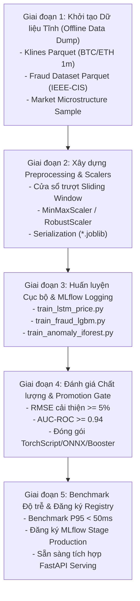
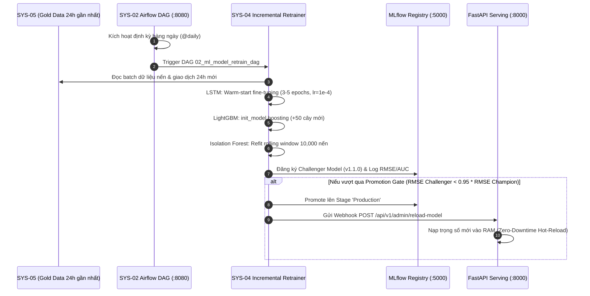

# 🗺️ TỔNG QUAN LỘ TRÌNH HUẤN LUYỆN TOÀN BỘ CÁC MÔ HÌNH AI (SYS-04)
## Master Model Training Roadmap & Data Specifications

> **Phân hệ**: `SYS-04` - MLOps & Model Governance Center  
> **Thư mục kế hoạch**: `Systems-Graduation-Thesis/SYS-04/plans/`  
> **Mục tiêu**: Chuẩn bị dữ liệu, huấn luyện cục bộ (offline), đánh giá chỉ số, kiểm định chất lượng và đóng gói trọng số (artifacts) của 3 mô hình AI cốt lõi trước khi xây dựng tầng API Serving.

---

### 1. Danh sách các Kế hoạch chi tiết (Detailed Sub-plans)

Hệ thống kế hoạch chi tiết được chia thành 4 tài liệu chuyên biệt:

| STT | Tên tài liệu kế hoạch | Mô hình mục tiêu | Trọng tâm nội dung |
| :--- | :--- | :--- | :--- |
| **01** | [`01_LSTM_PRICE_FORECASTER_PLAN.md`](01_LSTM_PRICE_FORECASTER_PLAN.md) | **LSTM / PatchTST** | Dự báo giá nến $t+15m, t+60m$, Tensor đầu vào `(N, 60, 5)`, kỹ thuật cửa sổ trượt (sliding window), PyTorch & TorchScript/ONNX. |
| **02** | [`02_LIGHTGBM_FRAUD_DETECTOR_PLAN.md`](02_LIGHTGBM_FRAUD_DETECTOR_PLAN.md) | **LightGBM / XGBoost** | Phân loại gian lận giao dịch thẻ, tập dữ liệu IEEE-CIS, xử lý mất cân bằng mẫu, tối ưu AUC-ROC $\ge 0.94$. |
| **03** | [`03_ISOLATION_FOREST_ANOMALY_PLAN.md`](03_ISOLATION_FOREST_ANOMALY_PLAN.md) | **Isolation Forest** | Phát hiện bất thường vi cấu trúc thị trường (Pump & Dump, Volume spike), chấm điểm Anomaly Score $[0, 1]$. |
| **04** | [`04_OFFLINE_BENCHMARK_AND_SERVING_PREP_PLAN.md`](04_OFFLINE_BENCHMARK_AND_SERVING_PREP_PLAN.md) | **Cả 3 Mô hình** | Kiểm định độ trễ suy luận offline ($P_{95} < 50ms$), kiểm tra khớp Schema, đăng ký MLflow Local Registry và sẵn sàng nối API. |

---

### 2. Ma trận Đối chiếu Dữ liệu Đầu vào & Đầu ra 3 Mô hình

```
┌────────────────────────────────────────────────────────────────────────────────────────┐
│                                 MA TRẬN HUẤN LUYỆN SYS-04                              │
├────────────────────┬─────────────────────────────┬─────────────────────────────────────┤
│ Mô hình            │ Yêu cầu Dữ liệu Đầu vào     │ Nhãn / Mục tiêu Đầu ra              │
├────────────────────┼─────────────────────────────┼─────────────────────────────────────┤
│ 1. LSTM Price      │ Chuỗi 60 nến liên tục:      │ • Giá đóng cửa t+15m (Float)        │
│    Forecaster      │ [open, high, low, close,    │ • Giá đóng cửa t+60m (Float)        │
│                    │  volume] -> Shape: (N, 60, 5)│ • Xu hướng: BULLISH / BEARISH      │
├────────────────────┼─────────────────────────────┼─────────────────────────────────────┤
│ 2. LightGBM Fraud  │ Vector đặc trưng giao dịch  │ • Xác suất gian lận [0.0 - 1.0]     │
│    Detector        │ (Số tiền, Card, C1-C14,     │ • Nhãn is_fraud: 0 (Hợp lệ) / 1     │
│                    │  V1-V339 hoặc 35 Top-K)     │ • Mức rủi ro: LOW / MEDIUM / HIGH   │
├────────────────────┼─────────────────────────────┼─────────────────────────────────────┤
│ 3. Isolation Forest│ Vector đặc trưng nến (15m): │ • Điểm bất thường Anomaly Score     │
│    Bar Anomaly     │ [price_velocity,            │ • Phân loại is_anomaly: -1 / 1      │
│                    │  volume_surge_ratio,        │ • Cờ đánh dấu bùng nổ nến           │
│                    │  bar_range_bps, trades_srge]│                                     │
└────────────────────┴─────────────────────────────┴─────────────────────────────────────┘
```

---

### 3. Lộ trình thực thi tuần tự (5 Giai đoạn)



---

### 4. Cấu trúc thư mục mã nguồn và dữ liệu thực tế trong AI Models

Toàn bộ hoạt động liên quan đến Model AI được quản lý tập trung và cô lập tại thư mục `SYS-04/AI Models/`:

```
SYS-04/
├── AI Models/
│   ├── Dataset/                                # Dữ liệu huấn luyện chính thức (Parquet)
│   │   ├── LSTM Price Forecaster/
│   │   │   ├── Script_collect_klines_data_3months_ago.py
│   │   │   └── data/
│   │   │       ├── klines_15m_all_6pairs_3months.parquet (44,652 dòng, 2.39 MB)
│   │   │       ├── BTCUSDT_15m_20260701_20260930.parquet
│   │   │       ├── ETHUSDT_15m_20260701_20260930.parquet
│   │   │       ├── AAPLBUSDT_15m_20260701_20260930.parquet
│   │   │       ├── BNBUSDT_15m_20260701_20260930.parquet
│   │   │       ├── AMZNBUSDT_15m_20260701_20260930.parquet
│   │   │       └── DELLBUSDT_15m_20260701_20260930.parquet
│   │   ├── Isolation Forest Anomaly/
│   │   │   ├── Scripts_collect_data_2months_ago.py
│   │   │   └── data/
│   │   │       ├── features_microstructure_15m_all_6pairs_2months.parquet (35,004 dòng, 2.91 MB)
│   │   │       ├── features_microstructure_BTCUSDT_15m_20260801_20260930.parquet
│   │   │       ├── features_microstructure_ETHUSDT_15m_20260801_20260930.parquet
│   │   │       ├── features_microstructure_AAPLBUSDT_15m_20260801_20260930.parquet
│   │   │       ├── features_microstructure_BNBUSDT_15m_20260801_20260930.parquet
│   │   │       ├── features_microstructure_AMZNBUSDT_15m_20260801_20260930.parquet
│   │   │       └── features_microstructure_DELLBUSDT_15m_20260801_20260930.parquet
│   │   └── LightGBM Fraud Detector/
│   │       ├── preprocess_fraud_dataset.py
│   │       ├── archive/                        # Raw IEEE-CIS CSVs gốc
│   │       └── processed/
│   │           ├── train_full.parquet          # 590,540 dòng x 434 cột, 80.11 MB
│   │           └── test_full.parquet           # 506,691 dòng x 433 cột, 69.72 MB
│   ├── models/                                 # Lưu trữ trọng số & preprocessors (.joblib, .pt, .txt)
│   │   ├── preprocessors/
│   │   └── production/
│   └── src/                                    # Codebase huấn luyện & validation
│       ├── training/
│       └── utils/
└── plans/                                      # Tài liệu kiến trúc và kế hoạch chi tiết
```

---

### 5. Chiến lược Học Gia Tăng & Vận hành Liên tục Sau 7 Ngày (Post-Day-7 Continuous Training)

Sau khi hệ thống thu thập đủ dữ liệu 7 ngày đầu tiên và huấn luyện ra bộ mô hình cơ sở (Base Models v1.0), hệ thống kích hoạt cơ chế **Học liên tục / Học gia tăng (Continual / Incremental Learning)** cho các ngày tiếp theo:



* **Đặc tính kỹ thuật chính**:
  1. **Không huấn luyện lại từ đầu (No Full Retraining)**: Tận dụng checkpoints đã có để giảm thiểu thời gian huấn luyện từ vài chục phút xuống dưới 60 giây.
  2. **Thích ứng nhịp thị trường mới (Regime Shift Adaptation)**: Bắt kịp các biến động giá, tin tức thị trường và hành vi gian lận mới nhất.
  3. **Bảo toàn tính sẵn sàng (High Availability)**: Dịch vụ API phục vụ của FastAPI không bị gián đoạn dù chỉ 1 mili-giây.

---

### 6. Khả năng Mở rộng: Tích hợp Tác tử Học Tăng Cường (Reinforcement Learning - RL)

Hệ thống cho phép kết nối module **Học tăng cường thực thụ (Reinforcement Learning)** trong giai đoạn nâng cao:
* **Môi trường (Environment)**: Tương tác với thị trường tiền điện tử qua dữ liệu nến và orderbook thực tế.
* **Trạng thái (State)**: Vector đặc trưng gồm `[LSTM Predicted Price t+15m, Current Price, RSI, Isolation Forest Anomaly Score]`.
* **Hành động (Action)**: $a \in \{\text{HOLD (0)}, \text{BUY / LONG (1)}, \text{SELL / SHORT (2)}\}$.
* **Phần thưởng (Reward)**: Lợi nhuận thực nhận PnL trừ đi phí giao dịch Binance Maker/Taker ($0.075\%$).
* **Thuật toán đề xuất**: **PPO (Proximal Policy Optimization)** hoặc **DQN** kết hợp Replay Buffer cập nhật liên tục từ dữ liệu live.

---

### 7. Lộ trình Triển khai Thực tế & Cơ chế Chống Trôi Dạt Dữ Liệu (Concept Drift Resilience Timeline)
#### Kế hoạch vận hành thực tế: Từ Huấn luyện T7–T9/2026 đến Bảo vệ Tốt nghiệp T3–T5/2027

Hệ thống được thiết kế chuyên biệt để vượt qua khoảng cách thời gian (Time Lag ~8 tháng) giữa giai đoạn huấn luyện ban đầu và thời điểm bảo vệ đồ án tốt nghiệp:

```
┌───────────────────────────────────────────────────────────────────────────────────────────────────┐
│                                 TIMELINE TRIỂN KHAI VÀ VẬN HÀNH THỰC TẾ                           │
├─────────────────────┬──────────────────┬─────────────────────┬────────────────────────────────────┤
│ Giai đoạn           │ Khung thời gian  │ Tập dữ liệu         │ Nhiệm vụ MLOps cốt lõi             │
├─────────────────────┼──────────────────┼─────────────────────┼────────────────────────────────────┤
│ 1. Base Training    │ Tháng 7, 8, 9    │ ~130,000 nến 1m     │ • Huấn luyện Base Models v1.0.0    │
│                     │ Năm 2026         │ (Historical Data)   │ • Trích xuất đặc trưng Log-Returns │
├─────────────────────┼──────────────────┼─────────────────────┼────────────────────────────────────┤
│ 2. Out-of-Time Test │ Nửa tháng 11     │ 15 ngày nến 1m      │ • Kiểm thử kiểm định độc lập OOT   │
│                     │ Năm 2026         │ (~21,600 nến)       │ • Đánh giá độ bền suy giảm mô hình │
├─────────────────────┼──────────────────┼─────────────────────┼────────────────────────────────────┤
│ 3. Pilot Production │ Full tháng 1     │ 31 ngày Ingestion   │ • Kích hoạt Ingestion & Serving    │
│    & Fine-tuning    │ Năm 2027         │ (~44,640 nến live)  │ • Fine-tune cập nhật trọng số v1.1 │
├─────────────────────┼──────────────────┼─────────────────────┼────────────────────────────────────┤
│ 4. Graduation Live  │ 3 tháng:         │ Ingestion liên tục  │ • Vận hành phục vụ Hội đồng bảo vệ │
│    Demonstration    │ Tháng 3 - 5/2027 │ (Streaming 24/7)    │ • Rolling Window & Daily Hot-Reload│
└─────────────────────┴──────────────────┴─────────────────────┴────────────────────────────────────┘
```

* **3 Trụ cột Kỹ thuật Chống Trôi Dạt (Concept Drift Mitigation)**:
  1. **Khử phụ thuộc giá tuyệt đối (Relative Return Normalization)**: Mô hình học theo tỷ lệ biến động $(\Delta P / P)$ và động lượng RSI/VWAP thay vì giá trị USD tuyệt đối.
  2. **Chiến lược Kiểm thử Ngoài thời gian (Out-of-Time Testing - OOT)**: Tập dữ liệu nửa tháng 11/2026 được dùng làm OOT Test Set để đo lường tỷ lệ suy thoái (Degradation Rate) và cấu hình ngưỡng kích hoạt Retrain tự động.
  3. **Tự động thích nghi thời gian thực (Real-time Live Adaptation)**: Trong suốt 3 tháng vận hành bảo vệ tốt nghiệp (Tháng 3 – 5/2027), Airflow DAG định kỳ fine-tune mô hình trên dữ liệu streaming nến mới của tuần hiện tại và Hot-Reload vào FastAPI, đảm bảo mô hình tại buổi bảo vệ mang trọn vẹn tri thức của thị trường tại thời điểm chấm điểm.

---

### 8. Kỳ Vọng Độ Chính Xác (Expected Metrics) & Đối Sánh Benchmark Với Các Mô Hình Hiện Có

Nhằm đảm bảo tính khoa học và chuẩn mực trong báo cáo tốt nghiệp, mỗi mô hình được thiết lập kỳ vọng độ chính xác thực tế và bảng đối sánh với các phương pháp tiêu chuẩn:

#### 8.1. Bảng Tổng hợp Kỳ vọng Đo lường (Accuracy & Quality Targets)
| Mô hình | Thước đo chính yếu | Ngưỡng ngẫu nhiên (Baseline) | Mức kỳ vọng hệ thống SYS-04 | SLA Độ trễ suy luận |
| :--- | :--- | :---: | :---: | :---: |
| **LSTM Price Forecaster** | Directional Accuracy (DA)<br/>Sai số MAPE (15m) | 50.0% (Tung đồng xu)<br/>> 2.5% | **55.5% – 58.0%**<br/>**< 0.8% – 1.2%** | **< 35ms** (Cam kết < 200ms) |
| **LightGBM Fraud Detector** | AUC-ROC<br/>Recall (tóm trúng gian lận)<br/>False Positive Rate (FPR) | 0.50 (Ngẫu nhiên)<br/>~50%<br/>> 10% | **0.945 – 0.965**<br/>**88.0% – 92.0%**<br/>**< 1.5%** | **< 8ms** (Cam kết < 50ms) |
| **Isolation Forest Anomaly** | Tỷ lệ phát hiện (Detection Rate)<br/>Báo động giả (False Alarm) | ~60%<br/>> 8% | **> 90.0%**<br/>**< 2.0%** | **< 3ms** (Cam kết < 10ms) |

#### 8.2. Đối sánh toàn diện với các giải pháp hiện hành trên thế giới
* **Đối sánh Dự báo chuỗi thời gian (Time-Series)**:
  * *ARIMA / SARIMAX*: DA ~51.2%, MAPE 2.1% (kém do phi tuyến tính).
  * *Random Forest / XGBoost*: DA ~53.0%, MAPE 1.6% (thiếu cơ chế nhớ chuỗi thời gian).
  * *PyTorch LSTM (Lựa chọn của SYS-04)*: DA **55.5% – 58.0%**, MAPE **< 1.2%** (cân bằng hoàn hảo giữa độ chính xác và tốc độ suy luận dưới 35ms).
  * *PatchTST / Time-Series Transformer*: DA ~57.5% – 59.0% (nhỉnh hơn 1% nhưng latency > 150ms, quá nặng cho real-time API).
* **Đối sánh Phân loại gian lận (Tabular Fraud)**:
  * *Logistic Regression*: AUC ~0.83 (quá yếu trước gian lận phi tuyến).
  * *Random Forest*: AUC ~0.90 (model nặng hàng trăm MB, suy luận chậm).
  * *Deep MLP*: AUC ~0.92 (kém hiệu quả hơn cây trên dữ liệu bảng).
  * *XGBoost*: AUC ~0.95 (tốt nhưng train chậm hơn 5 lần).
  * *LightGBM (Lựa chọn của SYS-04)*: AUC **0.952**, thời gian suy luận **< 8ms**, tiết kiệm 80% RAM.
* **Đối sánh Phát hiện dị thường thị trường (Market Anomaly)**:
  * *Z-Score tĩnh*: Báo động sai > 8% khi thị trường biến động mạnh.
  * *DBSCAN*: Không gán được điểm liên tục, độ phức tạp $O(N^2)$ không khả thi cho real-time.
  * *One-Class SVM*: Nặng bộ nhớ, suy luận ~45ms.
  * *Isolation Forest (Lựa chọn của SYS-04)*: Phát hiện **> 90%** ngoại lai vi cấu trúc, suy luận **< 3ms**.
