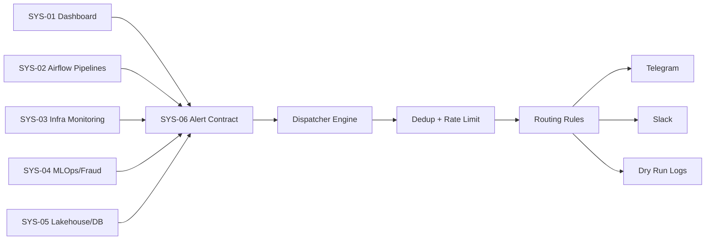

# SYS-06 Build Plan: Operational Alerting, Notification, And System Integration

## Purpose

Build SYS-06 from the official master-plan document:

- `Plan/systems_docs/06_Operational_Alerting_Notification_System.md`

This plan combines the official version and the improved version. The official role remains alerting and notification. The stronger version adds clear integration contracts so the other systems can send alerts into SYS-06 in a controlled company-architecture style.

## Target Result

By the end of this step, SYS-06 should have:

- A Python alert dispatcher service.
- A stable alert JSON contract used by all systems.
- Severity levels: `CRITICAL`, `WARNING`, `INFO`.
- Deduplication with a 300-second window.
- Rate limiting with a 10-message-per-minute target.
- Telegram notification support.
- Slack webhook support as an optional channel.
- Routing rules by source system, role, severity, and channel.
- Health/status alert input design for SYS-02, SYS-03, SYS-04, and SYS-05.
- A Docker Compose service with `.env.example`.
- Tests for validation, formatting, routing, deduplication, and rate limiting.

## Architecture Position

SYS-06 does not become a general API gateway. Instead, it becomes the **alert integration point** for the 6-system platform.

Simple flow:



## Phase 00: Context And Alert Source Mapping

Folder: `phase-00-context`

Tasks:

1. Read the official SYS-06 document.
2. Map alert sources from all 6 systems.
3. List which systems send alerts to SYS-06.
4. Define first-version alert types.
5. Decide which users receive which alerts.

Deliverables:

- `alert-source-map.md`
- `system-alert-matrix.md`
- `receiver-role-map.md`

Initial alert source map:

| Source System | Example Alerts | Receiver |
| --- | --- | --- |
| `SYS-01` | market anomaly, fraud dashboard signal | Business, Trader, Risk Manager |
| `SYS-02` | DAG failed, SLA missed, data quality failed | Data Engineer, DevOps |
| `SYS-03` | container down, disk > 85%, Kafka lag high | DevOps, SRE |
| `SYS-04` | model drift, serving error, fraud score > 0.85 | ML Engineer, Risk Manager |
| `SYS-05` | MinIO down, ClickHouse down, dataset freshness late | Data Engineer, DevOps |

## Phase 01: Alert Contracts

Folder: `phase-01-alert-contracts`

Tasks:

1. Define required JSON fields.
2. Define optional fields for market, fraud, infrastructure, pipeline, and data quality alerts.
3. Define severity rules.
4. Define deduplication key rules.
5. Define routing fields.
6. Create example payloads.

Recommended base payload:

```json
{
  "alert_type": "MARKET_ANOMALY",
  "level": "CRITICAL",
  "source_system": "SYS-01",
  "event": "PUMP_AND_DUMP_DETECTED",
  "deduplicate_key": "market_anomaly:BTCUSDT:pump_dump",
  "receiver_roles": ["trader", "risk_manager"],
  "channels": ["telegram", "slack"],
  "message": "BTCUSDT volume spike detected",
  "timestamp": "2026-08-23T00:14:02Z",
  "metadata": {
    "symbol": "BTCUSDT",
    "anomaly_score": 0.96,
    "volume_spike_pct": 340.5
  }
}
```

Deliverables:

- `alert-schema.json`
- `severity-rules.md`
- `routing-rules.md`
- `examples/*.json`

## Phase 02: Dispatcher Engine

Folder: `phase-02-dispatcher-engine`

Tasks:

1. Create Python service structure.
2. Add alert payload validation.
3. Add message formatting.
4. Add dispatch result logging.
5. Add routing by channel and receiver role.
6. Add error handling when one channel fails.

Suggested files:

- `src/alert_dispatcher/main.py`
- `src/alert_dispatcher/models.py`
- `src/alert_dispatcher/formatter.py`
- `src/alert_dispatcher/router.py`
- `src/alert_dispatcher/dispatcher.py`
- `tests/test_dispatcher.py`

Deliverables:

- Working local dispatcher.
- Unit tests for formatting, routing, and dispatch decisions.

## Phase 03: Notification Channels

Folder: `phase-03-notification-channels`

Tasks:

1. Implement Telegram Bot API adapter.
2. Implement Slack webhook adapter.
3. Add environment variable configuration.
4. Add dry-run mode for testing without real messages.
5. Keep SMS/email as later expansion.

Required environment variables:

```env
TELEGRAM_BOT_TOKEN=
TELEGRAM_CHAT_ID=
SLACK_WEBHOOK_URL=
ALERT_DRY_RUN=true
```

Deliverables:

- Telegram adapter
- Slack adapter
- Dry-run adapter
- `.env.example`

## Phase 04: Deduplication And Rate Limiting

Folder: `phase-04-dedup-rate-limit`

Tasks:

1. Add in-memory deduplication cache.
2. Suppress repeated alerts within 300 seconds.
3. Add rate limiter with 10 messages per minute.
4. Add queue or delayed handling for rate-limited messages.
5. Add tests for duplicate and burst messages.

Deliverables:

- Deduplication module.
- Rate limiter module.
- Unit tests.

## Phase 05: System Integrations

Folder: `phase-05-system-integrations`

Tasks:

1. Define how SYS-01 sends business/market alerts.
2. Define how SYS-02 sends pipeline alerts.
3. Define how SYS-03 sends infrastructure alerts.
4. Define how SYS-04 sends model/fraud alerts.
5. Define how SYS-05 sends storage/database alerts.
6. Provide client examples for each system.

Deliverables:

- `sys-01-dashboard-alerts.md`
- `sys-02-airflow-alerts.md`
- `sys-03-monitoring-alerts.md`
- `sys-04-mlops-alerts.md`
- `sys-05-lakehouse-alerts.md`
- `client-examples/*.py`

## Phase 06: Container Build

Folder: `phase-06-container-build`

Tasks:

1. Create Dockerfile.
2. Create SYS-06 `docker-compose.yml`.
3. Add `.env.example`.
4. Add health check endpoint or command.
5. Add startup logs showing enabled channels.
6. Test container start, dry run, and real Telegram send.

Deliverables:

- `Dockerfile`
- `docker-compose.yml`
- `.env.example`
- `runbook.md`

## Suggested Build Order

1. Confirm official SYS-06 scope from `Plan/systems_docs`.
2. Write alert contract and examples.
3. Build formatter and dispatcher logic.
4. Add dry-run mode.
5. Add Telegram adapter.
6. Add deduplication.
7. Add rate limiting.
8. Add Slack adapter.
9. Add Docker Compose.
10. Connect one alert source from `SYS-02` first.
11. Add alert examples from `SYS-01`, `SYS-03`, `SYS-04`, and `SYS-05`.

## Test Checklist

1. Valid alert payload is accepted.
2. Invalid alert payload is rejected clearly.
3. Critical alert formats correctly.
4. Warning alert formats correctly.
5. Duplicate alert is suppressed within 300 seconds.
6. New alert is sent immediately.
7. Burst over 10 messages per minute is rate-limited.
8. Routing chooses correct channel and receiver role.
9. Dry-run mode works without real Telegram credentials.
10. Telegram message sends successfully when credentials are configured.
11. Container starts with `docker compose up --build`.

## Important Boundary

SYS-06 remains the official Operational Alerting & Notification System. The improved part is its integration strength: contracts, source maps, role routing, and system-to-system alert links.
