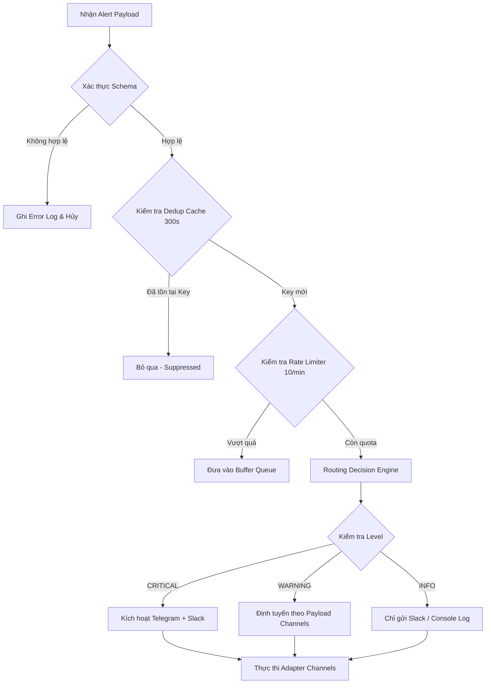

# 📡 QUY TẮC ĐỊNH TUYẾN KÊNH THÔNG BÁO (ROUTING RULES)

Tài liệu này xác định cách thức **`SYS-06 Dispatcher Engine`** phân luồng tin nhắn dựa trên sự kết hợp giữa:
1. `level` (Mức độ nghiêm trọng).
2. `source_system` (Hệ thống phát sinh).
3. `receiver_roles` (Nhóm người nhận).
4. `channels` (Các kênh được chỉ định).

---

## 1. Logic Định Tuyến Tổng Thể (Routing Flowchart)

---

## 2. Quy Tắc Định Tuyến Chi Tiết

| Cấp độ | Kênh mục tiêu ưu tiên | Đối tượng nhận mặc định |
| :---: | :--- | :--- |
| **`CRITICAL`** | Telegram Bot (On-call) + Slack Webhook (#critical-alerts) | `devops_sre`, `risk_manager`, `data_engineer` |
| **`WARNING`** | Slack Webhook (#warnings-feed) + Telegram (Tùy chọn) | `data_engineer`, `ml_engineer`, `devops_sre` |
| **`INFO`** | Slack Webhook (#general-ops) / Console Log | `devops_sre`, `data_engineer` |

---

## 3. Quy Tắc Bảo Vệ Khi Gặp Sự Cố Kênh (Fail-Safe Policy)

1. **Độc lập kênh (Channel Isolation)**: Nếu kênh Telegram trả về mã lỗi 4xx/5xx hoặc timeout, hệ thống vẫn tiếp tục gửi sang Slack và ghi log cảnh báo mà không ném exception làm crash dispatcher.
2. **Chế độ Dry-Run**: Khi cấu hình `ALERT_DRY_RUN=true`, toàn bộ tiến trình định tuyến, xác thực, format tin nhắn vẫn diễn ra bình thường, nhưng việc gửi qua mạng được thay thế bằng lệnh in log định dạng ra Console để kiểm thử.
